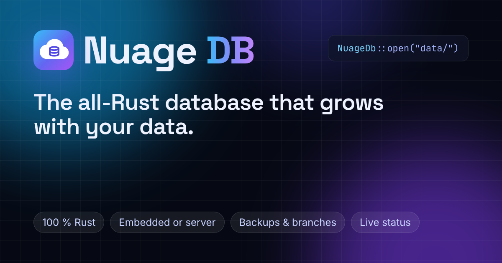

<div align="center">

[](https://github.com/maxlestage/Nuage)

# Nuage DB

**La base de datos de Memoire, en Rust puro. Integrada en tu aplicación o como servidor, con el mismo código.**

[](https://github.com/maxlestage/Nuage/actions/workflows/ci.yml)
[](#licencia)
[](https://heroku.com/deploy?template=https://github.com/maxlestage/Nuage)

[English](README.md) · [Français](README.fr.md) · **Español**

</div>

---

Nuage DB guarda tus tablas en disco detrás de un registro de escritura anticipada (WAL), crea
al instante ramas copy-on-write de una base, se respalda en una segunda ubicación y se
restaura desde ella al arrancar, y lo sirve todo por HTTP(S) con una consola de
administración y un panel en directo. Es la base de datos de
[Memoire](https://github.com/maxlestage/Memoire), el ORM de Rust: los mismos modelos y
consultas se ejecutan en ella integrada durante el desarrollo y las pruebas, y en un servidor
Nuage DB en producción, sin cambiar una línea.

## Funciones

| | |
|---|---|
| **Páginas en disco** | Tablas e índices en un solo archivo B-tree con una caché de páginas acotada (`NUAGE_CACHE_MB`): los datos no están limitados por la memoria. Las búsquedas por clave primaria e índice solo leen las filas necesarias. |
| **Registro de escritura** | Cada commit se añade al registro y se sincroniza en disco antes de aplicarse. Checkpoints, recuperación tras un fallo, CRC-32 en los registros y sumas de comprobación en las páginas. |
| **Semántica de Memoire** | Las consultas pasan por el evaluador de Memoire, sobre las filas leídas del disco: Nuage DB se comporta exactamente como el motor en memoria de Memoire, con datos de cualquier tamaño. |
| **Transacciones** | Lecturas sobre una instantánea, commits optimistas (`Error::Conflict`, reintentados por `db.transaction(...)`), transacciones interactivas por HTTP, lotes todo o nada. |
| **Ramas** | Una copia completa de la base para una vista previa, una prueba o un experimento, creada al instante: comparte las páginas de su padre y solo guarda sus propios cambios. |
| **Copias de seguridad restauradas al arrancar** | Instantáneas y segmentos del registro, hacia una carpeta o un almacenamiento compatible con S3. Un directorio de datos vacío se restaura automáticamente al arrancar: los alojamientos con disco efímero funcionan. |
| **Servidor** | Un solo binario, configurado con variables de entorno: el protocolo de la base (`/v1`), el estado en directo (`/api/status`, `/api/status/stream`), la consola (`/admin`) y el sitio web con su panel en directo (`/app`), en un solo puerto. |
| **Cliente WebAssembly** | `memoire_orm::NuageDb` habla HTTP(S): de forma nativa con Tokio, y en el navegador mediante `fetch`. |
| **Mantenimiento automático** | Un hilo en segundo plano hace los checkpoints, envía las copias de seguridad y compacta el archivo. |

## Dos modos, una API

Nuage DB se usa con la API de [Memoire](https://github.com/maxlestage/Memoire): modelos,
constructor de consultas, relaciones, transacciones y migraciones.

```toml
[dependencies]
# El motor, el modo integrado y el servidor. `default-features = false` deja fuera el sitio web.
nuage = { git = "https://github.com/maxlestage/Nuage", default-features = false }
# El mismo Memoire que Nuage DB (la feature `nuage` es el cliente de un servidor).
memoire-orm = { git = "https://github.com/maxlestage/Memoire", rev = "fd1fdd5464547ce1f60f4a11e552c394da73cfc8", features = ["nuage"] }
tokio = { version = "1", features = ["macros", "rt-multi-thread"] }
```

### Integrada: un directorio en disco

```rust
use memoire_orm::prelude::*;
use nuage::Embedded;

#[derive(Model, Debug, Clone)]
#[memoire(table = "notes")]
pub struct Note {
    #[memoire(primary_key, auto_increment)]
    pub id: i64,
    pub text: String,
}

#[tokio::main]
async fn main() -> memoire_orm::Result<()> {
    let db = Embedded::open("data")?; // se crea si no existe
    db.create_table_if_not_exists::<Note>().await?;
    Note { id: 0, text: "hola".into() }.insert(&db).await?;
    println!("{:?}", Note::query().all(&db).await?);
    Ok(())
}
```

### Servidor: el mismo código por HTTP(S)

```rust
let db = NuageDb::connect("https://mi-nuage.herokuapp.com", token).await?;
Note::query().filter(Note::TEXT.contains("hola")).all(&db).await?;
```

### Un solo ajuste para ambos

```rust
// NUAGE_URL=data                                    -> integrada, en ./data
// NUAGE_URL=https://db.example.com NUAGE_TOKEN=...  -> un servidor
let db = nuage::Db::from_env().await?;
```

### Ramas

```rust
db.create_branch("preview-42", None).await?;         // al instante, sea cual sea el tamaño
let preview = db.on_branch("preview-42");
Note { id: 0, text: "solo en la vista previa".into() }.insert(&preview).await?;
db.reset_branch("preview-42").await?;                // olvida sus cambios
db.delete_branch("preview-42").await?;
```

## Inicio rápido

```bash
git clone https://github.com/maxlestage/Nuage && cd Nuage
NUAGE_TOKEN=dev-token NUAGE_ADMIN_PASSWORD=dev-password cargo run -p nuage --release
# nuage: data is stored in /home/yo/Nuage/nuage-data on this server's disk
# nuage: listening on 0.0.0.0:8080
```

Después abre:

- http://localhost:8080/ : el sitio web (inglés, francés, español);
- http://localhost:8080/app : el panel en directo (inicia sesión con `NUAGE_ADMIN_PASSWORD`);
- http://localhost:8080/admin : la consola de administración.

Las aplicaciones se conectan con `NuageDb::connect("http://localhost:8080", "dev-token")`.

Docker:

```bash
docker build -t nuage .
docker run -p 8080:8080 -v nuage-data:/data -e NUAGE_TOKEN=... -e NUAGE_ADMIN_PASSWORD=... nuage
```

## Desplegar en Heroku

La raíz de este repositorio se despliega tal cual: `Procfile`, `RustConfig` y
`heroku-build.sh` (el buildpack `emk/rust` compila el binario `nuage` con el sitio web), y
`app.json` para el botón **Deploy to Heroku** de arriba.

- **Un dyno Basic.** Un dyno Basic nunca se duerme. Ejecuta exactamente un dyno web: dos
  dynos serían dos bases distintas escribiendo en las mismas copias de seguridad.
- **El disco es efímero.** El disco de un dyno se borra en cada reinicio (al menos una vez al
  día, y en cada despliegue). El directorio de datos es solo una copia de trabajo:
  **configura las copias de seguridad**, y cada arranque restaura la base a partir de ellas.
  En Heroku, usa un almacenamiento compatible con S3 (`NUAGE_BACKUP_S3_*`); en un alojamiento
  con disco persistente, basta con una carpeta (`NUAGE_BACKUP_DIR`).
- **Ventana de pérdida.** Los commits hechos desde el último segmento del registro enviado
  (30 segundos por defecto) solo se pierden si el dyno se detiene sin el `SIGTERM` que Heroku
  envía antes: con `SIGTERM`, el servidor hace un checkpoint y envía el último segmento.

A mano:

```bash
heroku create mi-nuage --buildpack emk/rust
heroku config:set NUAGE_TOKEN=$(openssl rand -hex 32) \
  NUAGE_ADMIN_PASSWORD='una frase de contraseña larga' \
  NUAGE_BACKUP_S3_BUCKET=mi-bucket NUAGE_BACKUP_S3_REGION=eu-west-3 \
  NUAGE_BACKUP_S3_ACCESS_KEY_ID=... NUAGE_BACKUP_S3_SECRET_ACCESS_KEY=...
git push heroku master
```

Para un almacenamiento distinto de AWS, define también `NUAGE_BACKUP_S3_ENDPOINT`. Después
abre `https://mi-nuage.herokuapp.com/admin`.

## Variables de entorno

| Variable | Función | Por defecto |
|---|---|---|
| `PORT` | puerto de escucha (lo fija Heroku y la mayoría de alojamientos) | `8080` |
| `NUAGE_DATA_DIR` | directorio de datos | `nuage-data` |
| `NUAGE_NAME` | nombre de la base | `nuage` |
| `NUAGE_TOKEN` | token de la API de la base y de la API de estado | ninguno: la API está desactivada |
| `NUAGE_ADMIN_PASSWORD` | contraseña de la consola (y del panel) | ninguna: la consola está desactivada |
| `NUAGE_PUBLIC_STATUS` | `true`: `/api/status` y `/app` muestran una parte pública sin iniciar sesión | `false` |
| `NUAGE_CACHE_MB` | caché de páginas, en MiB | `64` |
| `NUAGE_BACKUP_DIR` | copias de seguridad en esta carpeta | |
| `NUAGE_BACKUP_S3_BUCKET` | copias de seguridad en este bucket | |
| `NUAGE_BACKUP_S3_ENDPOINT` | endpoint del almacenamiento compatible con S3 | `https://s3.<region>.amazonaws.com` |
| `NUAGE_BACKUP_S3_REGION` | región | `us-east-1` |
| `NUAGE_BACKUP_S3_PREFIX` | prefijo de los objetos de copia | `nuage/` |
| `NUAGE_BACKUP_S3_ACCESS_KEY_ID`, `NUAGE_BACKUP_S3_SECRET_ACCESS_KEY` | credenciales (si no, `AWS_ACCESS_KEY_ID`, `AWS_SECRET_ACCESS_KEY`) | |
| `NUAGE_BACKUP_SNAPSHOT_MINUTES` | minutos entre dos instantáneas | `60` |
| `SITE_URL` | dirección pública del sitio (enlaces canónicos, tarjeta para compartir) | el host de cada petición |

Un ejemplo comentado: [`nuage.env.example`](nuage.env.example). Sirve el servidor por HTTPS
(la mayoría de alojamientos lo hacen por ti): el token viaja en una cabecera, y la cookie de
la consola es `Secure`.

## `/app` y `/admin`

- **`/app`**, el panel en directo: peticiones por segundo, latencia p50/p99, conexiones,
  servicios, almacenamiento, caché, registro de escritura, copias de seguridad, bases y ramas,
  y un registro de eventos en directo. Es una isla Rust/WebAssembly que lee `/api/status` y
  luego sigue `/api/status/stream` (Server-Sent Events, cada segundo). Es privado: el enlace
  **Iniciar sesión** pasa por `/admin?next=/es/app/` y vuelve al panel. Con
  `NUAGE_PUBLIC_STATUS=true`, los visitantes ven la parte pública. Se instala como una
  aplicación (PWA) y muestra el último estado conocido sin conexión.
- **`/admin`**, la consola: vista general, tablas y sus filas, consola de consultas (un
  pequeño subconjunto de SQL, con confirmación antes de los cambios), ramas, almacenamiento y
  botones para un checkpoint, una copia de seguridad, una comprobación de integridad y una
  compactación. Renderizada por el servidor, funciona sin JavaScript, también en el móvil.
  Cookie de sesión `HttpOnly`, `Secure`, `SameSite=Strict`, tokens CSRF, intentos de inicio
  de sesión limitados.

| Ruta | Contenido | Acceso |
|---|---|---|
| `/v1/*` | el protocolo de la base | `Authorization: Bearer $NUAGE_TOKEN` |
| `/api/health` | `{"status":"ok"}` | público |
| `/api/status`, `/api/status/stream` | estado en directo, en JSON y en Server-Sent Events | token o sesión de la consola |
| `/admin` | la consola | `NUAGE_ADMIN_PASSWORD` |
| todo lo demás | el sitio web, `/app` incluido | público |

## Estructura del repositorio

```
.
├── Cargo.toml            workspace (memoire-orm se fija aquí)
├── crates/
│   ├── nuage/            el motor, el modo integrado, el servidor, la consola, la API de
│   │                     estado, las copias (carpeta, S3), el binario `nuage`;
│   │                     tests/common es la suite de pruebas de backends de Memoire
│   └── nuage-site/       el sitio web: páginas, el panel /app (Rust/wasm, el bundle
│                         precompilado en pkg/, regenerado por build-wasm.sh), PWA, tarjeta para compartir
├── Procfile, RustConfig, heroku-build.sh, app.json    Heroku
├── Dockerfile            cualquier alojamiento de contenedores
├── nuage.env.example     el entorno, comentado
└── .github/workflows/ci.yml
```

La feature `site` de `crates/nuage` (activa por defecto) monta el sitio web en el servidor
(`nuage::site()`); `default-features = false` lo deja fuera.

## Desarrollo

```bash
cargo fmt --all --check
cargo clippy --workspace --all-targets --all-features -- -D warnings
cargo clippy -p nuage-site --lib --target wasm32-unknown-unknown -- -D warnings
cargo test --workspace --all-features
crates/nuage-site/build-wasm.sh   # tras cambiar el panel (Rust 1.99, wasm-bindgen de Cargo.lock)
```

## La familia

- [Memoire](https://github.com/maxlestage/Memoire) ([sitio](https://memoire-7f4525f1fdaf.herokuapp.com/)): el ORM de Rust cuya base de datos es Nuage DB.
- [Paquets](https://github.com/maxlestage/Paquets) ([sitio](https://paquets-90dfc06b6fea.herokuapp.com/)): el framework full-stack más sencillo para Rust.

## Licencia

Propietaria: consulta [LICENSE](LICENSE). Copyright (c) 2026 Maxime Nathan Lestage.
