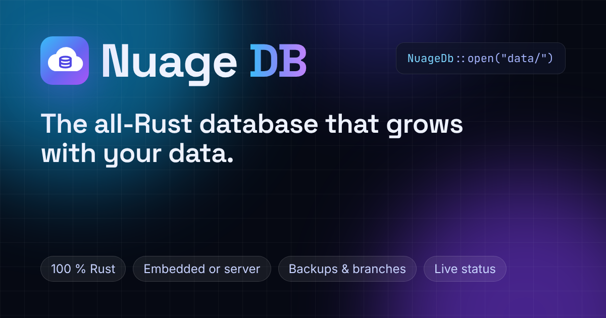

<div align="center">

[](https://github.com/maxlestage/Nuage)

# Nuage DB

**La base de datos de Memoire, en Rust puro. Integrada en tu aplicación o como servidor, con el mismo código.**

[](https://github.com/maxlestage/Nuage/actions/workflows/ci.yml)
[](#licencia)
[](https://heroku.com/deploy?template=https://github.com/maxlestage/Nuage)

[English](README.md) · [Français](README.fr.md) · **Español**

</div>

---

Nuage DB guarda tus tablas en disco detrás de un registro de escritura anticipada (WAL), crea
al instante ramas copy-on-write de una base, se respalda en una segunda ubicación y se
restaura desde ella al arrancar, y lo sirve todo por HTTP(S) con una consola de
administración y un panel en directo. Es la base de datos de
[Memoire](https://github.com/maxlestage/Memoire), el ORM de Rust: los mismos modelos y
consultas se ejecutan en ella integrada durante el desarrollo y las pruebas, y en un servidor
Nuage DB en producción, sin cambiar una línea.

## Funciones

| | |
|---|---|
| **Cifrado en reposo** | Todo lo almacenado se cifra (`NUAGE_ENCRYPTION_KEY`): las páginas con XTS-AES-256, cada registro del log con AES-256-GCM, y las copias de seguridad, que son copias de ellos. Claves derivadas por aplicación (HKDF, o Argon2id desde una frase de contraseña). |
| **Varias aplicaciones** | Un servidor, una base por aplicación: sus tokens, sus claves, sus copias. El token que envía una aplicación elige su base. La consola y `/app` las muestran una junto a otra. |
| **Páginas en disco** | Tablas e índices en un solo archivo de páginas en árbol B escrito por el propio Nuage DB (copia en escritura, suma de control en cada nodo), con una caché de páginas acotada (`NUAGE_CACHE_MB`): los datos no están limitados por la memoria. Las búsquedas por clave primaria e índice solo leen las filas necesarias. |
| **Registro de escritura** | Cada commit se añade al registro y se sincroniza en disco antes de devolverse o mostrarse a un lector; los commits hechos a la vez comparten una sincronización. Checkpoints, recuperación tras un fallo, CRC-32 en los registros y sumas de comprobación en las páginas. |
| **Semántica de Memoire** | Las consultas pasan por el evaluador de Memoire, sobre las filas leídas del disco: Nuage DB se comporta exactamente como el motor en memoria de Memoire, con datos de cualquier tamaño. |
| **Transacciones** | Lecturas sobre una instantánea, commits optimistas (`Error::Conflict`, reintentados por `db.transaction(...)`), transacciones interactivas por HTTP, lotes todo o nada. |
| **Ramas** | Una copia completa de la base para una vista previa, una prueba o un experimento, creada al instante: comparte las páginas de su padre y solo guarda sus propios cambios. |
| **Copias de seguridad restauradas al arrancar** | Instantáneas y segmentos del registro, hacia una carpeta o un almacenamiento compatible con S3, en un lugar o en dos que se mantienen al día. Un directorio de datos vacío se restaura automáticamente al arrancar: los alojamientos con disco efímero funcionan. Una base nunca escribe su copia encima de la de otra. |
| **Almacén clave-valor** | Cada aplicación tiene un almacén, en la memoria del servidor o en su propia base (`NUAGE_KV_STORAGE`): valores con caducidad, contadores, cerrojos, caché, por HTTP (`/v1/kv`) y en un puerto propio ([Almacén clave-valor](#almacén-clave-valor)). |
| **Archivos** | Cada aplicación guarda archivos de cualquier tamaño (teselas de mapa, fotos, archivos comprimidos) en un bucket compatible con S3 como Cloudflare R2: el servidor los lista y firma los enlaces, los bytes van directamente entre el cliente y el bucket ([Archivos](#archivos)). |
| **Servidor** | Un solo binario, configurado con variables de entorno: el protocolo de la base (`/v1`), el estado en directo (`/api/status`, `/api/status/stream`), la consola (`/admin`) y el sitio web con su panel en directo (`/app`), en un solo puerto. |
| **Cliente WebAssembly** | `memoire_orm::NuageDb` habla HTTP(S): de forma nativa con Tokio, y en el navegador mediante `fetch`. |
| **Mantenimiento automático** | Un hilo en segundo plano hace los checkpoints, envía las copias de seguridad y compacta el archivo. |

## Dos modos, una API

Nuage DB se usa con la API de [Memoire](https://github.com/maxlestage/Memoire): modelos,
constructor de consultas, relaciones, transacciones y migraciones.

```toml
[dependencies]
# El motor, el modo integrado y el servidor, sin el sitio web.
nuage = { git = "https://github.com/maxlestage/Nuage", default-features = false, features = ["server"] }
# El mismo Memoire que Nuage DB (la feature `nuage` es el cliente de un servidor).
memoire-orm = { git = "https://github.com/maxlestage/Memoire", rev = "8f7e0cb", features = ["nuage"] }
tokio = { version = "1", features = ["macros", "rt-multi-thread"] }
```

| Feature de Cargo | Lo que añade | Por defecto |
|---|---|---|
| *(ninguna)* | el motor integrado (`nuage::Embedded`), SQL, cifrado, copias en una carpeta: **Rust puro**, sin pila de red, ni C ni ensamblador (RustCrypto) | siempre |
| `s3` | copias en un almacenamiento compatible con S3 (HTTP/1.1 sobre rustls) | sí |
| `server` | el servidor (`/v1`, protocolo PostgreSQL, consola, estado en vivo), `nuage::Db::Remote` y el binario `nuage`; incluye `s3` | sí |
| `site` | el sitio web y el panel `/app`, servidos por el binario; incluye `server` | sí |
| `import-redb` | lee una vez el almacén de páginas de Nuage DB hasta la 0.4 (`nuage.redb`), para llevar una carpeta de datos o una copia de esas versiones a esta (ver [Viniendo de la versión 0.4](#viniendo-de-la-versión-04)); el único uso de redb | sí |

`default-features = false` es el motor integrado solo; añade `features = ["s3"]` para las
copias en S3 (la configuración de una base integrada con ellas:
`nuage::config::engine_from_vars`).

### Integrada: un directorio en disco

```rust
use memoire_orm::prelude::*;
use nuage::Embedded;

#[derive(Model, Debug, Clone)]
#[memoire(table = "notes")]
pub struct Note {
    #[memoire(primary_key, auto_increment)]
    pub id: i64,
    pub text: String,
}

#[tokio::main]
async fn main() -> memoire_orm::Result<()> {
    let db = Embedded::open("data")?; // se crea si no existe
    db.create_table_if_not_exists::<Note>().await?;
    Note { id: 0, text: "hola".into() }.insert(&db).await?;
    println!("{:?}", Note::query().all(&db).await?);
    Ok(())
}
```

### Servidor: el mismo código por HTTP(S)

```rust
let db = NuageDb::connect("https://mi-nuage.herokuapp.com", token).await?;
Note::query().filter(Note::TEXT.contains("hola")).all(&db).await?;
```

### Un solo ajuste para ambos

```rust
// NUAGE_URL=data                                    -> integrada, en ./data
// NUAGE_URL=https://db.example.com NUAGE_TOKEN=...  -> un servidor
let db = nuage::Db::from_env().await?;
```

### Ramas

```rust
db.create_branch("preview-42", None).await?;         // al instante, sea cual sea el tamaño
let preview = db.on_branch("preview-42");
Note { id: 0, text: "solo en la vista previa".into() }.insert(&preview).await?;
db.reset_branch("preview-42").await?;                // olvida sus cambios
db.delete_branch("preview-42").await?;
```

## Cifrado

Nuage DB cifra todo lo que guarda (AES-256, HKDF-SHA256, Argon2id):

| Qué | Cómo |
|---|---|
| páginas (`nuage.db`: tablas, índices, ramas, lista de aplicaciones) | XTS-AES-256 (IEEE 1619), el modo del cifrado de disco: las páginas conservan su lugar y tamaño |
| registro de escritura (`wal/*.log`) | AES-256-GCM por registro, con una clave propia de cada segmento (sal aleatoria), el LSN como nonce |
| copias de seguridad (carpeta o S3) | copias de los archivos anteriores, cifradas igual, con la cabecera del directorio |

`NUAGE_ENCRYPTION_KEY` es una clave (`openssl rand -hex 32`) o una frase de contraseña. Cada
directorio de datos tiene una cabecera, `encryption.json`, con una sal aleatoria y un valor de
control (nunca la clave): su clave raíz es HKDF(clave, sal), o Argon2id(frase, sal) (64 MiB,
3 pasadas), y de ella derivan las claves de las páginas, del registro y el valor de control.
Cada aplicación tiene su directorio, luego su sal y sus claves. Una clave incorrecta se
rechaza al arrancar, antes de leer nada. Una base o una copia guardada en claro por una
versión anterior se cifra al abrirla con una clave, y la copia en claro se sustituye.
**Guarda la clave**: sin ella, ni los datos ni las copias se pueden leer. El modo integrado
también cifra, con `EngineOptions { encryption: Some(Encryption::parse(clave)?), .. }` o
`NUAGE_ENCRYPTION_KEY` con `nuage::Db::from_env()`.

### Frente a los ordenadores cuánticos

Lo que Nuage DB guarda se cifra con algoritmos simétricos y claves de 256 bits (AES-256,
HKDF-SHA256, Argon2id, SHA-256 para las huellas de los tokens): un ordenador cuántico solo
divide por dos la fuerza de una clave así (Grover), y quedan 128 bits. Lo que un ordenador
cuántico rompe es el intercambio de claves públicas de TLS: una conversación grabada hoy podría
descifrarse más tarde. Por eso cada conexión que Nuage DB cifra por sí mismo acuerda sus claves
primero con **X25519MLKEM768**, un híbrido de X25519 y ML-KEM-768, el encapsulado de claves
poscuántico de la norma FIPS 203, seguro mientras uno de los dos resista (aws-lc-rs, cuyo ML-KEM
está validado FIPS 140-3, a través de rustls):

- los puertos PostgreSQL y clave-valor con `NUAGE_TLS_CERT` y `NUAGE_TLS_KEY`;
- **HTTPS en un puerto propio** con `NUAGE_HTTPS_PORT` (el mismo certificado): la consola, su
  contraseña, los tokens y la API cifrados de extremo a extremo, sin proxy delante;
- las copias hacia S3, `nuage check`, `nuage apps` y `nuage settings`, y Nuage DB Editor, como
  clientes (cuando el otro lado lo habla; si no, X25519, como antes).

Un cliente más antiguo (un driver PostgreSQL sobre OpenSSL anterior a 3.5) obtiene X25519 o
P-256, salvo con `NUAGE_TLS_POST_QUANTUM=required`: entonces solo se acepta TLS 1.3 con un
intercambio poscuántico. Los tokens que Nuage DB crea tienen 256 bits aleatorios. En Heroku,
HTTPS termina en el router de Heroku, que Nuage DB no controla: para un sitio poscuántico allí,
pon delante un servicio que hable X25519MLKEM768 (Cloudflare lo hace por defecto), o usa el
puerto PostgreSQL con TLS.

### Viniendo de la versión 0.4

Hasta la 0.4, las páginas eran un archivo [redb](https://docs.rs/redb), `nuage.redb`.
Ahora son las de Nuage DB (`nuage.db`). No hay nada que hacer: un directorio de datos de una
versión anterior, o una copia de seguridad de una de ellas restaurada en un directorio vacío,
se importa la primera vez que esta versión lo abre, cifrado como estaba, y el registro escrito
desde su último punto de control se vuelve a aplicar encima. Antes de ocupar su lugar, el
archivo nuevo se vuelve a leer y se compara con el antiguo, entrada por entrada: cualquier
diferencia detiene la apertura y deja el archivo antiguo como estaba. El servidor escribe en
su registro de arranque lo que contiene cada aplicación (tablas, filas) y lo que se importó.
El archivo antiguo queda junto al
nuevo como `nuage.redb.imported`: bórralo cuando hayas comprobado tus datos. Si hay copias de
seguridad configuradas, una instantánea de esta versión sigue en un momento: la restauración
siguiente ya no pasa por la importación. Justo antes, la copia de seguridad de la versión
anterior (su manifiesto, su instantánea, sus segmentos de registro y su cabecera de cifrado)
se copia bajo `before-import/` en la ubicación de copias, donde nada la purga: la base del
servidor en `before-import/`, cada aplicación en `before-import/apps/<nombre>/`, la forma
de la propia ubicación de copias. Volver atrás es arrancar la versión anterior sobre un
directorio de datos vacío con `before-import` como ubicación de copias
(`NUAGE_BACKUP_S3_PREFIX` o `NUAGE_BACKUP_DIR` seguido de `before-import/`): ahí encuentra
cada aplicación. Esta versión también restaura desde ahí. Bórrala cuando hayas comprobado
tus datos.

La lectura del archivo antiguo es la funcionalidad Cargo `import-redb`, activa por defecto:
el servidor la tiene. Una aplicación que integra el motor (`default-features = false`, con o
sin `s3`) no contiene redb en absoluto y rechaza un directorio así con un mensaje que lo
dice; si tiene datos o copias de seguridad de esas versiones, añade
`features = ["import-redb"]`. Cuando todas las bases hayan sido abiertas por esta
versión, la funcionalidad puede quitarse.

## Varias aplicaciones

Un servidor aloja varias aplicaciones, cada una con su base:

- la **primera aplicación** es la base del servidor (`NUAGE_NAME`, datos en la raíz de
  `NUAGE_DATA_DIR`, token `NUAGE_TOKEN`): un despliegue existente conserva sus datos;
- las **demás** se crean en la consola (`/admin`, **New application**), o con una
  petición a la API de gestión (`nuage apps create`, ver más abajo): una base en
  `apps/<nombre>/`, cifrada con sus propias claves, copiada bajo `apps/<nombre>/`, y un primer
  token, mostrado una sola vez (el servidor solo guarda su huella SHA-256);
- el **token** que envía una aplicación elige su base: `NuageDb::connect(url, token)` no
  cambia, y una aplicación nunca ve los datos de otra, ni sus transacciones;
- su lista está en los metadatos de la primera aplicación: registrada, cifrada, copiada y
  restaurada con ella; después cada aplicación restaura su propia copia.

`Server::create_app`, `new_app_token`, `revoke_app_token`, `delete_app` y `apps` hacen lo
mismo desde Rust.

### Crear una aplicación con un comando

La API de gestión, `/api/apps`, crea las aplicaciones y sus tokens con una petición HTTP:
desde un script, una CI, un paso de despliegue, sin el formulario de la consola. Se abre con
un token propio, `NUAGE_ADMIN_TOKEN`.

1. **Activarla**, una vez, en el servidor: `NUAGE_ADMIN_TOKEN=$(nuage genkey)` (32
   caracteres como mínimo; más corto, el servidor no arranca y dice por qué). Los
   instaladores ya ponen uno. En Heroku: la app del servidor → **Settings** → **Config Vars**.
   El registro de arranque dice `the management API (/api/apps) is on`.
2. **Crear una aplicación**. En el ordenador del servidor no hace falta nada más: `nuage`
   lee el token y el puerto en el fichero de ajustes del instalador (de ahí `sudo`; en
   Windows, un PowerShell como administrador), y muestra `SITE_URL` como dirección cuando el
   fichero la tiene:

   ```bash
   sudo nuage apps create tienda "La tienda"
   # NUAGE_URL=http://127.0.0.1:8080
   # NUAGE_TOKEN=nuage_3f9a12c0…
   ```

   Desde cualquier otro sitio, dele el servidor y su token de gestión:

   ```bash
   export NUAGE_URL=https://mi-nuage.herokuapp.com NUAGE_ADMIN_TOKEN=…
   nuage apps create tienda "La tienda"
   # NUAGE_URL=https://mi-nuage.herokuapp.com
   # NUAGE_TOKEN=nuage_3f9a12c0…
   nuage apps list
   # nuage     1 token(s)
   # tienda    1 token(s)   La tienda
   ```

   o con cualquier cliente HTTP:

   ```bash
   curl https://mi-nuage.herokuapp.com/api/apps \
     -H "Authorization: Bearer $NUAGE_ADMIN_TOKEN" \
     -d '{"name": "tienda", "description": "La tienda"}'
   ```

   ```json
   {
     "application": { "name": "tienda", "description": "La tienda", "first": false, "created_at": 1794690000000,
                      "tokens": [{ "id": "3f9a12c0", "created_at": 1794690000000, "read_only": false }],
                      "env_token": false, "origins": [] },
     "token": "nuage_3f9a12c0…",
     "env": { "NUAGE_URL": "https://mi-nuage.herokuapp.com", "NUAGE_TOKEN": "nuage_3f9a12c0…" },
     "message": "Application `tienda` created, with its own encrypted database. Copy its token now: it is not shown again."
   }
   ```

3. **Conectar la aplicación**: las dos líneas de `env` en su configuración (en Heroku, sus
   Config Vars). Se conecta y crea sus tablas en su primer arranque.

Desde Rust, `memoire_orm::NuageAdmin` (la función `nuage` de Memoire) hace lo mismo:
`NuageAdmin::new(url, token_de_gestion)?.create_app("tienda", "La tienda").await?` da el token
y `env()`, las dos líneas. En un proyecto [Paquets](https://github.com/maxlestage/Paquets),
`paquets nuage create tienda` crea la aplicación y escribe las dos líneas en `.env`.

| Método | Ruta | Cuerpo | Respuesta |
|---|---|---|---|
| `GET` | `/api/apps` | | `200 {"applications": [...]}`, la primera primero, después por nombre |
| `POST` | `/api/apps` | `{"name": "tienda", "description": "…"}` (descripción opcional) | `201` la aplicación, su `token` y `env`; `409` el nombre ya existe; `400` un nombre no válido (1 a 63 de `a-z 0-9 - _`) |
| `GET` | `/api/apps/{nombre}` | | `200` la aplicación; `404` |
| `POST` | `/api/apps/{nombre}/tokens` | `{"read_only": true}` (opcional, `false` por defecto) | `201 {"application", "token", "read_only", "env"}` |
| `DELETE` | `/api/apps/{nombre}/tokens/{id}` | | `200 {"revoked": true}`; `404` no existe ese token |
| `POST` | `/api/apps/{nombre}/origins` | `{"origins": ["https://sitio.es", "http://localhost:3000"]}`, la lista entera; `[]` los quita | `200` la aplicación, con sus `origins`; `400` no es un origen (esquema y host, sin ruta, o `*`) |
| `GET` | `/api/status` | | `200` el estado en directo de todas las aplicaciones, como lo ve una sesión de la consola |

Un rechazo es JSON, `{"error": {"kind", "message"}}`, con un mensaje que dice qué hacer:
`401` sin el token de gestión o con uno incorrecto, `403` cuando `NUAGE_ADMIN_TOKEN` no está
definido, `400`, `404`, `405`, `409`. La descripción completa está en
[`/v1/openapi.json`](crates/nuage/openapi.json).

Lo que la protege:

- **Un secreto propio**, ni la contraseña de la consola (una contraseña se teclea, luego se
  adivina) ni el token de una aplicación: un token abre su base y nada más, incluido el
  `NUAGE_TOKEN` de la primera aplicación. Se compara en tiempo constante.
- **Un token se muestra una sola vez**, en la respuesta que lo crea: el servidor solo guarda
  su huella SHA-256, y la lista muestra los tokens por su identificador (sus primeros
  caracteres).
- **Sin borrado**: borrar una aplicación borra sus datos y sus copias; eso sigue en la
  consola, tras volver a teclear su nombre.
- Guarde `NUAGE_ADMIN_TOKEN` con los demás secretos del servidor, nunca en una aplicación ni
  en una página. Para cambiarlo, dele un valor nuevo: el anterior deja de servir en el
  siguiente arranque.

## SQL

Nuage DB habla SQL (`POST /v1/sql`, la pestaña **Query** de la consola, `Embedded::sql` en Rust):

| | |
|---|---|
| **Leer** | `SELECT [DISTINCT]`, `JOIN`, `LEFT JOIN`, `CROSS JOIN` (`ON`, `USING`), `WHERE`, `GROUP BY`, `HAVING`, `ORDER BY ... NULLS FIRST/LAST`, `LIMIT`/`OFFSET`, `UNION [ALL]`, `INTERSECT`, `EXCEPT`, subconsultas (`IN`, `EXISTS`, escalares, correlacionadas, en `FROM`) |
| **Expresiones** | `CASE`, `CAST` y `::`, `\|\|`, `+ - * / %`, `LIKE`, `ILIKE`, `BETWEEN`, `IN`, `IS [NOT] NULL`, `IS [NOT] DISTINCT FROM` |
| **Funciones** | `count`, `sum`, `avg`, `min`, `max`, `total`, `group_concat`/`string_agg`, `array_agg` (con `DISTINCT`); `lower`, `upper`, `length`, `trim`, `substr`, `replace`, `instr`, `lpad`, `concat`, `coalesce`, `nullif`, `iif`, `greatest`, `least`, `abs`, `round`, `floor`, `ceil`, `power`, `sqrt`, `random`, `now`, `current_date`, `date`, `extract`, `strftime`, `json_extract`, `json_object`, `json_array`, `gen_random_uuid`... |
| **Escribir** | `INSERT ... VALUES / SELECT / DEFAULT VALUES`, `ON CONFLICT ... DO NOTHING / DO UPDATE SET ... excluded.x`, `INSERT OR IGNORE`, `REPLACE INTO`, `ON DUPLICATE KEY UPDATE`, `UPDATE ... SET col = <expresión>`, `DELETE`, `RETURNING` |
| **Esquema** | `CREATE TABLE [IF NOT EXISTS]` (tipos de PostgreSQL, MySQL y SQLite; `PRIMARY KEY`, `SERIAL`/`AUTOINCREMENT`, `NOT NULL`, `UNIQUE`, `DEFAULT`, `REFERENCES`, `UNIQUE (a, b)`), `CREATE TABLE ... AS SELECT`, `CREATE [UNIQUE] INDEX` (construido sobre las filas existentes), `DROP INDEX`, `ALTER TABLE ... ADD COLUMN`, `DROP TABLE`, `EXPLAIN` |

Una consulta que las instrucciones de Memoire saben expresar se ejecuta como una de ellas, por
los índices, deteniéndose al final de la página; el resto (funciones, `CASE`, subconsultas,
`UNION`) lo calcula la capa SQL sobre las filas encontradas por los índices, con joins por
hash. No están: joins `RIGHT`/`FULL`, `WITH`, funciones de ventana, vistas, disparadores, clave
primaria de varias columnas, cambiar una clave primaria. Una tabla creada sin clave primaria
recibe una columna `rowid`.

## Cualquier lenguaje

Nuage DB habla SQL por HTTP (`POST /v1/sql`, JSON de ida y de vuelta): todos los lenguajes
lo usan, sin instalar nada. [`clients/`](clients) tiene un ejemplo completo, probado contra un
servidor real en CI, para curl, JavaScript, TypeScript, Python, PHP, Go, Ruby, Java, Kotlin,
C#, Swift, Dart (Flutter), Elixir, Rust, C y Perl; la consola muestra la misma petición en cada lenguaje con la dirección del servidor.
Cada servidor describe su API en `/v1/openapi.json` (OpenAPI 3.1) para generar un cliente en
cualquier otro lenguaje. Rust tiene además el cliente nativo, `NuageDb`. Y
cada driver PostgreSQL se conecta también: ver abajo.

**¿Funciona mi conexión?** `GET /v1/ping` responde qué aplicación abre el token:
`curl https://db.example.com/v1/ping -H "Authorization: Bearer <token>"` da
`Connected to Nuage DB 0.4.11: application blog, read and write, branch main, 3 table(s).`,
y sin token, o con uno que no abre nada, dice qué falla. Desde cualquier máquina:
`nuage check <url> <token>`. Una conexión PostgreSQL recibe la misma frase como aviso (psql
la muestra), y la página de cada aplicación en la consola muestra su última conexión (cuándo,
cómo, qué cliente), o que espera la primera.

## Protocolo PostgreSQL

Nuage DB habla también el protocolo de PostgreSQL (`NUAGE_PG_PORT=5432`; el instalador y
Docker lo activan): **el driver PostgreSQL, el ORM y la herramienta de cada lenguaje se
conectan tal cual**, con cualquier nombre de usuario y **un token de aplicación como
contraseña**; el nombre de la base elige una rama (el nombre de la aplicación, o `main`: la
principal).

```bash
PGPASSWORD=<token> psql "host=db.example.com port=5432 user=app dbname=nuage sslmode=require"
# postgresql://app:<token>@db.example.com:5432/nuage?sslmode=require
```

Probado en CI con psql, psycopg 2 y 3, SQLAlchemy, node-postgres, Postgres.js, pgx,
database/sql de Go, JDBC, PDO, la gema pg, tokio-postgres y Npgsql: ejemplos en
[`clients/postgres/`](clients/postgres). Sentencias preparadas, parámetros `$1` (su tipo
viene de las columnas con las que se encuentran), valores en texto y binario, `BEGIN` ...
`COMMIT` entre mensajes, savepoints, códigos de error de PostgreSQL (`40001` en un conflicto
de escritura: vuelve a ejecutar la transacción). `SELECT ... FOR UPDATE` (`SKIP LOCKED`, `NOWAIT`, `FOR SHARE`) y los bloqueos consultivos (`pg_advisory_xact_lock`, `hashtextextended`) se aceptan: una transacción ya falla en su commit (`40001`) si otra modificó una tabla que leyó. `x IN (SELECT jsonb_array_elements_text($1::jsonb)::bigint)` recibe una lista en un solo parámetro JSON. TLS con `NUAGE_TLS_CERT` y `NUAGE_TLS_KEY`
(el instalador usa el certificado del dominio). El SQL es el de Nuage DB (arriba); los
catálogos del sistema (`pg_catalog`) no están: las herramientas que los recorren (pgAdmin)
muestran poco, y Npgsql lleva `Server Compatibility Mode=NoTypeLoading`. Heroku solo
enruta HTTP: allí, usa `/v1/sql`.

## Sitios web

Cualquier sitio puede usar la base de una aplicación, desde su servidor o desde sus páginas:

- **`POST /v1/sql`**, desde cualquier lenguaje: SQL completo con parámetros `?` (o `$1`),
  valores nunca leídos como SQL (sin inyección). Las filas vuelven como objetos JSON
  (`"arrays": true` para arrays); un insert devuelve su `last_insert_id`. Varias instrucciones
  (separadas por `;`, o `"statements": [...]`) forman una sola transacción, todo o nada.
- **Desde el navegador**: añade el sitio en la consola (**Settings → Websites**:
  `https://sitio.es`, `http://localhost:3000`, o `*`), o con `POST /api/apps/{nombre}/origins`
  y el token de gestión, y sus páginas pueden llamar a `/v1` (CORS). La petición previa del
  navegador se guarda en caché un día: un viaje, una sola vez.
- **Tokens de solo lectura** (**Tokens → New read-only token**): un token en una página es
  público, así que las páginas reciben uno que lee y nunca escribe; los tokens de lectura y
  escritura se quedan en servidores.

```js
const res = await fetch("https://mi-nuage.herokuapp.com/v1/sql", {
  method: "POST",
  headers: { "Authorization": "Bearer " + TOKEN_LECTURA, "Content-Type": "application/json" },
  body: JSON.stringify({ sql: "SELECT id, title FROM posts WHERE category = ? ORDER BY id DESC LIMIT 20", params: [3] }),
});
const { rows } = await res.json(); // [{ "id": 42, "title": "…" }, …]
```

```bash
curl https://mi-nuage.herokuapp.com/v1/sql -H "Authorization: Bearer $NUAGE_TOKEN" \
  -d '{"sql": "INSERT INTO messages (name, text) VALUES (?, ?)", "params": ["Ada", "Hola"]}'
```

Velocidad, medida en la máquina del servidor (`cargo run --release -p nuage --example bench`,
datos cifrados, 20 000 filas, 4 núcleos): una fila por clave o por columna única en
**0,1 ms**, una página de 20 filas por un índice en **0,2 ms**, una actualización duradera
(fsync) en **0,5 ms**, **más de 85 000 lecturas/s** con 32 clientes (más de 140 000 en el
almacén clave-valor). Las respuestas JSON de 1 KiB o más se
comprimen con gzip para los clientes que lo aceptan. Lo que nota un visitante es sobre todo
la red: elige la región del proveedor más cercana a él, y un dyno que nunca se duerme
(Heroku **Basic**, no Eco, cuya primera petición tras una pausa tarda varios segundos).

## Almacén clave-valor

Junto a su base, cada aplicación tiene un **almacén clave-valor**: una caché delante de todo
lo lento, sesiones, contadores, límites de peticiones, cerrojos. Por defecto está en la memoria
del servidor. Nada toca el disco: una lectura o una escritura cuesta un viaje de ida y vuelta,
y el servidor atiende más de 140 000 por segundo en 4 núcleos. Un reinicio lo vacía. La memoria
está limitada para cada aplicación (`NUAGE_KV_MB`): pasado el límite, las claves caducadas
salen primero, luego las menos usadas recientemente.

**En memoria o en la base.** `NUAGE_KV_STORAGE` dice dónde se guardan los almacenes de todas
las aplicaciones. `memory`, el valor por defecto, es el almacén de arriba: el más rápido, y
vaciado por un reinicio. `database` guarda las claves de cada aplicación en su propia base, en
disco. Se escriben por el mismo registro que sus filas: sobreviven a un reinicio, están
cifradas y están en las copias de seguridad. Las peticiones, los comandos y el puerto siguen
siendo los mismos. Con `database`:

- **una escritura espera al disco**, como la actualización de una fila: recibe su respuesta
  una vez sincronizada (las escrituras hechas a la vez comparten una sincronización). Una
  lectura no espera;
- **nada se desaloja**, y `NUAGE_KV_MB` no se usa: el almacén está limitado por el disco, como
  las tablas, así que ponga una caducidad a las entradas de caché. Un valor ocupa 64 MiB como
  máximo;
- **una lista de comandos, o `MULTI` ... `EXEC`, es un solo commit**: todo o nada. Una
  escritura que el disco rechaza es un error (`500` por HTTP, `-ERR storage: …` en el puerto),
  nunca a medio escribir;
- **una caducidad es una fecha**: una clave hecha para vivir una hora caduca una hora después,
  se haya reiniciado el servidor entretanto o no. Una clave caducada nunca se devuelve ni se
  cuenta, y unas pasadas en segundo plano la borran del disco, una tras otra mientras haya
  claves vencidas, tan rápido como caducan las claves;
- **`SCAN` responde página a página**: `COUNT` claves del almacén como mucho por página (10
  sin él), y un cursor para la página siguiente, `0` tras la última, como Redis: `scan_iter` y
  sus semejantes recorren cualquier número de claves, aunque las borren por el camino. Un
  cursor se guarda 10 minutos como mínimo, recorran lo que recorran los demás clientes
  entretanto; el dado antes de un reinicio se rechaza (`ERR invalid cursor`: vuelva a empezar
  en `SCAN 0`), nunca se toma por otra página. `KEYS` responde 100 000 claves como mucho (16
  MiB de claves): más allá, dice que se use `SCAN`;
- **en un disco que se borra en cada reinicio** (Heroku), un reinicio limpio conserva todas las
  claves: con `SIGTERM`, el servidor deja de aceptar escrituras y luego envía su último
  segmento del registro, que contiene así cada escritura a la que respondió (una que llega
  después recibe el error de almacenamiento). Tras un fallo, las
  claves vuelven tal como estaban en el último segmento enviado, como las filas (30 segundos
  por defecto): un cerrojo liberado en ese intervalo vuelve a estar tomado, un contador
  aumentado vuelve a su valor anterior;
- las cifras (`GET /v1/kv`, `/api/status`) dicen `"storage": "database"`, con `max_bytes` a 0;
  `INFO` dice `maxmemory:0` y `maxmemory_policy:noeviction`. Las ramas y el SQL no ven las
  claves.

Para cambiarlo, modifique la línea en el fichero de ajustes y reinicie el servidor (vea la
línea «reiniciar» de [Instalar en cualquier ordenador](#instalar-en-cualquier-ordenador)); en
Heroku, `heroku config:set NUAGE_KV_STORAGE=database`, que reinicia el dyno. El registro del
arranque dice `key-value stores are kept in each application's database`. Pasar de `memory` a
`database` empieza con lo que la base ya contiene, nada la primera vez: las claves en memoria
no se copian. Volver a `memory` deja las claves en la base, sin leerlas, y se encuentran de
nuevo cuando vuelve `database`. Cualquier otro valor detiene el servidor al arrancar.

**Por HTTP**, desde cualquier lenguaje, con un token de la aplicación (un token de solo lectura
lee):

| Petición | Qué |
|---|---|
| `GET /v1/kv/<clave>` | el valor, tal como se escribió (`404` si no hay); la cabecera `nuage-ttl-ms` dice cuánto le queda |
| `PUT /v1/kv/<clave>` (`?ttl=60`, `&nx`, `&xx`, `&keepttl`) | escribe el cuerpo bajo la clave: `{"set": true}`; `nx` solo escribe una clave que no existe (un cerrojo) |
| `DELETE /v1/kv/<clave>` | la borra: `{"deleted": 1}` |
| `POST /v1/kv/<clave>?incr` (`=5`, `&ttl=60`) | suma a un contador: `{"value": 6}`; `ttl` es la caducidad de un contador que esta llamada crea (un límite de peticiones en una sola) |
| `POST /v1/kv/<clave>?expire=60`, `?persist` | cambia su caducidad |
| `GET /v1/kv` (`?prefix=`, `&limit=`) | las claves (tamaño, tiempo restante) y las cifras del almacén |
| `POST /v1/kv` | comandos en JSON: `["SET", "k", "v", "EX", 60]` responde `{"result": "OK"}`; una lista de comandos responde `{"results": [...]}` en un viaje |
| `DELETE /v1/kv` | borra todas las claves |

```bash
curl -X PUT "https://mi-nuage.herokuapp.com/v1/kv/session:42?ttl=1800" -H "Authorization: Bearer $NUAGE_TOKEN" -d 'ada'
curl "https://mi-nuage.herokuapp.com/v1/kv/session:42" -H "Authorization: Bearer $NUAGE_TOKEN"        # ada
curl -X POST "https://mi-nuage.herokuapp.com/v1/kv/visitas?incr&ttl=60" -H "Authorization: Bearer $NUAGE_TOKEN"   # {"value":1}
curl https://mi-nuage.herokuapp.com/v1/kv -H "Authorization: Bearer $NUAGE_TOKEN" -d '[["GET","session:42"],["TTL","session:42"]]'
```

**En un puerto propio**: con `NUAGE_KV_PORT=6379`, el almacén responde también en una conexión
que sigue abierta, un token de la aplicación como contraseña. Su protocolo es RESP (2 y 3), el
que hablan los clientes Redis: ningún cliente que escribir, `redis-cli`, redis-py, node-redis,
go-redis, Jedis… se conectan tal cual:

```bash
redis-cli -u redis://default:<token>@db.example.com:6379 SET saludo hola EX 60
```

Textos y contadores: `GET`, `SET` (`EX`, `PX`, `NX`, `XX`, `KEEPTTL`, `GET`), `SETNX`, `SETEX`,
`GETSET`, `GETDEL`, `GETEX`, `MGET`, `MSET`, `APPEND`, `STRLEN`, `INCR`, `DECR`, `INCRBY`,
`DECRBY`, `DEL`, `EXISTS`, `EXPIRE`, `PEXPIRE`, `TTL`, `PTTL`, `PERSIST`, `TYPE`, `KEYS`, `SCAN`,
`DBSIZE`, `FLUSHDB`, `INFO`, `PING`, y `MULTI` … `EXEC` (los comandos se ejecutan como uno
solo). Las listas, los hashes, los conjuntos y pub/sub no están. Con `NUAGE_TLS_CERT` y
`NUAGE_TLS_KEY`, el mismo puerto responde también con TLS. Heroku solo enruta
HTTP: allí, use `/v1/kv`.

**Desde Rust**, `NuageKv` de Memoire (`db.kv()`): `get`, `set_for`, `incr_by`,
`set_if_absent`, y `remember(clave, duración, || cálculo())`, una caché en una llamada.
Embebido, `nuage::kv::Kv` es el almacén mismo.

## Archivos

Junto a su base, una aplicación puede guardar **archivos** (teselas de mapa, fotos, archivos
de varios gigabytes) en un bucket compatible con S3: Cloudflare R2, AWS S3, MinIO, Scaleway…
El servidor lleva la lista y firma los enlaces; **los bytes van directamente entre el cliente y
el bucket**, nunca por el servidor: un servidor pequeño (un dyno de Heroku) reparte terabytes.
Cada aplicación tiene su carpeta, `<prefijo><aplicación>/`: su token solo ve sus archivos.

| Petición | Qué | Token |
|---|---|---|
| `GET /v1/files` (`?prefix=regions/`) | los archivos: `{"files": [{"name", "size", "updated", "etag"}], "count", "bytes"}` | solo lectura o lectura-escritura |
| `GET /v1/files/<nombre>` | `307` hacia un enlace de descarga firmado (`Range` funciona: una descarga sigue donde se detuvo); `?link`: el enlace en JSON, `{"url", "expires_at"}`; `?download=<nombre de archivo>`: guardado con ese nombre | solo lectura o lectura-escritura |
| `POST /v1/files/<nombre>` | un enlace de subida firmado, `{"method": "PUT", "url", "expires_at"}`: enviarle los bytes con `PUT` (5 GB como máximo cada uno) | lectura-escritura |
| `DELETE /v1/files/<nombre>` | borra el archivo | lectura-escritura |

Un nombre son letras, cifras, `.`, `_` y `-`, en partes separadas por `/` (`regions/fr.tar`).
Un enlace funciona una hora (`NUAGE_FILES_LINK_MINUTES`, 7 días como máximo); después, pedir
otro.
El bucket rechaza un enlace que llega con una cabecera `Authorization`: curl y los navegadores
la quitan al seguir la redirección; un cliente que la conserva (algunas bibliotecas HTTP) usa
`?link` y luego descarga la `url` sin el token.

```bash
# Subida: un enlace, luego los bytes hacia el bucket
url=$(curl -s -X POST https://mi-nuage.herokuapp.com/v1/files/regions/fr.tar \
  -H "Authorization: Bearer $NUAGE_TOKEN" | jq -r .url)
curl -T fr.tar "$url"
# Descarga, reanudable (-C -), con un token de solo lectura
curl -L -C - -o fr.tar https://mi-nuage.herokuapp.com/v1/files/regions/fr.tar -H "Authorization: Bearer $READ_TOKEN"
```

En Cloudflare R2 (sin coste por los bytes descargados): **R2 → Create bucket**, luego **Manage
API tokens → Create API token**, *Object Read & Write* en ese bucket. En el servidor:

```bash
heroku config:set NUAGE_FILES_S3_BUCKET=mis-archivos \
  NUAGE_FILES_S3_ENDPOINT=https://<id de la cuenta>.r2.cloudflarestorage.com \
  NUAGE_FILES_S3_ACCESS_KEY_ID=... NUAGE_FILES_S3_SECRET_ACCESS_KEY=...
```

## Instalar en cualquier ordenador

Nuage DB funciona en cualquier ordenador: un servidor Linux, una Raspberry Pi, un Mac, un PC
con Windows, junto a (o en lugar de) un servidor en un proveedor como Heroku. Un comando lo
instala como un servicio que arranca con el ordenador, y pregunta adónde van las copias de
seguridad.

| | Un comando | Servicio |
|---|---|---|
| **Linux** (Debian, Ubuntu, Fedora, Rocky, Alpine, Raspberry Pi OS..., x86_64 o ARM64, desde 512 MiB) | `curl -fsSL https://raw.githubusercontent.com/maxlestage/Nuage/master/install.sh \| sudo bash` | systemd `nuage` |
| **macOS** (Apple silicon o Intel), en Terminal | `curl -fsSL https://raw.githubusercontent.com/maxlestage/Nuage/master/install.sh \| sudo bash` | launchd, con su usuario |
| **Windows** 10, 11, Server, en PowerShell **como administrador** | `irm https://raw.githubusercontent.com/maxlestage/Nuage/master/install.ps1 \| iex` | tarea programada `Nuage DB`, como SYSTEM |
| **cargo**, donde funcione Rust | `cargo install --locked --git https://github.com/maxlestage/Nuage nuage` (vea [Con cargo](#con-cargo)) | ninguno: páselo al instalador |
| **Docker**, en cualquier sitio | `docker compose up -d` en este repositorio (ajustes en `.env`) | el contenedor |

Cada uno instala el binario `nuage` (compilado estático: sin dependencias), genera el fichero
de ajustes con una clave, un token, una contraseña de consola y un token de gestión, crea la
carpeta de datos, configura las copias, arranca el servicio y comprueba que responde. Muestra
una vez la dirección, el token y la contraseña: **copie el fichero de ajustes en un lugar
seguro, lejos de este ordenador**: nadie puede leer los datos, ni sus copias, sin su clave.

| | Linux | macOS | Windows |
|---|---|---|---|
| ajustes | `/etc/nuage/nuage.env` | `/usr/local/etc/nuage/nuage.env` | `C:\ProgramData\Nuage\nuage.env` |
| datos | `/var/lib/nuage` | `/usr/local/var/nuage` | `C:\ProgramData\Nuage\data` |
| registro | `journalctl -u nuage -f` | `tail -f /usr/local/var/log/nuage.log` | `Get-Content -Wait C:\ProgramData\Nuage\nuage.log` |
| reiniciar | `sudo systemctl restart nuage` | `sudo launchctl kickstart -k system/io.github.maxlestage.nuage` | `Stop-ScheduledTask -TaskName 'Nuage DB'; Get-Process nuage -ErrorAction SilentlyContinue \| Stop-Process -Force; Start-ScheduledTask -TaskName 'Nuage DB'` |

Un cambio en el fichero de ajustes se aplica cuando el servicio se reinicia (con Docker:
`docker compose up -d` tras un cambio en `.env`). En Windows la parada es forzada: lo escrito
se reproduce desde el registro en el arranque siguiente.

En Linux también **crea swap** si el servidor no tiene (el tamaño de la memoria, de 1 a 4
GiB; `vm.swappiness=10`, para que la memoria vaya a la base) y un usuario de sistema `nuage`.
En macOS el servicio se ejecuta con la persona que lanzó `sudo`; en Windows, como SYSTEM,
legible solo por los administradores, con una regla de cortafuegos para la red local.

- **HTTPS** (Linux): apunte un nombre de dominio al servidor y luego
  `curl -fsSL .../install.sh | sudo NUAGE_DOMAIN=db.example.com bash` (Caddy, con un
  certificado gratuito; Nuage DB escucha entonces solo en `127.0.0.1`). Sin HTTPS la consola
  funciona, pero avisa de que la contraseña viaja en claro.
- **Actualizar**: vuelva a ejecutar el comando; datos, clave, ajustes y copias se conservan.
- **Opciones**: `NUAGE_PORT`, `NUAGE_PG_PORT` (`0`: desactivado), `NUAGE_SWAP_MB` (`0`: sin
  swap), `NUAGE_VERSION=v0.4.11`, `NUAGE_BINARY=/ruta/a/nuage`, `NUAGE_FROM_SOURCE=1`
  (compilar con cargo). En Windows, defínalas antes: `$env:NUAGE_PORT = '9090'; irm ... | iex`.
- **Desinstalar**: `... | sudo bash -s uninstall` conserva los datos, los ajustes y las
  copias; `... | sudo bash -s purge` borra los datos y los ajustes, nunca las copias. En
  Windows: `$env:NUAGE_ACTION = 'uninstall'` (o `'purge'`) y después el mismo comando.
- **Memoria**: Nuage DB usa la memoria del servidor donde se ejecuta, sea cual sea su tamaño,
  y nada más. Los datos quedan en disco; la memoria va a las cachés de páginas, que comparten
  un presupuesto (`NUAGE_CACHE_MB=auto`) que sigue a la memoria: una cuarta parte al principio,
  más mientras hay sitio y las cachés están llenas (hasta seis décimas), menos cuando la
  memoria escasea. Cada aplicación tiene lo que ocupa más una parte igual de lo que está libre:
  el presupuesto va a las aplicaciones que lo usan. Por encima del 85 % en uso, las cachés se
  vacían, su presupuesto se reduce a la mitad y la memoria liberada se devuelve al sistema,
  mientras las peticiones siguen. La página *Servidor* de la consola y la tarjeta **Memoria**
  del panel muestran la memoria de la que dispone este servidor (el límite de su contenedor, si
  lo tiene: en un alojamiento compartido, no la memoria de toda la máquina), lo usado y lo que
  queda, en gigabytes.
- **A mano**: hay binarios para Linux, macOS y Windows en la
  [página de versiones](https://github.com/maxlestage/Nuage/releases); `nuage --env-file nuage.env`
  arranca el servidor con los ajustes de un fichero (líneas `CLAVE=valor`; el entorno gana).

### Con cargo

Con Rust instalado ([rustup.rs](https://rustup.rs)), en Linux, macOS o Windows:

```bash
cargo install --locked --git https://github.com/maxlestage/Nuage nuage
nuage --version
```

El binario `nuage` queda en `~/.cargo/bin` (`%USERPROFILE%\.cargo\bin` en Windows), con el
sitio y el panel en directo. Un servidor más ligero, sin ellos (`/` es entonces una pequeña
página de inicio; la consola, la API y todo lo demás se mantienen):
`cargo install --locked --git https://github.com/maxlestage/Nuage nuage --no-default-features --features server`.
Una versión concreta: `--tag v0.4.11`. Actualizar: el mismo comando, con `--force`.

`cargo install` solo coloca el binario: ni servicio, ni ajustes, ni copias. Páselo al
instalador, que hace el resto (ajustes, copias, servicio que arranca con el ordenador):

```bash
# Linux, macOS: `command -v nuage` lo encuentra antes de sudo, cuyo PATH no tiene ~/.cargo/bin
curl -fsSL https://raw.githubusercontent.com/maxlestage/Nuage/master/install.sh | sudo NUAGE_BINARY="$(command -v nuage)" bash
```

```powershell
# Windows, PowerShell como administrador
$env:NUAGE_BINARY = (Get-Command nuage).Source; irm https://raw.githubusercontent.com/maxlestage/Nuage/master/install.ps1 | iex
```

O arránquelo usted mismo, con un fichero de ajustes: `nuage genkey` crea la clave,
`nuage --env-file nuage.env` arranca el servidor (vea [`nuage.env.example`](nuage.env.example)).
En Linux y macOS, `NUAGE_FROM_SOURCE=1` hace que el propio instalador compile con cargo.

### Copias de seguridad: usted elige dónde

La carpeta de datos es solo una copia. Con una copia de seguridad, Nuage DB envía una
**instantánea** de cada base (cada hora, `NUAGE_BACKUP_SNAPSHOT_MINUTES`) y el **registro de
escritura** desde entonces (en cada checkpoint, cada 30 segundos), todo cifrado con la clave;
y cuando arranca con una **carpeta de datos vacía** (un disco nuevo, un ordenador nuevo), **se
restaura solo** desde la copia antes de servir. El instalador pregunta adónde van; o dígalo en
el comando:

| Dónde | Comando (Linux, macOS) | Windows |
|---|---|---|
| una carpeta en **otro disco**: un disco externo, un NAS | `curl ... \| sudo NUAGE_BACKUP_DIR=/Volumes/MiDisco/nuage bash` | `$env:NUAGE_BACKUP_DIR = 'E:\Nuage'; irm ... \| iex` |
| un **almacenamiento compatible con S3**: AWS S3, Cloudflare R2, Scaleway, Backblaze B2, MinIO | `NUAGE_BACKUP_S3_BUCKET=… NUAGE_BACKUP_S3_REGION=… NUAGE_BACKUP_S3_ENDPOINT=… NUAGE_BACKUP_S3_ACCESS_KEY_ID=… NUAGE_BACKUP_S3_SECRET_ACCESS_KEY=…` | las mismas, con `$env:` |
| ninguna (no recomendado) | `NUAGE_BACKUP=none` | `$env:NUAGE_BACKUP = 'none'` |

- **Otro disco, o fuera de casa.** Una copia en el disco de los datos muere con él: el
  instalador y el servidor avisan cuando la carpeta de copias está en el mismo disco. Una
  copia en casa no sobrevive a un incendio ni a un robo; un almacenamiento compatible con S3,
  sí (R2 y B2 cuestan poco para este tamaño). Guarde también la clave del fichero de ajustes
  lejos del bucket de las copias.
- **Un disco externo desconectado**: el instalador solo crea la última carpeta de
  `NUAGE_BACKUP_DIR` (`/Volumes/MiDisco` debe existir), y el servidor avisa al arrancar cuando
  la carpeta resulta estar en el disco del ordenador. En macOS, si las copias a un disco
  externo fallan (en el registro), añada `/usr/local/bin/nuage` en Ajustes del Sistema →
  Privacidad y seguridad → Acceso total al disco. En Windows, un recurso compartido de NAS
  (`\\nas\copias\nuage`) debe dejar escribir a la cuenta del ordenador (`ORDENADOR$`).
- **Cambiar** de destino, en un disco que no se borra (su ordenador, un servidor): vuelva a
  ejecutar el instalador con la nueva opción. Reemplaza la anterior en el fichero de ajustes y
  reinicia el servicio; sin opción, las conserva. Para un bucket, cambiar el fichero de ajustes
  y reiniciar el servicio hace lo mismo. En Linux, una carpeta nueva pasa por el instalador,
  que además deja escribir en ella al servicio. Justo después del arranque, el servidor envía
  una instantánea completa de cada aplicación al nuevo lugar. El anterior se queda como está:
  bórrelo cuando la consola muestre las copias del nuevo.
- **Una base nunca escribe encima de la copia de seguridad de otra.** Antes de cada
  instantánea, el servidor compara el archivo `encryption.json` del destino con el suyo. Un
  lugar que guarda la copia de otra base se rechaza, y no se escribe nada en él. El registro
  de eventos dice `backup failed: … holds the backup of another database (its encryption.json
  is not this one's): nothing was written there`, y la consola y `/app` muestran la copia
  fallando. Dé a esta base un lugar propio, o vacíe ese. Un bucket que no existe también es un
  error, nunca una copia vacía.
- **Un arranque en vacío se dice, y puede rechazarse.** Cuando la carpeta de datos está vacía
  y la copia no contiene nada que restaurar, el servidor arranca una base nueva y vacía, y lo
  dice en su registro (`warning: the data directory was empty and … holds no backup: this is a
  NEW, EMPTY database`) y en el registro de eventos; una aplicación cuya copia no contiene nada
  también lo dice. Con `NUAGE_RESTORE_REQUIRED=true`, ese arranque se rechaza en su lugar: el
  servidor se detiene y dice qué comprobar, sin haber creado ni escrito nada. Una aplicación
  registrada cuya copia no contiene nada tampoco se sirve: el servidor arranca sin ella, y la
  consola la muestra entre las que no se pueden abrir (complete su copia y reinicie, o
  bórrela allí). Actívelo cuando el servidor ya tenga datos: un primer arranque no tiene nada
  que restaurar.
- **Dos lugares a la vez** (experimental): `NUAGE_BACKUP2_DIR`, o `NUAGE_BACKUP2_S3_BUCKET` y los demás
  `NUAGE_BACKUP2_S3_*`, añaden un segundo destino que se mantiene al día con el primero. Cada
  uno recibe las instantáneas y el registro a su propio ritmo: el que no responde nunca
  retiene al otro (cada uno tiene su propio hilo), y recibe una instantánea completa cuando
  vuelve a responder. Una carpeta de datos vacía se restaura desde uno solo de los dos,
  entero: el que llega más lejos. El servidor no arranca cuando uno de los dos no responde,
  ya que puede ser el que llega más lejos (quítelo de los ajustes para arrancar desde el otro
  solo; un segundo que no ha respondido 5 segundos después del primero cuenta como que no
  responde), ni cuando los dos guardan bases distintas. Sin el primero, `NUAGE_BACKUP2_*` es
  el único destino. Todavía es experimental: aún no es una forma segura de mover las copias a
  otro lugar (muévalas deteniendo el servidor, como se indica para Heroku), y sus límites
  conocidos están en el CHANGELOG. La página
  *Almacenamiento* de la consola muestra la última copia de cada destino, y `/api/status` cada
  uno en `backup.destinations`: un destino no muestra hora hasta que ha recibido una
  instantánea completa desde el arranque, y la última copia no la muestra hasta que la han
  recibido los dos. Una ronda hacia un destino que no ha terminado al cabo de una hora (no
  responde, o tan despacio que nunca se pone al día) se muestra como su error, y en el
  registro de eventos, hasta que termina. La parada envía a los dos a la vez: el primero tiene
  el tiempo que haga falta, el segundo 20 segundos como mucho. En Linux, el servicio del
  instalador solo puede escribir en la carpeta de datos y en `NUAGE_BACKUP_DIR`: allí, use
  un bucket para el segundo.
- **Borrar una aplicación** en la consola vacía su copia (`apps/<nombre>/`) en cada destino,
  una vez terminada la ronda de copia en curso hacia él, si la hay: nada de ella se escribe
  allí después. El que no puede vaciarse se nombra en la respuesta y en el registro de
  eventos; mientras su copia no se borre allí a mano, no se puede crear ninguna aplicación con
  ese nombre, para que una nueva nunca arranque con las filas de la borrada. El que no ha
  respondido en 10 segundos se nombra también, y su vaciado continúa: el nombre sigue ocupado
  hasta que termina.
- **Comprobar**: la página *Almacenamiento* de la consola, y `/app`, muestran la última copia
  y sus errores. Un bucket que deja de responder hace fallar la ronda a los 60 segundos sin
  que nada avance, y la ronda siguiente lo vuelve a intentar; un envío nunca se corta
  mientras sus bytes siguen saliendo del servidor (el límite cuenta desde el último byte que
  salió por la línea, no desde lo que espera a salir).
- **Restaurar** en un ordenador nuevo: instale, ponga en el nuevo fichero de ajustes la
  `NUAGE_ENCRYPTION_KEY` del antiguo y los mismos ajustes de copia, vacíe la carpeta de datos y
  reinicie el servicio: restaura la última instantánea y reproduce el registro posterior.
- **Un solo escritor por copia**: dos servidores nunca deben copiar en la misma carpeta ni con
  el mismo prefijo de bucket. Un servidor con otra base se rechaza allí (vea más arriba), pero
  dos copias de una misma base, como dos dynos restaurados desde la misma copia, se
  sobrescribirían. Un ordenador junto a un servidor de Heroku usa su propia carpeta, su bucket
  o su `NUAGE_BACKUP_S3_PREFIX`.

#### Una segunda copia, elegida más tarde

A diferencia de `NUAGE_BACKUP2_*` (más arriba, fijada en el entorno y al día con el registro),
esta copia se elige desde la consola, mientras el servidor funciona, y es una copia completa cada
hora.

Además del destino que indica el entorno, la página de Ajustes de la consola (sección
*Copias de seguridad*), `nuage backup second dir /Volumes/OtroDisco/nuage` (o `nuage backup
second s3 <bucket> [endpoint] [region] [prefix]`, las claves en `NUAGE_SECOND_S3_ACCESS_KEY_ID`
y `NUAGE_SECOND_S3_SECRET_ACCESS_KEY`) y `POST /api/backup/second` eligen una **segunda copia**:
una carpeta en otro disco, o un almacenamiento compatible con S3. Es la única cuando el entorno
no indica ninguna (en un equipo cuyo disco se conserva).

- Es una **copia completa de cada base**, escrita al guardarla, al arrancar el servidor y luego
  **cada hora**: le puede faltar hasta una hora de escrituras, mientras que el primer destino
  recibe además el registro cada 30 segundos.
- Cada arranque del servidor escribe en **su propia carpeta** (`lives/<inicio>-<id>/`): nunca se
  sobrescribe nada, escriba lo que escriba otro en el mismo lugar; se guardan las tres completas
  más recientes.
- El lugar se comprueba antes de guardarlo (se escribe y se relee; nunca dentro de la carpeta de
  datos, ni donde ya van las copias); su secreto S3 se guarda con los ajustes, cifrado con los
  datos, y no se vuelve a mostrar.
- El servidor **nunca restaura desde ella por sí solo**. `nuage backup`, la página y `GET
  /api/backup` dan las líneas que arrancan un servidor desde la copia de una ejecución:
  ponlas en su entorno, con una carpeta de datos vacía y la misma `NUAGE_ENCRYPTION_KEY`.
- En un alojamiento cuyo disco se borra en cada reinicio (Heroku), una segunda copia necesita un
  destino en el entorno: guardada sola, se perdería con el disco.

## Inicio rápido

```bash
git clone https://github.com/maxlestage/Nuage && cd Nuage
# La clave que lo cifra todo: guárdala, sin ella los datos son ilegibles.
export NUAGE_ENCRYPTION_KEY=$(openssl rand -hex 32)
NUAGE_TOKEN=dev-token NUAGE_ADMIN_PASSWORD=dev-password cargo run -p nuage --release
# nuage: data is stored in /home/yo/Nuage/nuage-data on this server's disk
# nuage: listening on 0.0.0.0:8080
```

Después abre:

- http://localhost:8080/ : el sitio web (inglés, francés, español);
- http://localhost:8080/app : el panel en directo (inicia sesión con `NUAGE_ADMIN_PASSWORD`);
- http://localhost:8080/admin : la consola de administración.

Las aplicaciones se conectan con `NuageDb::connect("http://localhost:8080", "dev-token")`.

Docker (Compose, con los ajustes en `.env`, a partir de [`nuage.env.example`](nuage.env.example)):

```bash
cp nuage.env.example .env   # y define NUAGE_ENCRYPTION_KEY, NUAGE_TOKEN, NUAGE_ADMIN_PASSWORD
docker compose up -d
```

## Desplegar en Heroku

La raíz de este repositorio se despliega tal cual: `Procfile`, `RustConfig` y
`heroku-build.sh` (el buildpack `emk/rust` compila el binario `nuage` con el sitio web), y
`app.json` para el botón **Deploy to Heroku** de arriba.

- **Un dyno Basic.** Un dyno Basic nunca se duerme. Ejecute exactamente un dyno web: dos
  dynos serían dos bases distintas escribiendo en las mismas copias de seguridad.
- **El disco es efímero.** El disco de un dyno se borra en cada reinicio (al menos una vez al
  día, y en cada despliegue). El directorio de datos es solo una copia de trabajo:
  **configure las copias de seguridad**, y cada arranque restaura la base a partir de ellas.
  En Heroku, use un almacenamiento compatible con S3 (`NUAGE_BACKUP_S3_*`); en un alojamiento
  con disco persistente, basta con una carpeta (`NUAGE_BACKUP_DIR`).
- **Ventana de pérdida.** Los commits hechos desde el último segmento del registro enviado
  (30 segundos por defecto) solo se pierden si el dyno se detiene sin el `SIGTERM` que Heroku
  envía antes: con `SIGTERM`, el servidor deja de aceptar escrituras (una que llega después
  recibe un error, nunca una respuesta que la copia no tenga), hace un checkpoint y envía el
  último segmento. Las
  claves de los almacenes clave-valor siguen la misma regla con `NUAGE_KV_STORAGE=database`;
  en memoria, un reinicio las vacía.
- **Cambiar un ajuste reinicia el dyno.** Cada `heroku config:set` o `config:unset` lo
  reinicia: su disco se borra y la base se restaura desde la copia que nombran los nuevos
  ajustes. Así que nunca apunte las variables de copia, en un solo comando, a un lugar que no
  guarda la copia: el dyno no encontraría nada allí y arrancaría una base nueva y vacía (su
  registro lo dice, y el lugar antiguo conserva sus copias). Muévalas como se indica abajo.
- **Rechazar un arranque en vacío.** Cuando el servidor ya tenga datos, haga
  `heroku config:set NUAGE_RESTORE_REQUIRED=true`. Desde entonces, un dyno que no encuentra
  nada que restaurar (un bucket o un prefijo mal escrito, las variables de copia quitadas) no
  arranca, y no crea ni escribe nada. Heroku lo muestra caído, `heroku logs --tail` dice qué
  comprobar, y volver a poner los ajustes lo arranca desde su copia. No en un primer
  despliegue, que no tiene nada que restaurar: `app.json` no lo define.
- **Mover las copias deteniendo el servidor.** Cambiar las variables de copia reinicia el
  dyno sobre el nuevo lugar: deténgalo primero, copie allí la copia con las herramientas del
  almacenamiento, y luego cambie los ajustes y arránquelo de nuevo (los comandos están más
  abajo). El segundo destino (`NUAGE_BACKUP2_*`) todavía es experimental, y aún no es una
  forma segura de moverlas.

A mano:

```bash
heroku create mi-nuage --buildpack emk/rust
heroku config:set NUAGE_ENCRYPTION_KEY=$(openssl rand -hex 32) NUAGE_TOKEN=$(openssl rand -hex 32) \
  NUAGE_ADMIN_PASSWORD='una frase de contraseña larga' \
  NUAGE_BACKUP_S3_BUCKET=mi-bucket NUAGE_BACKUP_S3_REGION=eu-west-3 \
  NUAGE_BACKUP_S3_ACCESS_KEY_ID=... NUAGE_BACKUP_S3_SECRET_ACCESS_KEY=...
git push heroku master
```

Para un almacenamiento distinto de AWS, defina también `NUAGE_BACKUP_S3_ENDPOINT`. Después
abra `https://mi-nuage.herokuapp.com/admin`: su página *Almacenamiento* (o `backup.last_ok` en
`/api/status`) debe mostrar la primera copia, sin errores.

Para mover las copias a otro bucket:

```bash
heroku config:set NUAGE_RESTORE_REQUIRED=true        # una vez: desde ahora un arranque en vacío se rechaza
heroku ps:scale web=0                                # el servidor envía su última copia y se detiene
aws s3 sync s3://bucket-antiguo/nuage/ s3://bucket-nuevo/nuage/   # todos los objetos (o rclone sync)
heroku config:set NUAGE_BACKUP_S3_BUCKET=bucket-nuevo NUAGE_BACKUP_S3_REGION=… \
  NUAGE_BACKUP_S3_ACCESS_KEY_ID=… NUAGE_BACKUP_S3_SECRET_ACCESS_KEY=…   # todas, en un solo comando
heroku ps:scale web=1                                # restaura desde el bucket nuevo, o no arranca
```

## Ajustes: tú eliges, y cambias de idea cuando quieras

Quien hace funcionar un servidor Nuage DB, en su ordenador o en línea, elige cómo funciona y
lo cambia después, sin reiniciar:

- **la página Ajustes de la consola** (`/admin/settings`), en español, inglés y francés;
- **`nuage settings`** en un terminal: `nuage settings` los lista, `nuage settings set
  memory.cache_mb 2G` cambia uno, `nuage settings unset memory.cache_mb` lo devuelve;
- **`/api/settings`**, con el token de gestión (`GET`; `POST {"memory.cache_mb": 2048}`;
  `DELETE /api/settings/memory.cache_mb`).

Lo que se guarda **entra en vigor al momento** y **se conserva con los datos**: cifrado,
copiado y restaurado con ellos. Tiene prioridad sobre el entorno (el fichero de ajustes, las
variables del alojamiento), que la tiene sobre el valor por defecto; cada ajuste dice de
dónde viene su valor, y un clic lo devuelve al entorno. Con `NUAGE_SETTINGS=environment` el
entorno es la única fuente: lo que se había guardado se ignora (la página lo muestra, y lo
quita si lo pides).

| Ajuste | Qué | Valor de partida |
|---|---|---|
| `memory.total_mb` | la memoria con la que Nuage DB puede contar: `auto` (el límite del contenedor, si no toda la memoria de la máquina: Linux, macOS, Windows), o una cantidad que deja el resto a los demás programas | `NUAGE_MEMORY_MB` |
| `memory.cache_mb` | las cachés de páginas de todas las aplicaciones juntas: `auto` (sigue a la memoria) o un máximo | `NUAGE_CACHE_MB` |
| `memory.kv_mb` | el almacén clave-valor de cada aplicación: `auto` o una cantidad | `NUAGE_KV_MB` |
| `statement.memory_mb` | lo que una sentencia SQL puede retener a la vez (`auto`: un octavo de la memoria) | `NUAGE_STATEMENT_MB` |
| `statement.seconds` | cuánto puede durar una sentencia (`0`: sin límite) | `NUAGE_STATEMENT_SECONDS` |
| `postgres.connections` | conexiones PostgreSQL atendidas a la vez | `NUAGE_PG_MAX_CONNECTIONS` |
| `status.public` | el estado público (`true`, `false`) | `NUAGE_PUBLIC_STATUS` |

Una cantidad se escribe `auto`, `512 MiB` o `2 GiB` (`2G`, `2 Go`, `1,5 GiB`); un número solo
va en MiB.

**La memoria: la del servidor, o por base de datos.** Por defecto, un servidor usa la memoria
que tiene: un solo presupuesto para las cachés de páginas de todas sus aplicaciones, que
sigue a la memoria y va a las aplicaciones que lo usan. Una aplicación (una base de datos)
puede en cambio tener **una parte propia**, reservada: en su pestaña Ajustes, en la tabla
*Memoria por aplicación* de la página Ajustes, con `nuage apps memory shop 2G` (y `auto` para
volver a compartir), o `POST /api/apps/shop/memory {"cache_mb": 2048, "kv_mb": "auto"}`. Su
caché dispone entonces de esa cantidad hagan lo que hagan las demás, que se reparten el
resto. Lo mismo vale para su almacén clave-valor.

Nuage DB comprueba lo que se fija a mano antes de guardarlo, y da las cifras cuando lo
rechaza: los almacenes clave-valor dentro de un cuarto de la memoria, y con las cachés de
páginas fijadas a mano dentro de tres cuartos; una memoria dicha a mano solo puede bajar la
que indica el sistema. Cuando falta memoria, la guardia tiene la última palabra: lo
reservado se reduce con el resto, y luego vuelve.

**Lo que se queda en el entorno.** Lo que el servidor lee antes de poder abrir sus datos (la
clave de cifrado, el directorio de datos), aquello en lo que escucha (puertos, direcciones,
certificados), lo que da acceso a él (contraseña, tokens) y el destino de sus copias se leen
una vez, al arrancar: un valor erróneo guardado desde la consola podría dejarte fuera. La
página Ajustes los lista (un secreto se muestra como definido, nunca su valor) y dice cómo
cambiarlos en este alojamiento.

### En una ventana: Nuage DB Editor

Para quien prefiera no usar una terminal, **Nuage DB Editor** es un programa con ventana, en
español, inglés y francés (el idioma del sistema, o el que elijas), claro, oscuro o como el
sistema, con los colores de la consola. Se ocupa de un servidor a través de su API de gestión,
y no cambia nada por su cuenta: cada cambio es un botón que pulsas, y dice lo que ha hecho.

- **Ver que funciona**: su versión, desde cuándo está en marcha, la memoria que ocupa y la del
  equipo, sus aplicaciones y su última conexión, y si las copias de seguridad funcionan (la
  última copia, cuándo, adónde, y con palabras el error cuando una falló).
- **Crear una aplicación** para un sitio web o un programa: di para qué sirve, su nombre sigue.
  Sus dos líneas (`NUAGE_URL`, `NUAGE_TOKEN`) se muestran una sola vez, ocultas hasta que las
  muestres, y se copian pidiendo al historial del portapapeles que las ignore. **Probar el
  token** llama al servidor con él desde este equipo; la página de la aplicación dice luego que
  se probó desde el editor, y cuándo se conectó tu sitio por última vez tal como lo vio el
  editor (el servidor solo guarda la última conexión).
- **Conectar una página web**: un token de solo lectura, el sitio que autorizar
  (`https://misitio.es`), y el script que pegar en la página. Un token se revoca tras una
  pregunta.
- **Memoria y límites**: en vigor al momento, sin reiniciar; un rechazo llega en tu idioma, con
  sus cifras. Lo que el servidor lee al arrancar (puertos, claves, destino de las copias) se
  muestra, nunca se cambia, con dónde se cambia en ese alojamiento.
- **Herramientas**: probar el token de una aplicación desde cualquier sitio, y generar un token
  (como `nuage genkey`).

Eliminar una aplicación sigue en la consola, tras su confirmación escrita. Un servidor de 0.4.2
a 0.4.6 también se abre, para sus aplicaciones y sus tokens; para lo que le falta (los ajustes,
el estado, los sitios web), el editor dice que actualizar el servidor lo mostraría.

1. **Descárgalo** de la [última versión](https://github.com/maxlestage/Nuage/releases/latest):
   `Nuage-DB-Editor-macOS.dmg` (cualquier Mac con macOS 11 o posterior, chip de Apple o
   Intel), `Nuage-DB-Editor-windows-x64.exe` (Windows 10 y 11),
   `nuage-editor-x86_64-linux.tar.gz` (un escritorio Linux, Ubuntu 20.04, Debian 11 o
   posterior). Cada uno tiene su `.sha256`.
2. **Ábrelo.** No está firmado con un certificado de desarrollador: la primera vez pregunta.
   macOS: abre el `.dmg`, arrastra *Nuage DB Editor* a Aplicaciones y ábrelo; macOS dice que
   no puede comprobarlo: Ajustes del Sistema, Privacidad y seguridad, **Abrir igualmente**, y
   tu contraseña. Windows: doble clic en el `.exe` (nada que instalar); Edge puede decir que
   no se descarga a menudo: **Conservar**; SmartScreen dice que protegió tu PC: **Más
   información** y **Ejecutar de todas formas**. Linux: descomprime y haz clic derecho en
   `nuage-editor`, **Ejecutar como un programa** (Archivos de GNOME no abre un programa con
   doble clic); en el editor, **Acerca de** y luego **Añadir el editor al menú de
   aplicaciones** lo pone en el menú (`README.txt` da lo mismo en órdenes).
3. **Conéctate.** Un servidor instalado en este equipo por el instalador se encuentra solo:
   **Abrir**, con una ventana del sistema como mucho. El editor nunca se ejecuta como
   administrador; las herramientas del sistema leen por él cuatro líneas del archivo de ajustes
   (`PORT`, `NUAGE_ADMIN_TOKEN`, `SITE_URL`, `NUAGE_BIND`; nunca la clave de cifrado): pkexec y
   grep tras tu contraseña en Linux, osascript y grep en macOS (sin contraseña para la cuenta
   que instaló), cmd.exe y findstr de Windows tras la ventana UAC, que nombra *Procesador de
   comandos de Windows*, de Microsoft; el editor lo dice antes de que se abra la ventana. Para
   un servidor en otro sitio, escribe su dirección y su token de gestión, `NUAGE_ADMIN_TOKEN`:
   *¿Dónde lo encuentro?* muestra dónde está en Heroku (Settings de la aplicación, **Reveal
   Config Vars**), en un servidor que puso el instalador, y en el `.env` de Docker, y genera uno
   cuando no lo hay. La conexión va paso a paso (el servidor, el token, sus ajustes), con
   **Dejar de esperar** a los 3 segundos; cuando un paso falla, el editor dice cuál, por qué, y
   qué probar. Recuerda la dirección; el token solo si marcas *Recordar en este equipo*, y
   entonces en el almacén de contraseñas de tu sistema (el llavero de macOS, el Administrador de
   credenciales de Windows, el llavero de un escritorio Linux), nunca en un archivo propio.
   Nunca envía el token tras una redirección, y pregunta antes de enviarlo en claro (`http://`)
   a una dirección de Internet.

Lo que cambia lo guarda el servidor, como desde la consola: vigente al instante, guardado
con los datos. Los ajustes que el servidor lee al arrancar (la clave de cifrado, los
puertos, las contraseñas, el destino de las copias) se muestran, y el editor dice cómo
cambiarlos en ese alojamiento. Arrancado con `NUAGE_URL` y `NUAGE_ADMIN_TOKEN` en su
entorno, se conecta al momento. Desde el código fuente: `cargo run --profile release-editor -p nuage-editor`.

## Variables de entorno

| Variable | Función | Por defecto |
|---|---|---|
| `PORT` | puerto de escucha (lo fija Heroku y la mayoría de alojamientos) | `8080` |
| `NUAGE_PG_PORT` | sirve también el protocolo PostgreSQL en este puerto (`5432`): el driver PostgreSQL de cada lenguaje, un token como contraseña | apagado |
| `NUAGE_PG_BIND` | su dirección, cuando el sitio queda detrás de un proxy en `127.0.0.1` | `NUAGE_BIND` |
| `NUAGE_TLS_CERT`, `NUAGE_TLS_KEY` | archivos PEM de un certificado y su clave: TLS para el protocolo PostgreSQL | ninguno |
| `NUAGE_TLS_POST_QUANTUM` | `required`: TLS solo acepta clientes que acuerdan sus claves con un intercambio poscuántico (X25519MLKEM768, TLS 1.3); `preferred`: va primero, los clientes más antiguos obtienen X25519 o P-256 (ver [Frente a los ordenadores cuánticos](#frente-a-los-ordenadores-cuánticos)) | `preferred` |
| `NUAGE_HTTPS_PORT` | HTTPS también en este puerto (la consola, la API y el sitio), con el certificado de `NUAGE_TLS_CERT`: cifrado de extremo a extremo sin proxy delante | ninguno |
| `NUAGE_BIND` | dirección de escucha (`127.0.0.1`: solo esta máquina, detrás de un proxy) | `0.0.0.0` |
| `NUAGE_DATA_DIR` | directorio de datos | `nuage-data` |
| `NUAGE_NAME` | nombre de la primera aplicación (y de su base) | `nuage` |
| `NUAGE_ENCRYPTION_KEY` | la clave que lo cifra todo: 64 dígitos hexadecimales (`openssl rand -hex 32`, `nuage genkey`), el base64 de 32 bytes, o una frase de al menos 12 caracteres | **obligatoria**: el binario no arranca sin ella |
| `NUAGE_TOKEN` | un token de la primera aplicación (llamada `NUAGE_NAME`); la consola crea las demás aplicaciones y sus tokens | ninguno |
| `NUAGE_ADMIN_PASSWORD` | contraseña de la consola (y del panel) | ninguna: la consola está desactivada |
| `NUAGE_ADMIN_TOKEN` | token de la API de gestión (`/api/apps`, `nuage apps`): crea las aplicaciones y sus tokens; 32 caracteres como mínimo (`nuage genkey`) | ninguno: la API está desactivada |
| `NUAGE_PUBLIC_STATUS` | `true`: `/api/status` y `/app` muestran una parte pública sin iniciar sesión | `false` |
| `NUAGE_CACHE_MB` | memoria que las cachés de páginas de todas las aplicaciones pueden ocupar juntas, en MiB, o `auto` | `auto`: sigue a la memoria: una cuarta parte al principio, más mientras hay sitio (hasta seis décimas), menos cuando escasea |
| `NUAGE_MEMORY_MB` | la memoria con la que contar, en MiB, para un alojamiento que la limita sin decirlo | el límite del contenedor, si no la memoria de la máquina |
| `NUAGE_PG_MAX_CONNECTIONS` | conexiones PostgreSQL atendidas a la vez (cada una tiene un hilo) | `100`, menos donde el sistema permite pocos hilos |
| `NUAGE_ENV_FILE` | lee también los ajustes de este fichero (líneas `CLAVE=valor`; `nuage --env-file <fichero>` hace lo mismo); el entorno gana al fichero | ninguno |
| `NUAGE_SETTINGS` | `environment`: los ajustes son solo los del entorno; lo guardado desde la página Ajustes de la consola, `nuage settings` o `/api/settings` se ignora, y nada se guarda allí (ver [Ajustes](#ajustes-tú-eliges-y-cambias-de-idea-cuando-quieras)) | los ajustes guardados tienen prioridad sobre el entorno |
| `NUAGE_STATEMENT_MB` | memoria que una sentencia SQL puede retener a la vez (las filas que ordena, une o devuelve), en MiB, o `auto`; más allá, la sentencia falla con un error claro | `auto`: un octavo de la memoria (32 MiB a 2 GiB) |
| `NUAGE_STATEMENT_SECONDS` | segundos que puede durar una sentencia antes de detenerse y deshacer sus cambios; `0`: sin límite | `60` |
| `NUAGE_BACKUP_DIR` | copias de seguridad en esta carpeta, en otro disco (el servidor avisa cuando está en el disco de los datos) | |
| `NUAGE_BACKUP_S3_BUCKET` | copias de seguridad en este bucket | |
| `NUAGE_BACKUP_S3_ENDPOINT` | endpoint del almacenamiento compatible con S3 | `https://s3.<region>.amazonaws.com` |
| `NUAGE_BACKUP_S3_REGION` | región | `us-east-1` |
| `NUAGE_BACKUP_S3_PREFIX` | prefijo de los objetos de copia | `nuage/` |
| `NUAGE_BACKUP_S3_ACCESS_KEY_ID`, `NUAGE_BACKUP_S3_SECRET_ACCESS_KEY` | credenciales (si no, `AWS_ACCESS_KEY_ID`, `AWS_SECRET_ACCESS_KEY`) | |
| `NUAGE_BACKUP_SNAPSHOT_MINUTES` | minutos entre dos instantáneas (de cada destino) | `60` |
| `NUAGE_BACKUP2_DIR` | un segundo destino de copia, al día con el primero: esta carpeta (vea las copias más arriba); solo, es el único destino | |
| `NUAGE_BACKUP2_S3_BUCKET` | el segundo destino en este bucket (con `NUAGE_BACKUP2_DIR` también, o en el mismo lugar que el primero, el servidor no arranca) | |
| `NUAGE_BACKUP2_S3_ENDPOINT`, `NUAGE_BACKUP2_S3_REGION`, `NUAGE_BACKUP2_S3_PREFIX` | su endpoint, su región y su prefijo, propios: nunca los del primero | `https://s3.<region>.amazonaws.com`, `us-east-1`, `nuage/` |
| `NUAGE_BACKUP2_S3_ACCESS_KEY_ID`, `NUAGE_BACKUP2_S3_SECRET_ACCESS_KEY` | sus credenciales (si no, `AWS_ACCESS_KEY_ID`, `AWS_SECRET_ACCESS_KEY`) | |
| `NUAGE_RESTORE_REQUIRED` | `true`: un directorio de datos vacío debe restaurarse desde la copia de seguridad; sin nada que restaurar, o sin copia, el servidor no arranca, y no crea ni escribe nada (tampoco sirve una aplicación registrada cuya copia no contiene nada). Para un disco que se borra en cada reinicio, cuando el servidor ya tenga datos (vea [Desplegar en Heroku](#desplegar-en-heroku)) | `false`: un arranque en vacío se permite, y se dice en el registro |
| `NUAGE_KV_PORT` | sirve también el almacén clave-valor en un puerto propio (`6379`), por el protocolo que hablan los clientes Redis: uno se conecta al almacén de una aplicación, un token como contraseña | desactivado |
| `NUAGE_KV_BIND` | su dirección | `NUAGE_BIND` |
| `NUAGE_KV_MB` | memoria del almacén clave-valor de cada aplicación, en MiB, o `auto`; pasado el límite, salen las claves menos usadas recientemente. No se usa con `NUAGE_KV_STORAGE=database` | `auto`: un dieciseisavo de la memoria, 4 a 256 MiB |
| `NUAGE_KV_STORAGE` | dónde se guardan los almacenes clave-valor de todas las aplicaciones: `memory` (el más rápido; un reinicio los vacía) o `database` (en la base de cada aplicación: se conservan de un reinicio a otro y están en las copias; una escritura espera al disco; vea [Almacén clave-valor](#almacén-clave-valor)) | `memory` |
| `NUAGE_FILES_S3_BUCKET` | guarda los archivos de las aplicaciones (`/v1/files`) en este bucket compatible con S3 (ver [Archivos](#archivos)) | ninguno: sin archivos |
| `NUAGE_FILES_S3_ENDPOINT` | su dirección (`https://<id de la cuenta>.r2.cloudflarestorage.com` en R2) | `https://s3.<región>.amazonaws.com` |
| `NUAGE_FILES_S3_REGION` | su región | `auto` en R2, si no `us-east-1` |
| `NUAGE_FILES_S3_PREFIX` | prefijo de los objetos: los archivos de una aplicación van bajo `<prefijo><aplicación>/` | `files/` |
| `NUAGE_FILES_S3_ACCESS_KEY_ID`, `NUAGE_FILES_S3_SECRET_ACCESS_KEY` | sus credenciales (si no `AWS_ACCESS_KEY_ID`, `AWS_SECRET_ACCESS_KEY`) | |
| `NUAGE_FILES_LINK_MINUTES` | cuánto tiempo funciona un enlace de descarga o de subida (10080 como máximo) | `60` |
| `NUAGE_KEEP_AWAKE_URL` | el servidor llama a esta dirección (su propio `https://…/api/health`) para que un proveedor que duerme los servidores inactivos (Heroku Eco) lo mantenga despierto; solo si está despierto: dormido, el siguiente visitante lo despierta | desactivado |
| `NUAGE_KEEP_AWAKE_MINUTES` | minutos entre dos llamadas (menos de los 30 de Eco) | `20` |
| `NUAGE_KEEP_AWAKE_HOURS` | solo a esas horas, en UTC (`6-22`); fuera de ellas puede dormirse | siempre |
| `SITE_URL` | dirección pública del sitio (enlaces canónicos, tarjeta para compartir) | el host de cada petición |

Un ejemplo comentado: [`nuage.env.example`](nuage.env.example). Sirve el servidor por HTTPS
(la mayoría de alojamientos lo hacen por ti; en tu propio servidor, `NUAGE_DOMAIN` del
instalador): el token viaja en una cabecera, y la cookie de la consola es `Secure` por HTTPS.

## `/app` y `/admin`

- **`/app`**, el panel en directo: peticiones por segundo, latencia p50/p99, conexiones,
  servicios, almacenamiento, caché, registro de escritura, copias de seguridad, una tarjeta por aplicación (sus peticiones, latencia, datos, ramas y cifrado; unas pastillas limitan las tarjetas y el registro a una de ellas),
  y un registro de eventos en directo. Es una isla Rust/WebAssembly que lee `/api/status` y
  luego sigue `/api/status/stream` (Server-Sent Events, cada segundo). Es privado: el enlace
  **Iniciar sesión** pasa por `/admin?next=/es/app/` y vuelve al panel. Con
  `NUAGE_PUBLIC_STATUS=true`, los visitantes ven la parte pública. Se instala como una
  aplicación (PWA) y muestra el último estado conocido sin conexión.
- **`/admin`**, la consola (en español, inglés y francés: el idioma del navegador, o los enlaces EN · FR · ES de cada página): las aplicaciones (tarjetas; crear una, su token se muestra una vez), y para cada una su vista general, sus tablas y sus filas, sus tokens (nuevo, revocar), sus ajustes (descripción, borrado confirmado con su nombre), consola de consultas (todo
  SQL, con confirmación antes de los cambios), ramas, almacenamiento y
  botones para un checkpoint, una copia de seguridad, una comprobación de integridad y una
  compactación. Renderizada por el servidor, funciona sin JavaScript, también en el móvil.
  Cookie de sesión `HttpOnly`, `Secure`, `SameSite=Strict`, tokens CSRF, intentos de inicio
  de sesión limitados.

| Ruta | Contenido | Acceso |
|---|---|---|
| `/v1/*` | el protocolo de la base, sobre la base de la aplicación que abre el token | `Authorization: Bearer <token de una aplicación>` |
| `POST /v1/sql` | SQL con parámetros `?`, filas como objetos JSON (sitios, cualquier lenguaje) | un token de la aplicación; un token de solo lectura solo lee |
| `/v1/kv` | el almacén clave-valor de la aplicación (ver [Almacén clave-valor](#almacén-clave-valor)) | un token de la aplicación; un token de solo lectura lee |
| `/v1/files` | los archivos de la aplicación, por enlaces firmados hacia su bucket (ver [Archivos](#archivos)) | un token de la aplicación; un token de solo lectura lista y descarga |
| `/api/health` | `{"status":"ok"}` | público |
| `/api/status`, `/api/status/stream` | estado en directo, en JSON y en Server-Sent Events | token de una aplicación (esa aplicación), token de gestión o sesión de la consola (todas) |
| `/api/apps` | la API de gestión: las aplicaciones y sus tokens (ver [Crear una aplicación con un comando](#crear-una-aplicación-con-un-comando)) | `Authorization: Bearer <NUAGE_ADMIN_TOKEN>` |
| `/admin` | la consola | `NUAGE_ADMIN_PASSWORD` |
| todo lo demás | el sitio web, `/app` incluido | público |

## Estructura del repositorio

```
.
├── Cargo.toml            workspace (memoire-orm se fija aquí)
├── crates/
│   ├── nuage/            el motor, el modo integrado, el servidor, la consola, la API de
│   │                     estado, las copias (carpeta, S3), el binario `nuage`;
│   │                     tests/common es la suite de pruebas de backends de Memoire
│   ├── nuage-site/       el sitio web: páginas, el panel /app (Rust/wasm, el bundle
│   │                     precompilado en pkg/, regenerado por build-wasm.sh), PWA, tarjeta para compartir
│   └── nuage-editor/     Nuage DB Editor, los ajustes en una ventana (egui); packaging/ para
│                         la aplicación de macOS, el icono de Windows y el menú de Linux
├── Procfile, RustConfig, heroku-build.sh, app.json    Heroku
├── Dockerfile            cualquier alojamiento de contenedores
├── nuage.env.example     el entorno, comentado
└── .github/workflows/ci.yml
```

La feature `site` de `crates/nuage` (activa por defecto) monta el sitio web en el servidor
(`nuage::site()`); `default-features = false` lo deja fuera.

## Desarrollo

```bash
cargo fmt --all --check
cargo clippy --workspace --all-targets --all-features -- -D warnings
cargo clippy -p nuage-site --lib --target wasm32-unknown-unknown -- -D warnings
cargo test --workspace --all-features
cargo run -p nuage-editor           # el editor, frente a un servidor que arrancas
crates/nuage-site/build-wasm.sh   # tras cambiar el panel (Rust 1.99, wasm-bindgen de Cargo.lock)
```

## La familia

- [Memoire](https://github.com/maxlestage/Memoire) ([sitio](https://memoire-7f4525f1fdaf.herokuapp.com/)): el ORM de Rust cuya base de datos es Nuage DB.
- [Paquets](https://github.com/maxlestage/Paquets) ([sitio](https://paquets-90dfc06b6fea.herokuapp.com/)): el framework full-stack más sencillo para Rust.

## Licencia

Propietaria: consulta [LICENSE](LICENSE). Copyright (c) 2026 Maxime Nathan Lestage.
