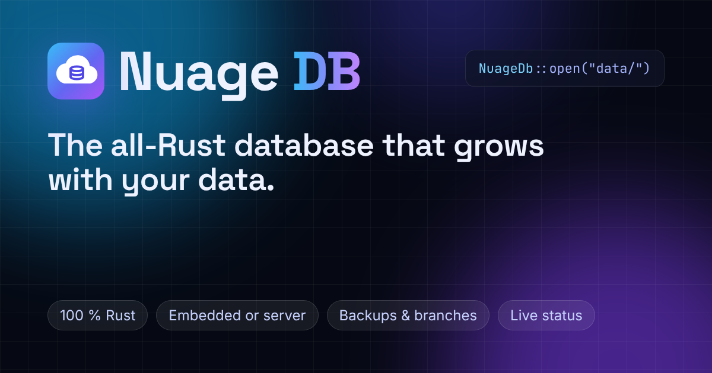

<div align="center">

[](https://github.com/maxlestage/Nuage)

# Nuage DB

**La base de données de Memoire, en pur Rust. Intégrée à votre application ou en serveur, avec le même code.**

[](https://github.com/maxlestage/Nuage/actions/workflows/ci.yml)
[](#licence)
[](https://heroku.com/deploy?template=https://github.com/maxlestage/Nuage)

[English](README.md) · **Français** · [Español](README.es.md)

</div>

---

Nuage DB garde vos tables sur disque derrière un journal d'écriture, crée en un instant des
branches copy-on-write d'une base, se sauvegarde vers un second emplacement et s'en restaure
au démarrage, et sert le tout en HTTP(S) avec une console d'administration et un tableau de
bord en direct. C'est la base de données de [Memoire](https://github.com/maxlestage/Memoire),
l'ORM Rust : les mêmes modèles et les mêmes requêtes tournent dessus en mode intégré pendant
le développement et les tests, et sur un serveur Nuage DB en production, sans changer une
ligne.

## Fonctionnalités

| | |
|---|---|
| **Chiffré au repos** | Tout ce qui est stocké est chiffré (`NUAGE_ENCRYPTION_KEY`) : les pages en XTS-AES-256, chaque enregistrement du journal en AES-256-GCM, et les sauvegardes, qui en sont des copies. Clés dérivées par application (HKDF, ou Argon2id depuis une phrase de passe), comme dans [brocolis](https://github.com/maxlestage/brocolis). |
| **Plusieurs applications** | Un serveur, une base par application : ses jetons, ses clés, ses sauvegardes. Le jeton qu'envoie une application choisit sa base. La console et `/app` les montrent côte à côte. |
| **Pages sur disque** | Tables et index dans un seul fichier B-tree, avec un cache de pages borné (`NUAGE_CACHE_MB`) : les données ne sont pas limitées par la mémoire. Les recherches par clé primaire et par index ne lisent que les lignes utiles. |
| **Journal d'écriture** | Chaque commit est ajouté au journal et synchronisé sur disque avant d'être appliqué. Checkpoints, reprise après crash, CRC-32 sur les enregistrements du journal et sommes de contrôle sur les pages. |
| **Sémantique de Memoire** | Les requêtes passent par l'évaluateur de Memoire, sur les lignes lues sur disque : Nuage DB se comporte exactement comme le moteur en mémoire de Memoire, quelle que soit la taille des données. |
| **Transactions** | Lectures sur instantané, commits optimistes (`Error::Conflict`, rejoués par `db.transaction(...)`), transactions interactives en HTTP, lots tout-ou-rien. |
| **Branches** | Une copie complète de la base pour une préversion, un test ou une expérience, créée en un instant : elle partage les pages de son parent et ne stocke que ses propres changements. |
| **Sauvegardes restaurées au démarrage** | Instantanés et segments de journal, vers un dossier ou un stockage compatible S3. Un répertoire de données vide est restauré automatiquement au démarrage : les hébergeurs à disque éphémère fonctionnent. |
| **Serveur** | Un seul binaire, configuré par variables d'environnement : le protocole de la base (`/v1`), le statut en direct (`/api/status`, `/api/status/stream`), la console (`/admin`) et le site avec son tableau de bord en direct (`/app`), sur un seul port. |
| **Client WebAssembly** | `memoire_orm::NuageDb` parle HTTP(S) : en natif avec Tokio, et dans le navigateur via `fetch`. |
| **Entretien automatique** | Un fil d'arrière-plan fait les checkpoints, envoie les sauvegardes et compacte le fichier. |

## Deux modes, une API

Nuage DB s'utilise avec l'API de [Memoire](https://github.com/maxlestage/Memoire) : modèles,
constructeur de requêtes, relations, transactions et migrations.

```toml
[dependencies]
# Le moteur, le mode intégré et le serveur. `default-features = false` laisse le site de côté.
nuage = { git = "https://github.com/maxlestage/Nuage", default-features = false }
# Le même Memoire que Nuage DB (la feature `nuage` est le client d'un serveur).
memoire-orm = { git = "https://github.com/maxlestage/Memoire", rev = "fd1fdd5464547ce1f60f4a11e552c394da73cfc8", features = ["nuage"] }
tokio = { version = "1", features = ["macros", "rt-multi-thread"] }
```

### Intégré : un répertoire sur disque

```rust
use memoire_orm::prelude::*;
use nuage::Embedded;

#[derive(Model, Debug, Clone)]
#[memoire(table = "notes")]
pub struct Note {
    #[memoire(primary_key, auto_increment)]
    pub id: i64,
    pub text: String,
}

#[tokio::main]
async fn main() -> memoire_orm::Result<()> {
    let db = Embedded::open("data")?; // créé s'il n'existe pas
    db.create_table_if_not_exists::<Note>().await?;
    Note { id: 0, text: "bonjour".into() }.insert(&db).await?;
    println!("{:?}", Note::query().all(&db).await?);
    Ok(())
}
```

### Serveur : le même code en HTTP(S)

```rust
let db = NuageDb::connect("https://mon-nuage.herokuapp.com", token).await?;
Note::query().filter(Note::TEXT.contains("bonjour")).all(&db).await?;
```

### Un seul réglage pour les deux

```rust
// NUAGE_URL=data                                    -> intégré, dans ./data
// NUAGE_URL=https://db.example.com NUAGE_TOKEN=...  -> un serveur
let db = nuage::Db::from_env().await?;
```

### Branches

```rust
db.create_branch("preview-42", None).await?;         // instantané, quelle que soit la taille
let preview = db.on_branch("preview-42");
Note { id: 0, text: "seulement dans la préversion".into() }.insert(&preview).await?;
db.reset_branch("preview-42").await?;                // oublie ses changements
db.delete_branch("preview-42").await?;
```

## Chiffrement

Nuage DB chiffre tout ce qu'il stocke, avec les primitives de
[brocolis](https://github.com/maxlestage/brocolis) (AES-256, HKDF-SHA256, Argon2id) :

| Quoi | Comment |
|---|---|
| pages (`nuage.redb` : tables, index, branches, liste des applications) | XTS-AES-256 (IEEE 1619), le mode du chiffrement de disque : les pages gardent leur place et leur taille |
| journal d'écriture (`wal/*.log`) | AES-256-GCM par enregistrement, sous une clé propre à chaque segment (sel aléatoire), le LSN comme nonce |
| sauvegardes (dossier ou S3) | copies des fichiers ci-dessus, chiffrées de même, avec l'en-tête du répertoire |

`NUAGE_ENCRYPTION_KEY` est une clé (`openssl rand -hex 32`) ou une phrase de passe. Chaque
répertoire de données a un en-tête, `encryption.json`, avec un sel aléatoire et une valeur de
contrôle (jamais la clé) : sa clé racine est HKDF(clé, sel), ou Argon2id(phrase, sel)
(64 Mio, 3 passes), et les clés des pages, du journal et la valeur de contrôle en dérivent.
Chaque application a son répertoire, donc son sel et ses clés. Une mauvaise clé est refusée
au démarrage, avant toute lecture. Une base ou une sauvegarde stockée en clair par une
version précédente est chiffrée à l'ouverture avec une clé, et la sauvegarde en clair est
remplacée. **Gardez la clé** : sans elle, ni les données ni les sauvegardes ne sont lisibles.
Le mode intégré chiffre aussi, avec
`EngineOptions { encryption: Some(Encryption::parse(clé)?), .. }` ou `NUAGE_ENCRYPTION_KEY`
avec `nuage::Db::from_env()`.

## Plusieurs applications

Un serveur accueille plusieurs applications, chacune avec sa base :

- la **première application** est la base du serveur (`NUAGE_NAME`, données à la racine de
  `NUAGE_DATA_DIR`, jeton `NUAGE_TOKEN`) : un déploiement existant garde ses données telles
  quelles ;
- les **autres** se créent dans la console (`/admin`, **New application**) : une base dans
  `apps/<nom>/`, chiffrée sous ses propres clés, sauvegardée sous `apps/<nom>/`, et un premier
  jeton, affiché une seule fois (le serveur n'en garde que l'empreinte SHA-256) ;
- le **jeton** qu'envoie une application choisit sa base : `NuageDb::connect(url, jeton)` ne
  change pas, et une application ne voit jamais les données d'une autre, ni ses transactions ;
- leur liste est dans les métadonnées de la première application : journalisée, chiffrée,
  sauvegardée et restaurée avec elle, puis chaque application restaure sa propre sauvegarde.

`Server::create_app`, `new_app_token`, `revoke_app_token`, `delete_app` et `apps` font de
même depuis Rust.

## Démarrage rapide

```bash
git clone https://github.com/maxlestage/Nuage && cd Nuage
# La clé qui chiffre tout : gardez-la, sans elle les données sont illisibles.
export NUAGE_ENCRYPTION_KEY=$(openssl rand -hex 32)
NUAGE_TOKEN=dev-token NUAGE_ADMIN_PASSWORD=dev-password cargo run -p nuage --release
# nuage: data is stored in /home/moi/Nuage/nuage-data on this server's disk
# nuage: listening on 0.0.0.0:8080
```

Puis ouvrez :

- http://localhost:8080/ : le site (anglais, français, espagnol) ;
- http://localhost:8080/app : le tableau de bord en direct (connexion avec `NUAGE_ADMIN_PASSWORD`) ;
- http://localhost:8080/admin : la console d'administration.

Les applications se connectent avec `NuageDb::connect("http://localhost:8080", "dev-token")`.

Docker :

```bash
docker build -t nuage .
docker run -p 8080:8080 -v nuage-data:/data -e NUAGE_ENCRYPTION_KEY=... -e NUAGE_TOKEN=... -e NUAGE_ADMIN_PASSWORD=... nuage
```

## Déployer sur Heroku

La racine de ce dépôt se déploie telle quelle : `Procfile`, `RustConfig` et
`heroku-build.sh` (le buildpack `emk/rust` compile le binaire `nuage` avec le site), et
`app.json` pour le bouton **Deploy to Heroku** ci-dessus.

- **Un dyno Basic.** Un dyno Basic ne se met jamais en veille. Lancez exactement un dyno
  web : deux dynos feraient deux bases distinctes qui écrivent dans les mêmes sauvegardes.
- **Le disque est éphémère.** Le disque d'un dyno est effacé à chaque redémarrage (au moins
  une fois par jour, et à chaque déploiement). Le répertoire de données n'est qu'une copie de
  travail : **configurez les sauvegardes**, et chaque démarrage restaure la base à partir
  d'elles. Sur Heroku, utilisez un stockage compatible S3 (`NUAGE_BACKUP_S3_*`) ; chez un
  hébergeur au disque persistant, un dossier suffit (`NUAGE_BACKUP_DIR`).
- **Fenêtre de perte.** Les commits faits depuis le dernier segment de journal envoyé
  (30 secondes par défaut) ne sont perdus que si le dyno s'arrête sans le `SIGTERM` qu'Heroku
  envoie d'abord : au `SIGTERM`, le serveur fait un checkpoint et envoie le dernier segment.

À la main :

```bash
heroku create mon-nuage --buildpack emk/rust
heroku config:set NUAGE_ENCRYPTION_KEY=$(openssl rand -hex 32) NUAGE_TOKEN=$(openssl rand -hex 32) \
  NUAGE_ADMIN_PASSWORD='une longue phrase de passe' \
  NUAGE_BACKUP_S3_BUCKET=mon-bucket NUAGE_BACKUP_S3_REGION=eu-west-3 \
  NUAGE_BACKUP_S3_ACCESS_KEY_ID=... NUAGE_BACKUP_S3_SECRET_ACCESS_KEY=...
git push heroku master
```

Pour un stockage autre qu'AWS, définissez aussi `NUAGE_BACKUP_S3_ENDPOINT`. Ouvrez ensuite
`https://mon-nuage.herokuapp.com/admin`.

## Variables d'environnement

| Variable | Rôle | Par défaut |
|---|---|---|
| `PORT` | port d'écoute (fixé par Heroku et la plupart des hébergeurs) | `8080` |
| `NUAGE_DATA_DIR` | répertoire de données | `nuage-data` |
| `NUAGE_NAME` | nom de la première application (et de sa base) | `nuage` |
| `NUAGE_ENCRYPTION_KEY` | la clé qui chiffre tout : 64 chiffres hexadécimaux (`openssl rand -hex 32`, `nuage genkey`), le base64 de 32 octets, ou une phrase de passe d'au moins 12 caractères | **obligatoire** : le binaire ne démarre pas sans |
| `NUAGE_TOKEN` | un jeton de la première application (nommée `NUAGE_NAME`) ; la console crée les autres applications et leurs jetons | aucun |
| `NUAGE_ADMIN_PASSWORD` | mot de passe de la console (et du tableau de bord) | aucun : la console est coupée |
| `NUAGE_PUBLIC_STATUS` | `true` : `/api/status` et `/app` montrent une partie publique sans connexion | `false` |
| `NUAGE_CACHE_MB` | cache de pages de chaque application, en Mio | `64` |
| `NUAGE_BACKUP_DIR` | sauvegarde vers ce dossier | |
| `NUAGE_BACKUP_S3_BUCKET` | sauvegarde vers ce bucket | |
| `NUAGE_BACKUP_S3_ENDPOINT` | point d'accès du stockage compatible S3 | `https://s3.<region>.amazonaws.com` |
| `NUAGE_BACKUP_S3_REGION` | région | `us-east-1` |
| `NUAGE_BACKUP_S3_PREFIX` | préfixe des objets de sauvegarde | `nuage/` |
| `NUAGE_BACKUP_S3_ACCESS_KEY_ID`, `NUAGE_BACKUP_S3_SECRET_ACCESS_KEY` | identifiants (sinon `AWS_ACCESS_KEY_ID`, `AWS_SECRET_ACCESS_KEY`) | |
| `NUAGE_BACKUP_SNAPSHOT_MINUTES` | minutes entre deux instantanés | `60` |
| `SITE_URL` | adresse publique du site (liens canoniques, carte de partage) | l'hôte de chaque requête |

Un exemple commenté : [`nuage.env.example`](nuage.env.example). Servez le serveur en HTTPS
(la plupart des hébergeurs le font pour vous) : le jeton voyage dans un en-tête, et le cookie
de la console est `Secure`.

## `/app` et `/admin`

- **`/app`**, le tableau de bord en direct : requêtes par seconde, latence p50/p99,
  connexions, services, stockage, cache, journal d'écriture, sauvegardes, une carte par application (ses requêtes, sa latence, ses données, ses branches, son chiffrement ; des pastilles restreignent les cartes et le journal à l'une d'elles),
  et un journal d'événements en direct. C'est un îlot Rust/WebAssembly qui lit `/api/status`,
  puis suit `/api/status/stream` (Server-Sent Events, chaque seconde). Il est privé : le lien
  **Se connecter** passe par `/admin?next=/fr/app/` et revient au tableau de bord. Avec
  `NUAGE_PUBLIC_STATUS=true`, les visiteurs voient la partie publique. Il s'installe comme une
  application (PWA) et montre le dernier état connu hors ligne.
- **`/admin`**, la console : les applications (des cartes ; en créer une, son jeton s'affiche une fois), puis pour chacune sa vue d'ensemble, ses tables et leurs lignes, ses jetons (nouveau, révocation), ses réglages (description, suppression confirmée par son nom), une console de requêtes (un
  petit sous-ensemble de SQL, avec confirmation avant les modifications), branches, stockage
  et boutons pour un checkpoint, une sauvegarde, une vérification d'intégrité et un
  compactage. Rendue par le serveur, elle fonctionne sans JavaScript, sur téléphone aussi.
  Cookie de session `HttpOnly`, `Secure`, `SameSite=Strict`, jetons CSRF, tentatives de
  connexion limitées.

| Chemin | Contenu | Accès |
|---|---|---|
| `/v1/*` | le protocole de la base, sur la base de l'application qu'ouvre le jeton | `Authorization: Bearer <jeton d'une application>` |
| `/api/health` | `{"status":"ok"}` | public |
| `/api/status`, `/api/status/stream` | statut en direct, en JSON et en Server-Sent Events | jeton d'une application (cette application) ou session de la console (toutes) |
| `/admin` | la console | `NUAGE_ADMIN_PASSWORD` |
| tout le reste | le site, `/app` compris | public |

## Organisation du dépôt

```
.
├── Cargo.toml            workspace (memoire-orm y est épinglé)
├── crates/
│   ├── nuage/            le moteur, le mode intégré, le serveur, la console, l'API de
│   │                     statut, les sauvegardes (dossier, S3), le binaire `nuage` ;
│   │                     tests/common est la suite de tests des backends de Memoire
│   └── nuage-site/       le site : pages, tableau de bord /app (Rust/wasm, le bundle
│                         précompilé dans pkg/, refait par build-wasm.sh), PWA, carte de partage
├── Procfile, RustConfig, heroku-build.sh, app.json    Heroku
├── Dockerfile            tout hébergeur de conteneurs
├── nuage.env.example     l'environnement, commenté
└── .github/workflows/ci.yml
```

La feature `site` de `crates/nuage` (active par défaut) monte le site dans le serveur
(`nuage::site()`) ; `default-features = false` le laisse de côté.

## Développement

```bash
cargo fmt --all --check
cargo clippy --workspace --all-targets --all-features -- -D warnings
cargo clippy -p nuage-site --lib --target wasm32-unknown-unknown -- -D warnings
cargo test --workspace --all-features
crates/nuage-site/build-wasm.sh   # après une modification du tableau de bord (Rust 1.99, wasm-bindgen de Cargo.lock)
```

## La famille

- [Memoire](https://github.com/maxlestage/Memoire) ([site](https://memoire-7f4525f1fdaf.herokuapp.com/)) : l'ORM Rust dont Nuage DB est la base de données.
- [Paquets](https://github.com/maxlestage/Paquets) ([site](https://paquets-90dfc06b6fea.herokuapp.com/)) : le framework full-stack le plus simple pour Rust.

## Licence

Propriétaire : voir [LICENSE](LICENSE). Copyright (c) 2026 Maxime Nathan Lestage.
