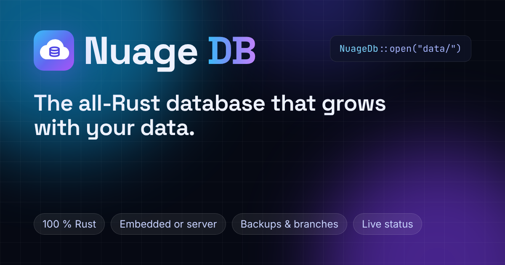

<div align="center">

[](https://github.com/maxlestage/Nuage)

# Nuage DB

**La base de données de Memoire, en pur Rust. Intégrée à votre application ou en serveur, avec le même code.**

[](https://github.com/maxlestage/Nuage/actions/workflows/ci.yml)
[](#licence)
[](https://heroku.com/deploy?template=https://github.com/maxlestage/Nuage)

[English](README.md) · **Français** · [Español](README.es.md)

</div>

---

Nuage DB garde vos tables sur disque derrière un journal d'écriture, crée en un instant des
branches copy-on-write d'une base, se sauvegarde vers un second emplacement et s'en restaure
au démarrage, et sert le tout en HTTP(S) avec une console d'administration et un tableau de
bord en direct. C'est la base de données de [Memoire](https://github.com/maxlestage/Memoire),
l'ORM Rust : les mêmes modèles et les mêmes requêtes tournent dessus en mode intégré pendant
le développement et les tests, et sur un serveur Nuage DB en production, sans changer une
ligne.

## Fonctionnalités

| | |
|---|---|
| **Chiffré au repos** | Tout ce qui est stocké est chiffré (`NUAGE_ENCRYPTION_KEY`) : les pages en XTS-AES-256, chaque enregistrement du journal en AES-256-GCM, et les sauvegardes, qui en sont des copies. Clés dérivées par application (HKDF, ou Argon2id depuis une phrase de passe). |
| **Plusieurs applications** | Un serveur, une base par application : ses jetons, ses clés, ses sauvegardes. Le jeton qu'envoie une application choisit sa base. La console et `/app` les montrent côte à côte. |
| **Pages sur disque** | Tables et index dans un seul fichier de pages en arbre B écrit par Nuage DB lui-même (copie sur écriture, somme de contrôle sur chaque nœud), avec un cache de pages borné (`NUAGE_CACHE_MB`) : les données ne sont pas limitées par la mémoire. Les recherches par clé primaire et par index ne lisent que les lignes utiles. |
| **Journal d'écriture** | Chaque commit est ajouté au journal et synchronisé sur disque avant d'être rendu ou montré à un lecteur ; les commits faits en même temps partagent une synchronisation. Checkpoints, reprise après crash, CRC-32 sur les enregistrements du journal et sommes de contrôle sur les pages. |
| **Sémantique de Memoire** | Les requêtes passent par l'évaluateur de Memoire, sur les lignes lues sur disque : Nuage DB se comporte exactement comme le moteur en mémoire de Memoire, quelle que soit la taille des données. |
| **Transactions** | Lectures sur instantané, commits optimistes (`Error::Conflict`, rejoués par `db.transaction(...)`), transactions interactives en HTTP, lots tout-ou-rien. |
| **Branches** | Une copie complète de la base pour une préversion, un test ou une expérience, créée en un instant : elle partage les pages de son parent et ne stocke que ses propres changements. |
| **Sauvegardes restaurées au démarrage** | Instantanés et segments de journal, vers un dossier ou un stockage compatible S3. Un répertoire de données vide est restauré automatiquement au démarrage : les hébergeurs à disque éphémère fonctionnent. |
| **Serveur** | Un seul binaire, configuré par variables d'environnement : le protocole de la base (`/v1`), le statut en direct (`/api/status`, `/api/status/stream`), la console (`/admin`) et le site avec son tableau de bord en direct (`/app`), sur un seul port. |
| **Client WebAssembly** | `memoire_orm::NuageDb` parle HTTP(S) : en natif avec Tokio, et dans le navigateur via `fetch`. |
| **Entretien automatique** | Un fil d'arrière-plan fait les checkpoints, envoie les sauvegardes et compacte le fichier. |

## Deux modes, une API

Nuage DB s'utilise avec l'API de [Memoire](https://github.com/maxlestage/Memoire) : modèles,
constructeur de requêtes, relations, transactions et migrations.

```toml
[dependencies]
# Le moteur, le mode intégré et le serveur. `default-features = false` laisse le site de côté.
nuage = { git = "https://github.com/maxlestage/Nuage", default-features = false }
# Le même Memoire que Nuage DB (la feature `nuage` est le client d'un serveur).
memoire-orm = { git = "https://github.com/maxlestage/Memoire", rev = "8f7e0cb", features = ["nuage"] }
tokio = { version = "1", features = ["macros", "rt-multi-thread"] }
```

### Intégré : un répertoire sur disque

```rust
use memoire_orm::prelude::*;
use nuage::Embedded;

#[derive(Model, Debug, Clone)]
#[memoire(table = "notes")]
pub struct Note {
    #[memoire(primary_key, auto_increment)]
    pub id: i64,
    pub text: String,
}

#[tokio::main]
async fn main() -> memoire_orm::Result<()> {
    let db = Embedded::open("data")?; // créé s'il n'existe pas
    db.create_table_if_not_exists::<Note>().await?;
    Note { id: 0, text: "bonjour".into() }.insert(&db).await?;
    println!("{:?}", Note::query().all(&db).await?);
    Ok(())
}
```

### Serveur : le même code en HTTP(S)

```rust
let db = NuageDb::connect("https://mon-nuage.herokuapp.com", token).await?;
Note::query().filter(Note::TEXT.contains("bonjour")).all(&db).await?;
```

### Un seul réglage pour les deux

```rust
// NUAGE_URL=data                                    -> intégré, dans ./data
// NUAGE_URL=https://db.example.com NUAGE_TOKEN=...  -> un serveur
let db = nuage::Db::from_env().await?;
```

### Branches

```rust
db.create_branch("preview-42", None).await?;         // instantané, quelle que soit la taille
let preview = db.on_branch("preview-42");
Note { id: 0, text: "seulement dans la préversion".into() }.insert(&preview).await?;
db.reset_branch("preview-42").await?;                // oublie ses changements
db.delete_branch("preview-42").await?;
```

## Chiffrement

Nuage DB chiffre tout ce qu'il stocke (AES-256, HKDF-SHA256, Argon2id) :

| Quoi | Comment |
|---|---|
| pages (`nuage.db` : tables, index, branches, liste des applications) | XTS-AES-256 (IEEE 1619), le mode du chiffrement de disque : les pages gardent leur place et leur taille |
| journal d'écriture (`wal/*.log`) | AES-256-GCM par enregistrement, sous une clé propre à chaque segment (sel aléatoire), le LSN comme nonce |
| sauvegardes (dossier ou S3) | copies des fichiers ci-dessus, chiffrées de même, avec l'en-tête du répertoire |

`NUAGE_ENCRYPTION_KEY` est une clé (`openssl rand -hex 32`) ou une phrase de passe. Chaque
répertoire de données a un en-tête, `encryption.json`, avec un sel aléatoire et une valeur de
contrôle (jamais la clé) : sa clé racine est HKDF(clé, sel), ou Argon2id(phrase, sel)
(64 Mio, 3 passes), et les clés des pages, du journal et la valeur de contrôle en dérivent.
Chaque application a son répertoire, donc son sel et ses clés. Une mauvaise clé est refusée
au démarrage, avant toute lecture. Une base ou une sauvegarde stockée en clair par une
version précédente est chiffrée à l'ouverture avec une clé, et la sauvegarde en clair est
remplacée. **Gardez la clé** : sans elle, ni les données ni les sauvegardes ne sont lisibles.
Le mode intégré chiffre aussi, avec
`EngineOptions { encryption: Some(Encryption::parse(clé)?), .. }` ou `NUAGE_ENCRYPTION_KEY`
avec `nuage::Db::from_env()`.

### En venant de la version 0.4

Jusqu'à la 0.4, les pages étaient un fichier [redb](https://docs.rs/redb), `nuage.redb`.
Ce sont maintenant celles de Nuage DB (`nuage.db`). Rien à faire : un répertoire de données
d'une version antérieure, ou une sauvegarde d'une telle version restaurée dans un répertoire
vide, est importé à la première ouverture par cette version, chiffré comme il l'était, et le
journal écrit depuis son dernier point de contrôle est rejoué par-dessus. Avant de prendre sa
place, le nouveau fichier est relu et comparé à l'ancien, entrée par entrée : le moindre écart
arrête l'ouverture et laisse l'ancien fichier tel quel. Le serveur écrit dans son journal de
démarrage ce que contient chaque application (tables, lignes) et ce qui a été importé.
L'ancien fichier reste à côté du nouveau sous le nom `nuage.redb.imported` : supprimez-le une fois vos données
vérifiées. Quand des sauvegardes sont configurées, un instantané de cette version suit dans
l'instant : la restauration suivante ne passe plus par l'import. Juste avant, la sauvegarde
de l'ancienne version (son manifeste, son instantané, ses segments de journal et son en-tête
de chiffrement) est copiée sous `before-import/` dans l'emplacement de sauvegarde, où rien
ne la purge : la base du serveur dans `before-import/`, chaque application dans
`before-import/apps/<nom>/`, la forme de l'emplacement de sauvegarde lui-même. Revenir en
arrière, c'est démarrer l'ancienne version sur un répertoire de données vide avec
`before-import` comme emplacement de sauvegarde (`NUAGE_BACKUP_S3_PREFIX` ou
`NUAGE_BACKUP_DIR` suivi de `before-import/`) : elle y trouve chaque application. Cette
version restaure aussi depuis là. Supprimez-la une fois vos données vérifiées.

La lecture de l'ancien fichier est la fonctionnalité Cargo `import-redb`, active par défaut :
le serveur l'a. Une application qui embarque le moteur (`default-features = false`, avec ou
sans `s3`) ne contient plus redb du tout et refuse un tel répertoire avec un message qui le
dit ; si elle a des données ou des sauvegardes de ces versions, elle ajoute
`features = ["import-redb"]`. Une fois toutes les bases ouvertes par cette version,
la fonctionnalité peut être retirée.

## Plusieurs applications

Un serveur accueille plusieurs applications, chacune avec sa base :

- la **première application** est la base du serveur (`NUAGE_NAME`, données à la racine de
  `NUAGE_DATA_DIR`, jeton `NUAGE_TOKEN`) : un déploiement existant garde ses données telles
  quelles ;
- les **autres** se créent dans la console (`/admin`, **New application**), ou d'une
  requête à l'API de gestion (`nuage apps create`, voir plus bas) : une base dans
  `apps/<nom>/`, chiffrée sous ses propres clés, sauvegardée sous `apps/<nom>/`, et un premier
  jeton, affiché une seule fois (le serveur n'en garde que l'empreinte SHA-256) ;
- le **jeton** qu'envoie une application choisit sa base : `NuageDb::connect(url, jeton)` ne
  change pas, et une application ne voit jamais les données d'une autre, ni ses transactions ;
- leur liste est dans les métadonnées de la première application : journalisée, chiffrée,
  sauvegardée et restaurée avec elle, puis chaque application restaure sa propre sauvegarde.

`Server::create_app`, `new_app_token`, `revoke_app_token`, `delete_app` et `apps` font de
même depuis Rust.

### Créer une application en une commande

L'API de gestion, `/api/apps`, crée les applications et leurs jetons en une requête HTTP :
depuis un script, une CI, une étape de déploiement, sans le formulaire de la console. Elle
s'ouvre avec un jeton à elle, `NUAGE_ADMIN_TOKEN`.

1. **L'activer**, une fois, sur le serveur : `NUAGE_ADMIN_TOKEN=$(nuage genkey)` (32
   caractères au moins ; plus court, le serveur refuse de démarrer et dit pourquoi). Les
   installateurs en mettent déjà un. Sur Heroku : l'app du serveur → **Settings** → **Config
   Vars**. Le journal de démarrage dit `the management API (/api/apps) is on`.
2. **Créer une application**. Sur l'ordinateur du serveur, rien d'autre : `nuage` lit le
   jeton et le port dans le fichier de réglages de l'installateur (d'où `sudo` ; sur Windows,
   un PowerShell en administrateur), et montre `SITE_URL` comme adresse quand le fichier l'a :

   ```bash
   sudo nuage apps create boutique "La boutique"
   # NUAGE_URL=http://127.0.0.1:8080
   # NUAGE_TOKEN=nuage_3f9a12c0…
   ```

   D'ailleurs, donnez-lui le serveur et son jeton de gestion :

   ```bash
   export NUAGE_URL=https://mon-nuage.herokuapp.com NUAGE_ADMIN_TOKEN=…
   nuage apps create boutique "La boutique"
   # NUAGE_URL=https://mon-nuage.herokuapp.com
   # NUAGE_TOKEN=nuage_3f9a12c0…
   nuage apps list
   # nuage       1 token(s)
   # boutique    1 token(s)   La boutique
   ```

   ou avec n'importe quel client HTTP :

   ```bash
   curl https://mon-nuage.herokuapp.com/api/apps \
     -H "Authorization: Bearer $NUAGE_ADMIN_TOKEN" \
     -d '{"name": "boutique", "description": "La boutique"}'
   ```

   ```json
   {
     "application": { "name": "boutique", "description": "La boutique", "first": false, "created_at": 1794690000000,
                      "tokens": [{ "id": "3f9a12c0", "created_at": 1794690000000, "read_only": false }],
                      "env_token": false, "origins": [] },
     "token": "nuage_3f9a12c0…",
     "env": { "NUAGE_URL": "https://mon-nuage.herokuapp.com", "NUAGE_TOKEN": "nuage_3f9a12c0…" },
     "message": "Application `boutique` created, with its own encrypted database. Copy its token now: it is not shown again."
   }
   ```

3. **Brancher l'application** : les deux lignes de `env` dans sa configuration (sur Heroku,
   ses Config Vars). Elle se connecte et crée ses tables à son premier démarrage.

Depuis Rust, `memoire_orm::NuageAdmin` (la fonction `nuage` de Memoire) fait de même :
`NuageAdmin::new(url, jeton_de_gestion)?.create_app("boutique", "La boutique").await?` donne le
jeton et `env()`, les deux lignes. Dans un projet [Paquets](https://github.com/maxlestage/Paquets),
`paquets nuage create boutique` crée l'application et écrit les deux lignes dans `.env`.

| Méthode | Chemin | Corps | Réponse |
|---|---|---|---|
| `GET` | `/api/apps` | | `200 {"applications": [...]}`, la première d'abord, puis par nom |
| `POST` | `/api/apps` | `{"name": "boutique", "description": "…"}` (description facultative) | `201` l'application, son `token` et `env` ; `409` le nom est pris ; `400` un nom invalide (1 à 63 de `a-z 0-9 - _`) |
| `GET` | `/api/apps/{nom}` | | `200` l'application ; `404` |
| `POST` | `/api/apps/{nom}/tokens` | `{"read_only": true}` (facultatif, `false` par défaut) | `201 {"application", "token", "read_only", "env"}` |
| `DELETE` | `/api/apps/{nom}/tokens/{id}` | | `200 {"revoked": true}` ; `404` pas de tel jeton |

Un refus est du JSON, `{"error": {"kind", "message"}}`, avec un message qui dit quoi faire :
`401` sans le jeton de gestion ou avec un mauvais, `403` quand `NUAGE_ADMIN_TOKEN` n'est pas
défini, `400`, `404`, `405`, `409`. La description complète est dans
[`/v1/openapi.json`](crates/nuage/openapi.json).

Ce qui la protège :

- **Un secret à elle**, ni le mot de passe de la console (un mot de passe se tape, donc se
  devine), ni le jeton d'une application : un jeton ouvre sa base et rien d'autre, le
  `NUAGE_TOKEN` de la première application compris. Il est comparé en temps constant.
- **Un jeton ne se voit qu'une fois**, dans la réponse qui le crée : le serveur n'en garde
  que l'empreinte SHA-256, et la liste montre les jetons par leur identifiant (leurs premiers
  caractères).
- **Pas de suppression** : supprimer une application efface ses données et ses
  sauvegardes ; cela reste dans la console, derrière son nom tapé à nouveau.
- Gardez `NUAGE_ADMIN_TOKEN` avec les autres secrets du serveur, jamais dans une application
  ni dans une page. Pour le changer, donnez-lui une nouvelle valeur : l'ancienne ne sert plus
  au démarrage suivant.

## SQL

Nuage DB parle SQL (`POST /v1/sql`, l'onglet **Query** de la console, `Embedded::sql` en Rust) :

| | |
|---|---|
| **Lire** | `SELECT [DISTINCT]`, `JOIN`, `LEFT JOIN`, `CROSS JOIN` (`ON`, `USING`), `WHERE`, `GROUP BY`, `HAVING`, `ORDER BY ... NULLS FIRST/LAST`, `LIMIT`/`OFFSET`, `UNION [ALL]`, `INTERSECT`, `EXCEPT`, sous-requêtes (`IN`, `EXISTS`, scalaires, corrélées, dans `FROM`) |
| **Expressions** | `CASE`, `CAST` et `::`, `\|\|`, `+ - * / %`, `LIKE`, `ILIKE`, `BETWEEN`, `IN`, `IS [NOT] NULL`, `IS [NOT] DISTINCT FROM` |
| **Fonctions** | `count`, `sum`, `avg`, `min`, `max`, `total`, `group_concat`/`string_agg`, `array_agg` (avec `DISTINCT`) ; `lower`, `upper`, `length`, `trim`, `substr`, `replace`, `instr`, `lpad`, `concat`, `coalesce`, `nullif`, `iif`, `greatest`, `least`, `abs`, `round`, `floor`, `ceil`, `power`, `sqrt`, `random`, `now`, `current_date`, `date`, `extract`, `strftime`, `json_extract`, `json_object`, `json_array`, `gen_random_uuid`... |
| **Écrire** | `INSERT ... VALUES / SELECT / DEFAULT VALUES`, `ON CONFLICT ... DO NOTHING / DO UPDATE SET ... excluded.x`, `INSERT OR IGNORE`, `REPLACE INTO`, `ON DUPLICATE KEY UPDATE`, `UPDATE ... SET col = <expression>`, `DELETE`, `RETURNING` |
| **Schéma** | `CREATE TABLE [IF NOT EXISTS]` (types de PostgreSQL, MySQL et SQLite ; `PRIMARY KEY`, `SERIAL`/`AUTOINCREMENT`, `NOT NULL`, `UNIQUE`, `DEFAULT`, `REFERENCES`, `UNIQUE (a, b)`), `CREATE TABLE ... AS SELECT`, `CREATE [UNIQUE] INDEX` (construit sur les lignes déjà là), `DROP INDEX`, `ALTER TABLE ... ADD COLUMN`, `DROP TABLE`, `EXPLAIN` |

Une requête que les instructions de Memoire savent exprimer s'exécute comme l'une d'elles, par
les index, en s'arrêtant à la fin de la page ; le reste (fonctions, `CASE`, sous-requêtes,
`UNION`) est calculé par la couche SQL sur les lignes trouvées par les index, avec des
jointures par hachage. Absents : jointures `RIGHT`/`FULL`, `WITH`, fonctions de fenêtre, vues,
déclencheurs, clé primaire sur plusieurs colonnes, changement de clé primaire. Une table créée
sans clé primaire reçoit une colonne `rowid`.

## Tous les langages

Nuage DB parle SQL en HTTP (`POST /v1/sql`, du JSON à l'aller et au retour) : tous les
langages s'en servent, sans rien installer. [`clients/`](clients) contient un exemple complet,
testé sur un vrai serveur en CI, pour curl, JavaScript, TypeScript, Python, PHP, Go, Ruby,
Java, Kotlin, C#, Swift, Dart (Flutter), Elixir, Rust, C et Perl ; la console montre la même requête dans chaque langage avec l'adresse du
serveur. Chaque serveur décrit son API à `/v1/openapi.json` (OpenAPI 3.1) pour générer un
client dans n'importe quel autre langage. Rust a aussi le client natif, `NuageDb`. Et
chaque pilote PostgreSQL se connecte aussi : voir plus bas.

**Ma connexion marche-t-elle ?** `GET /v1/ping` répond quelle application le jeton ouvre :
`curl https://db.example.com/v1/ping -H "Authorization: Bearer <jeton>"` donne
`Connected to Nuage DB 0.4.1: application blog, read and write, branch main, 3 table(s).`,
et sans jeton, ou avec un jeton qui n'ouvre rien, il dit ce qui ne va pas. Depuis n'importe
quelle machine : `nuage check <url> <jeton>`. Une connexion PostgreSQL reçoit la même phrase
en avis (psql l'affiche), et la page de chaque application dans la console montre sa dernière
connexion (quand, comment, quel client), ou qu'elle attend la première.

## Protocole PostgreSQL

Nuage DB parle aussi le protocole de PostgreSQL (`NUAGE_PG_PORT=5432` ; l'installateur et
Docker l'activent) : **le pilote PostgreSQL, l'ORM et l'outil de chaque langage s'y
connectent tels quels**, avec un nom d'utilisateur quelconque et **un jeton d'application
comme mot de passe** ; le nom de base choisit une branche (le nom de l'application, ou `main` :
la principale).

```bash
PGPASSWORD=<jeton> psql "host=db.example.com port=5432 user=app dbname=nuage sslmode=require"
# postgresql://app:<jeton>@db.example.com:5432/nuage?sslmode=require
```

Testé en CI avec psql, psycopg 2 et 3, SQLAlchemy, node-postgres, Postgres.js, pgx,
database/sql de Go, JDBC, PDO, le gem pg, tokio-postgres et Npgsql : exemples dans
[`clients/postgres/`](clients/postgres). Requêtes préparées, paramètres `$1` (leur type vient
des colonnes qu'ils rencontrent), valeurs texte et binaires, `BEGIN` ... `COMMIT` d'un
message à l'autre, savepoints, codes d'erreur de PostgreSQL (`40001` sur un conflit
d'écriture : relancez la transaction). `SELECT ... FOR UPDATE` (`SKIP LOCKED`, `NOWAIT`, `FOR SHARE`) et les verrous consultatifs (`pg_advisory_xact_lock`, `hashtextextended`) sont acceptés : une transaction échoue déjà à son commit (`40001`) si une autre a modifié une table qu'elle a lue. `x IN (SELECT jsonb_array_elements_text($1::jsonb)::bigint)` prend une liste en un seul paramètre JSON. TLS avec `NUAGE_TLS_CERT` et `NUAGE_TLS_KEY`
(l'installateur prend le certificat du domaine). Le SQL est celui de Nuage DB (ci-dessus) ;
les catalogues système (`pg_catalog`) n'y sont pas : les outils qui les parcourent (pgAdmin)
montrent peu de chose, et Npgsql prend `Server Compatibility Mode=NoTypeLoading`. Heroku ne
route que le HTTP : là, utilisez `/v1/sql`.

## Sites web

Tout site peut utiliser la base d'une application, depuis son serveur ou depuis ses pages :

- **`POST /v1/sql`**, depuis n'importe quel langage : du SQL complet, paramètres `?` (ou
  `$1`), des valeurs jamais lues comme du SQL (pas d'injection). Les lignes reviennent en
  objets JSON (`"arrays": true` pour des tableaux), un insert renvoie son `last_insert_id`.
  Plusieurs instructions (séparées par `;`, ou `"statements": [...]`) forment une seule
  transaction, tout ou rien.
- **Depuis le navigateur** : ajoutez le site dans la console (**Settings → Websites** :
  `https://site.fr`, `http://localhost:3000`, ou `*`) et ses pages peuvent appeler `/v1`
  (CORS). La requête préalable du navigateur est mise en cache un jour : un aller-retour, une
  seule fois.
- **Jetons en lecture seule** (**Tokens → New read-only token**) : un jeton dans une page est
  public, les pages reçoivent donc un jeton qui lit sans jamais écrire ; gardez les jetons
  lecture-écriture sur des serveurs.

```js
const res = await fetch("https://mon-nuage.herokuapp.com/v1/sql", {
  method: "POST",
  headers: { "Authorization": "Bearer " + JETON_LECTURE, "Content-Type": "application/json" },
  body: JSON.stringify({ sql: "SELECT id, title FROM posts WHERE category = ? ORDER BY id DESC LIMIT 20", params: [3] }),
});
const { rows } = await res.json(); // [{ "id": 42, "title": "…" }, …]
```

```bash
curl https://mon-nuage.herokuapp.com/v1/sql -H "Authorization: Bearer $NUAGE_TOKEN" \
  -d '{"sql": "INSERT INTO messages (name, text) VALUES (?, ?)", "params": ["Ada", "Bonjour"]}'
```

Vitesse, mesurée sur la machine du serveur (`cargo run --release -p nuage --example bench`,
données chiffrées, 20 000 lignes, 4 cœurs) : une ligne par clé ou par colonne unique en
**0,2 ms**, une page de 20 lignes par un index en **0,5 ms**, une mise à jour durable (fsync)
en **0,5 ms**, **plus de 13 000 lectures/s**. Les réponses JSON de 1 Kio ou plus sont
compressées en gzip pour les clients qui l'acceptent. Ce que ressent un visiteur, c'est
surtout le réseau : choisissez la région de l'hébergeur la plus proche de lui, et un dyno qui
ne se met jamais en veille (Heroku **Basic**, pas Eco, dont la première requête après une
pause prend plusieurs secondes).

## Installer sur n'importe quel ordinateur

Nuage DB tourne sur n'importe quel ordinateur : un serveur Linux, un Raspberry Pi, un Mac, un
PC sous Windows, à côté (ou à la place) d'un serveur chez un hébergeur comme Heroku. Une
commande l'installe comme un service qui démarre avec l'ordinateur, et demande où vont les
sauvegardes.

| | Une commande | Service |
|---|---|---|
| **Linux** (Debian, Ubuntu, Fedora, Rocky, Alpine, Raspberry Pi OS..., x86_64 ou ARM64, dès 512 Mio) | `curl -fsSL https://raw.githubusercontent.com/maxlestage/Nuage/master/install.sh \| sudo bash` | systemd `nuage` |
| **macOS** (Apple silicon ou Intel), dans le Terminal | `curl -fsSL https://raw.githubusercontent.com/maxlestage/Nuage/master/install.sh \| sudo bash` | launchd, sous votre utilisateur |
| **Windows** 10, 11, Server, dans PowerShell **en administrateur** | `irm https://raw.githubusercontent.com/maxlestage/Nuage/master/install.ps1 \| iex` | tâche planifiée `Nuage DB`, en SYSTEM |
| **cargo**, partout où tourne Rust | `cargo install --locked --git https://github.com/maxlestage/Nuage nuage` (voir [Avec cargo](#avec-cargo)) | aucun : donnez-le à l'installateur |
| **Docker**, partout | `docker compose up -d` dans ce dépôt (réglages dans `.env`) | le conteneur |

Chacune installe le binaire `nuage` (compilé en statique : aucune dépendance), crée le
fichier de réglages avec une clé, un jeton, un mot de passe de console et un jeton de gestion,
crée le dossier des données, règle les sauvegardes, démarre le service et vérifie qu'il
répond. Elle affiche une fois l'adresse, le jeton et le mot de passe : **copiez le fichier de
réglages en lieu sûr, loin de cet ordinateur** : personne ne peut lire les données, ni leurs
sauvegardes, sans sa clé.

| | Linux | macOS | Windows |
|---|---|---|---|
| réglages | `/etc/nuage/nuage.env` | `/usr/local/etc/nuage/nuage.env` | `C:\ProgramData\Nuage\nuage.env` |
| données | `/var/lib/nuage` | `/usr/local/var/nuage` | `C:\ProgramData\Nuage\data` |
| journal | `journalctl -u nuage -f` | `tail -f /usr/local/var/log/nuage.log` | `Get-Content -Wait C:\ProgramData\Nuage\nuage.log` |

Sur Linux, elle **crée aussi du swap** si le serveur n'en a pas (la taille de la mémoire, de
1 à 4 Gio ; `vm.swappiness=10`, pour que la mémoire aille à la base) et un utilisateur système
`nuage`. Sur macOS, le service tourne sous la personne qui a lancé `sudo` ; sur Windows, en
SYSTEM, lisible des seuls administrateurs, avec une règle de pare-feu pour le réseau local.

- **HTTPS** (Linux) : faites pointer un nom de domaine vers le serveur, puis
  `curl -fsSL .../install.sh | sudo NUAGE_DOMAIN=db.example.com bash` (Caddy, avec un
  certificat gratuit ; Nuage DB n'écoute alors que sur `127.0.0.1`). Sans HTTPS, la console
  fonctionne, mais prévient que le mot de passe circule en clair.
- **Mise à jour** : relancez la commande ; données, clé, réglages et sauvegardes restent.
- **Options** : `NUAGE_PORT`, `NUAGE_PG_PORT` (`0` : coupé), `NUAGE_SWAP_MB` (`0` : pas de
  swap), `NUAGE_VERSION=v0.4.2`, `NUAGE_BINARY=/chemin/vers/nuage`, `NUAGE_FROM_SOURCE=1`
  (compiler avec cargo). Sur Windows, définissez-les avant : `$env:NUAGE_PORT = '9090'; irm ... | iex`.
- **Désinstaller** : `... | sudo bash -s uninstall` garde les données, les réglages et les
  sauvegardes ; `... | sudo bash -s purge` efface les données et les réglages, jamais les
  sauvegardes. Sur Windows : `$env:NUAGE_ACTION = 'uninstall'` (ou `'purge'`), puis la même
  commande.
- **Mémoire** : le cache de pages de chaque application est `NUAGE_CACHE_MB=auto`, un
  huitième de la mémoire (8 à 512 Mio) ; le reste demeure sur disque. La page *Serveur* de la
  console montre la mémoire utilisée par Nuage DB, la mémoire libre et le swap.
- **À la main** : des binaires pour Linux, macOS et Windows sont sur la
  [page des versions](https://github.com/maxlestage/Nuage/releases) ; `nuage --env-file nuage.env`
  démarre le serveur avec les réglages d'un fichier (lignes `CLÉ=valeur` ; l'environnement
  l'emporte).

### Avec cargo

Avec Rust installé ([rustup.rs](https://rustup.rs)), sur Linux, macOS ou Windows :

```bash
cargo install --locked --git https://github.com/maxlestage/Nuage nuage
nuage --version
```

Le binaire `nuage` arrive dans `~/.cargo/bin` (`%USERPROFILE%\.cargo\bin` sur Windows), avec
le site et le tableau de bord en direct. Un serveur plus léger, sans eux (`/` est alors une
petite page d'accueil ; la console, l'API et tout le reste demeurent) :
`cargo install --locked --git https://github.com/maxlestage/Nuage nuage --no-default-features --features server`.
Une version précise : `--tag v0.4.2`. Mise à jour : la même commande, avec `--force`.

`cargo install` ne pose que le binaire : ni service, ni réglages, ni sauvegardes. Donnez-le à
l'installateur, qui fait le reste (réglages, sauvegardes, service lancé avec l'ordinateur) :

```bash
# Linux, macOS : `command -v nuage` le trouve avant sudo, dont le PATH n'a pas ~/.cargo/bin
curl -fsSL https://raw.githubusercontent.com/maxlestage/Nuage/master/install.sh | sudo NUAGE_BINARY="$(command -v nuage)" bash
```

```powershell
# Windows, PowerShell en administrateur
$env:NUAGE_BINARY = (Get-Command nuage).Source; irm https://raw.githubusercontent.com/maxlestage/Nuage/master/install.ps1 | iex
```

Ou lancez-le vous-même, avec un fichier de réglages : `nuage genkey` crée la clé,
`nuage --env-file nuage.env` démarre le serveur (voir [`nuage.env.example`](nuage.env.example)).
Sur Linux et macOS, `NUAGE_FROM_SOURCE=1` fait compiler l'installateur lui-même avec cargo.

### Sauvegardes : vous choisissez où

Le dossier des données n'est qu'une copie. Avec une sauvegarde, Nuage DB envoie un
**instantané** de chaque base (toutes les heures, `NUAGE_BACKUP_SNAPSHOT_MINUTES`) et le
**journal d'écriture** depuis (à chaque checkpoint, toutes les 30 secondes), le tout chiffré
avec la clé ; et quand il démarre avec un **dossier de données vide** (un nouveau disque, un
nouvel ordinateur), il **se restaure tout seul** depuis la sauvegarde avant de servir.
L'installateur demande où elles vont ; ou dites-le dans la commande :

| Où | Commande (Linux, macOS) | Windows |
|---|---|---|
| un dossier sur **un autre disque** : un disque externe, un NAS | `curl ... \| sudo NUAGE_BACKUP_DIR=/Volumes/MonDisque/nuage bash` | `$env:NUAGE_BACKUP_DIR = 'E:\Nuage'; irm ... \| iex` |
| un **stockage compatible S3** : AWS S3, Cloudflare R2, Scaleway, Backblaze B2, MinIO | `NUAGE_BACKUP_S3_BUCKET=… NUAGE_BACKUP_S3_REGION=… NUAGE_BACKUP_S3_ENDPOINT=… NUAGE_BACKUP_S3_ACCESS_KEY_ID=… NUAGE_BACKUP_S3_SECRET_ACCESS_KEY=…` | les mêmes, avec `$env:` |
| aucune (déconseillé) | `NUAGE_BACKUP=none` | `$env:NUAGE_BACKUP = 'none'` |

- **Un autre disque, ou ailleurs.** Une sauvegarde sur le disque des données meurt avec lui :
  l'installateur et le serveur préviennent quand le dossier de sauvegarde est sur le même
  disque. Une copie à la maison ne survit pas à un incendie ni à un vol : un stockage
  compatible S3, si (R2 et B2 coûtent peu pour cette taille). Gardez aussi la clé du fichier
  de réglages loin du bucket des sauvegardes.
- **Un disque externe débranché** : l'installateur ne crée que le dernier dossier de
  `NUAGE_BACKUP_DIR` (`/Volumes/MonDisque` doit exister), et le serveur prévient au démarrage
  quand le dossier se trouve en fait sur le disque de l'ordinateur. Sur macOS, si les
  sauvegardes vers un disque externe échouent (dans le journal), ajoutez
  `/usr/local/bin/nuage` dans Réglages Système → Confidentialité et sécurité → Accès complet
  au disque. Sur Windows, un partage de NAS (`\\nas\sauvegarde\nuage`) doit laisser écrire le
  compte de l'ordinateur (`ORDINATEUR$`).
- **Changer** de destination : relancez l'installateur avec la nouvelle option ; il remplace
  l'ancienne dans le fichier de réglages et redémarre le service. Sans option, il les garde.
- **Vérifier** : la page *Stockage* de la console, et `/app`, montrent la dernière sauvegarde
  et ses erreurs.
- **Restaurer** sur un nouvel ordinateur : installez, mettez dans le nouveau fichier de
  réglages la `NUAGE_ENCRYPTION_KEY` de l'ancien et les mêmes réglages de sauvegarde, videz le
  dossier des données et redémarrez le service : il restaure le dernier instantané et rejoue
  le journal qui le suit.
- **Un seul écrivain par sauvegarde** : deux serveurs ne doivent jamais sauvegarder dans le
  même dossier ni sous le même préfixe de bucket (chacun écraserait l'autre). Un ordinateur à
  côté d'un serveur Heroku a son propre dossier, son bucket ou son `NUAGE_BACKUP_S3_PREFIX`.

## Démarrage rapide

```bash
git clone https://github.com/maxlestage/Nuage && cd Nuage
# La clé qui chiffre tout : gardez-la, sans elle les données sont illisibles.
export NUAGE_ENCRYPTION_KEY=$(openssl rand -hex 32)
NUAGE_TOKEN=dev-token NUAGE_ADMIN_PASSWORD=dev-password cargo run -p nuage --release
# nuage: data is stored in /home/moi/Nuage/nuage-data on this server's disk
# nuage: listening on 0.0.0.0:8080
```

Puis ouvrez :

- http://localhost:8080/ : le site (anglais, français, espagnol) ;
- http://localhost:8080/app : le tableau de bord en direct (connexion avec `NUAGE_ADMIN_PASSWORD`) ;
- http://localhost:8080/admin : la console d'administration.

Les applications se connectent avec `NuageDb::connect("http://localhost:8080", "dev-token")`.

Docker (Compose, avec les réglages dans `.env`, d'après [`nuage.env.example`](nuage.env.example)) :

```bash
cp nuage.env.example .env   # puis renseignez NUAGE_ENCRYPTION_KEY, NUAGE_TOKEN, NUAGE_ADMIN_PASSWORD
docker compose up -d
```

## Déployer sur Heroku

La racine de ce dépôt se déploie telle quelle : `Procfile`, `RustConfig` et
`heroku-build.sh` (le buildpack `emk/rust` compile le binaire `nuage` avec le site), et
`app.json` pour le bouton **Deploy to Heroku** ci-dessus.

- **Un dyno Basic.** Un dyno Basic ne se met jamais en veille. Lancez exactement un dyno
  web : deux dynos feraient deux bases distinctes qui écrivent dans les mêmes sauvegardes.
- **Le disque est éphémère.** Le disque d'un dyno est effacé à chaque redémarrage (au moins
  une fois par jour, et à chaque déploiement). Le répertoire de données n'est qu'une copie de
  travail : **configurez les sauvegardes**, et chaque démarrage restaure la base à partir
  d'elles. Sur Heroku, utilisez un stockage compatible S3 (`NUAGE_BACKUP_S3_*`) ; chez un
  hébergeur au disque persistant, un dossier suffit (`NUAGE_BACKUP_DIR`).
- **Fenêtre de perte.** Les commits faits depuis le dernier segment de journal envoyé
  (30 secondes par défaut) ne sont perdus que si le dyno s'arrête sans le `SIGTERM` qu'Heroku
  envoie d'abord : au `SIGTERM`, le serveur fait un checkpoint et envoie le dernier segment.

À la main :

```bash
heroku create mon-nuage --buildpack emk/rust
heroku config:set NUAGE_ENCRYPTION_KEY=$(openssl rand -hex 32) NUAGE_TOKEN=$(openssl rand -hex 32) \
  NUAGE_ADMIN_PASSWORD='une longue phrase de passe' \
  NUAGE_BACKUP_S3_BUCKET=mon-bucket NUAGE_BACKUP_S3_REGION=eu-west-3 \
  NUAGE_BACKUP_S3_ACCESS_KEY_ID=... NUAGE_BACKUP_S3_SECRET_ACCESS_KEY=...
git push heroku master
```

Pour un stockage autre qu'AWS, définissez aussi `NUAGE_BACKUP_S3_ENDPOINT`. Ouvrez ensuite
`https://mon-nuage.herokuapp.com/admin`.

## Variables d'environnement

| Variable | Rôle | Par défaut |
|---|---|---|
| `PORT` | port d'écoute (fixé par Heroku et la plupart des hébergeurs) | `8080` |
| `NUAGE_PG_PORT` | sert aussi le protocole PostgreSQL sur ce port (`5432`) : le pilote PostgreSQL de chaque langage, un jeton comme mot de passe | désactivé |
| `NUAGE_PG_BIND` | son adresse, quand le site reste derrière un proxy sur `127.0.0.1` | `NUAGE_BIND` |
| `NUAGE_TLS_CERT`, `NUAGE_TLS_KEY` | fichiers PEM d'un certificat et de sa clé : TLS pour le protocole PostgreSQL | aucun |
| `NUAGE_BIND` | adresse d'écoute (`127.0.0.1` : cette machine seulement, derrière un proxy) | `0.0.0.0` |
| `NUAGE_DATA_DIR` | répertoire de données | `nuage-data` |
| `NUAGE_NAME` | nom de la première application (et de sa base) | `nuage` |
| `NUAGE_ENCRYPTION_KEY` | la clé qui chiffre tout : 64 chiffres hexadécimaux (`openssl rand -hex 32`, `nuage genkey`), le base64 de 32 octets, ou une phrase de passe d'au moins 12 caractères | **obligatoire** : le binaire ne démarre pas sans |
| `NUAGE_TOKEN` | un jeton de la première application (nommée `NUAGE_NAME`) ; la console crée les autres applications et leurs jetons | aucun |
| `NUAGE_ADMIN_PASSWORD` | mot de passe de la console (et du tableau de bord) | aucun : la console est coupée |
| `NUAGE_ADMIN_TOKEN` | jeton de l'API de gestion (`/api/apps`, `nuage apps`) : crée les applications et leurs jetons ; 32 caractères au moins (`nuage genkey`) | aucun : l'API est coupée |
| `NUAGE_PUBLIC_STATUS` | `true` : `/api/status` et `/app` montrent une partie publique sans connexion | `false` |
| `NUAGE_CACHE_MB` | cache de pages de chaque application, en Mio, ou `auto` | `auto` : un huitième de la mémoire, de 8 à 512 Mio |
| `NUAGE_ENV_FILE` | lit aussi les réglages de ce fichier (lignes `CLÉ=valeur` ; `nuage --env-file <fichier>` fait de même) ; l'environnement l'emporte sur le fichier | aucun |
| `NUAGE_BACKUP_DIR` | sauvegarde vers ce dossier, sur un autre disque (le serveur prévient quand il est sur le disque des données) | |
| `NUAGE_BACKUP_S3_BUCKET` | sauvegarde vers ce bucket | |
| `NUAGE_BACKUP_S3_ENDPOINT` | point d'accès du stockage compatible S3 | `https://s3.<region>.amazonaws.com` |
| `NUAGE_BACKUP_S3_REGION` | région | `us-east-1` |
| `NUAGE_BACKUP_S3_PREFIX` | préfixe des objets de sauvegarde | `nuage/` |
| `NUAGE_BACKUP_S3_ACCESS_KEY_ID`, `NUAGE_BACKUP_S3_SECRET_ACCESS_KEY` | identifiants (sinon `AWS_ACCESS_KEY_ID`, `AWS_SECRET_ACCESS_KEY`) | |
| `NUAGE_BACKUP_SNAPSHOT_MINUTES` | minutes entre deux instantanés | `60` |
| `NUAGE_KEEP_AWAKE_URL` | le serveur appelle cette adresse (son propre `https://…/api/health`) pour qu'un hébergeur qui endort les serveurs inactifs (Heroku Eco) le garde éveillé ; seulement s'il est éveillé : endormi, le visiteur suivant le réveille | coupé |
| `NUAGE_KEEP_AWAKE_MINUTES` | minutes entre deux appels (moins que les 30 d'Eco) | `20` |
| `NUAGE_KEEP_AWAKE_HOURS` | seulement à ces heures, en UTC (`6-22`) ; en dehors, il peut s'endormir | toujours |
| `SITE_URL` | adresse publique du site (liens canoniques, carte de partage) | l'hôte de chaque requête |

Un exemple commenté : [`nuage.env.example`](nuage.env.example). Servez le serveur en HTTPS
(la plupart des hébergeurs le font pour vous ; sur votre serveur, `NUAGE_DOMAIN` de
l'installateur) : le jeton voyage dans un en-tête, et le cookie de la console est `Secure` en
HTTPS.

## `/app` et `/admin`

- **`/app`**, le tableau de bord en direct : requêtes par seconde, latence p50/p99,
  connexions, services, stockage, cache, journal d'écriture, sauvegardes, une carte par application (ses requêtes, sa latence, ses données, ses branches, son chiffrement ; des pastilles restreignent les cartes et le journal à l'une d'elles),
  et un journal d'événements en direct. C'est un îlot Rust/WebAssembly qui lit `/api/status`,
  puis suit `/api/status/stream` (Server-Sent Events, chaque seconde). Il est privé : le lien
  **Se connecter** passe par `/admin?next=/fr/app/` et revient au tableau de bord. Avec
  `NUAGE_PUBLIC_STATUS=true`, les visiteurs voient la partie publique. Il s'installe comme une
  application (PWA) et montre le dernier état connu hors ligne.
- **`/admin`**, la console (en français, anglais et espagnol : la langue du navigateur, ou les liens EN · FR · ES de chaque page) : les applications (des cartes ; en créer une, son jeton s'affiche une fois), puis pour chacune sa vue d'ensemble, ses tables et leurs lignes, ses jetons (nouveau, révocation), ses réglages (description, suppression confirmée par son nom), une console de requêtes (tout
  SQL, avec confirmation avant les modifications), branches, stockage
  et boutons pour un checkpoint, une sauvegarde, une vérification d'intégrité et un
  compactage. Rendue par le serveur, elle fonctionne sans JavaScript, sur téléphone aussi.
  Cookie de session `HttpOnly`, `Secure`, `SameSite=Strict`, jetons CSRF, tentatives de
  connexion limitées.

| Chemin | Contenu | Accès |
|---|---|---|
| `/v1/*` | le protocole de la base, sur la base de l'application qu'ouvre le jeton | `Authorization: Bearer <jeton d'une application>` |
| `POST /v1/sql` | SQL avec paramètres `?`, lignes en objets JSON (sites, tout langage) | un jeton de l'application ; un jeton en lecture seule ne fait que lire |
| `/api/health` | `{"status":"ok"}` | public |
| `/api/status`, `/api/status/stream` | statut en direct, en JSON et en Server-Sent Events | jeton d'une application (cette application) ou session de la console (toutes) |
| `/api/apps` | l'API de gestion : les applications et leurs jetons (voir [Créer une application en une commande](#créer-une-application-en-une-commande)) | `Authorization: Bearer <NUAGE_ADMIN_TOKEN>` |
| `/admin` | la console | `NUAGE_ADMIN_PASSWORD` |
| tout le reste | le site, `/app` compris | public |

## Organisation du dépôt

```
.
├── Cargo.toml            workspace (memoire-orm y est épinglé)
├── crates/
│   ├── nuage/            le moteur, le mode intégré, le serveur, la console, l'API de
│   │                     statut, les sauvegardes (dossier, S3), le binaire `nuage` ;
│   │                     tests/common est la suite de tests des backends de Memoire
│   └── nuage-site/       le site : pages, tableau de bord /app (Rust/wasm, le bundle
│                         précompilé dans pkg/, refait par build-wasm.sh), PWA, carte de partage
├── Procfile, RustConfig, heroku-build.sh, app.json    Heroku
├── Dockerfile            tout hébergeur de conteneurs
├── nuage.env.example     l'environnement, commenté
└── .github/workflows/ci.yml
```

La feature `site` de `crates/nuage` (active par défaut) monte le site dans le serveur
(`nuage::site()`) ; `default-features = false` le laisse de côté.

## Développement

```bash
cargo fmt --all --check
cargo clippy --workspace --all-targets --all-features -- -D warnings
cargo clippy -p nuage-site --lib --target wasm32-unknown-unknown -- -D warnings
cargo test --workspace --all-features
crates/nuage-site/build-wasm.sh   # après une modification du tableau de bord (Rust 1.99, wasm-bindgen de Cargo.lock)
```

## La famille

- [Memoire](https://github.com/maxlestage/Memoire) ([site](https://memoire-7f4525f1fdaf.herokuapp.com/)) : l'ORM Rust dont Nuage DB est la base de données.
- [Paquets](https://github.com/maxlestage/Paquets) ([site](https://paquets-90dfc06b6fea.herokuapp.com/)) : le framework full-stack le plus simple pour Rust.

## Licence

Propriétaire : voir [LICENSE](LICENSE). Copyright (c) 2026 Maxime Nathan Lestage.
