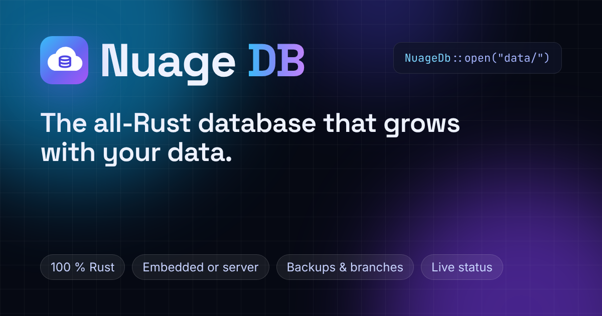

<div align="center">

[](https://github.com/maxlestage/Nuage)

# Nuage DB

**Memoire's own database, in pure Rust. Embedded in your application or as a server, with the same code.**

[](https://github.com/maxlestage/Nuage/actions/workflows/ci.yml)
[](#license)
[](https://heroku.com/deploy?template=https://github.com/maxlestage/Nuage)

**English** · [Français](README.fr.md) · [Español](README.es.md)

</div>

---

Nuage DB keeps your tables on disk behind a write-ahead log, makes instant copy-on-write
branches of a database, backs itself up to a second location and restores itself from there
at boot, and serves everything over HTTP(S) with a management console and a live dashboard.
It is the database of [Memoire](https://github.com/maxlestage/Memoire), the Rust ORM: the
same models and queries run on it embedded during development and tests, and on a Nuage DB
server in production, without changing a line.

## Features

| | |
|---|---|
| **Encrypted at rest** | Everything stored is encrypted (`NUAGE_ENCRYPTION_KEY`): the pages with XTS-AES-256, each log record with AES-256-GCM, and the backups, which are copies of them. Keys derived per application (HKDF, or Argon2id from a passphrase). |
| **Several applications** | One server, one database per application: its own tokens, its own keys, its own backups. The token an application sends picks its database. The console and `/app` show them side by side. |
| **Pages on disk** | Tables and indexes in one file of B-tree pages written by Nuage DB itself (copy-on-write, a checksum on each node), with a bounded page cache (`NUAGE_CACHE_MB`): the data is not limited by memory. Primary-key and index lookups read only the rows they need. |
| **Write-ahead log** | Each commit is appended to the log and synced to disk before it returns or is shown to a reader; commits made at the same time share one sync. Checkpoints, crash recovery, CRC-32 on log records and checksums on pages. |
| **Memoire semantics** | Statements run on Memoire's own evaluator over the rows read from disk: Nuage DB behaves exactly like Memoire's in-memory engine, on data of any size. |
| **Transactions** | Snapshot reads, optimistic commits (`Error::Conflict`, retried by `db.transaction(...)`), interactive transactions over HTTP, all-or-nothing batches. |
| **Branches** | A full copy of the database for a preview, a test or an experiment, made in an instant: it shares its parent's pages and stores only its own changes. |
| **Backups, restored at boot** | Snapshots plus log segments, to a folder or to S3-compatible storage. An empty data directory is restored automatically at startup, which makes hosts with an ephemeral disk work. |
| **Key-value store** | Each application has a store in memory: values with an expiry, counters, locks, a cache, over HTTP (`/v1/kv`) and on a port of its own ([Key-value store](#key-value-store)). |
| **Files** | Each application keeps files of any size (map tiles, photos, archives) in an S3-compatible bucket such as Cloudflare R2: the server lists them and signs the links, the bytes go straight between the client and the bucket ([Files](#files)). |
| **Server** | One binary, configured by environment variables: the database protocol (`/v1`), the live status (`/api/status`, `/api/status/stream`), the console (`/admin`) and the website with its live dashboard (`/app`), on one port. |
| **WebAssembly client** | `memoire_orm::NuageDb` speaks HTTP(S): natively with Tokio, and in the browser through `fetch`. |
| **Upkeep on its own** | A background thread runs the checkpoints, ships the backups and compacts the file. |

## Two modes, one API

Nuage DB is used through [Memoire](https://github.com/maxlestage/Memoire)'s API: models,
the query builder, relations, transactions and migrations.

```toml
[dependencies]
# The engine, embedded mode and the server, without the website.
nuage = { git = "https://github.com/maxlestage/Nuage", default-features = false, features = ["server"] }
# The same Memoire as Nuage DB (the `nuage` feature is the client of a server).
memoire-orm = { git = "https://github.com/maxlestage/Memoire", rev = "8f7e0cb", features = ["nuage"] }
tokio = { version = "1", features = ["macros", "rt-multi-thread"] }
```

| Cargo feature | What it adds | Default |
|---|---|---|
| *(none)* | the embedded engine (`nuage::Embedded`), SQL, encryption, backups to a folder: **pure Rust**, no network stack, no C or assembly (RustCrypto) | always |
| `s3` | backups to S3-compatible storage (HTTP/1.1 over rustls) | yes |
| `server` | the server (`/v1`, PostgreSQL protocol, console, live status), `nuage::Db::Remote` and the `nuage` binary; implies `s3` | yes |
| `site` | the website and the `/app` dashboard, served by the binary; implies `server` | yes |
| `import-redb` | reads the page store of Nuage DB up to 0.4 (`nuage.redb`) once, to bring a data directory or a backup of those versions to this one (see [Coming from 0.4](#coming-from-04)); the only use of redb | yes |

`default-features = false` is the embedded engine alone; add `features = ["s3"]` for
S3 backups (the configuration of an embedded database with them:
`nuage::config::engine_from_vars`).

### Embedded: a directory on disk

```rust
use memoire_orm::prelude::*;
use nuage::Embedded;

#[derive(Model, Debug, Clone)]
#[memoire(table = "notes")]
pub struct Note {
    #[memoire(primary_key, auto_increment)]
    pub id: i64,
    pub text: String,
}

#[tokio::main]
async fn main() -> memoire_orm::Result<()> {
    let db = Embedded::open("data")?; // created if missing
    db.create_table_if_not_exists::<Note>().await?;
    Note { id: 0, text: "hello".into() }.insert(&db).await?;
    println!("{:?}", Note::query().all(&db).await?);
    Ok(())
}
```

### Server: the same code over HTTP(S)

```rust
let db = NuageDb::connect("https://my-nuage.herokuapp.com", token).await?;
Note::query().filter(Note::TEXT.contains("hello")).all(&db).await?;
```

### One setting for both

```rust
// NUAGE_URL=data                                    -> embedded, in ./data
// NUAGE_URL=https://db.example.com NUAGE_TOKEN=...  -> a server
let db = nuage::Db::from_env().await?;
```

### Branches

```rust
db.create_branch("preview-42", None).await?;         // instant, whatever the size
let preview = db.on_branch("preview-42");
Note { id: 0, text: "only in the preview".into() }.insert(&preview).await?;
db.reset_branch("preview-42").await?;                // forget its changes
db.delete_branch("preview-42").await?;
```

## Encryption

Nuage DB encrypts everything it stores (AES-256, HKDF-SHA256, Argon2id):

| What | How |
|---|---|
| pages (`nuage.db`: tables, indexes, branches, the list of applications) | XTS-AES-256 (IEEE 1619), the mode of disk encryption: pages keep their place and size |
| write-ahead log (`wal/*.log`) | AES-256-GCM per record, under a key of its own for each segment (random salt), the LSN as nonce |
| backups (folder or S3) | copies of the files above, encrypted the same way, with the directory's header |

`NUAGE_ENCRYPTION_KEY` is a key (`openssl rand -hex 32`) or a passphrase. Each data directory
has a header, `encryption.json`, with a random salt and a check value (never the key): its
root key is HKDF(key, salt), or Argon2id(passphrase, salt) (64 MiB, 3 passes), and the keys
of the pages, of the log and the check value derive from it. Each application has its own
directory, hence its own salt and keys. A wrong key is refused at startup, before anything is
read. A database or a backup stored in clear by an earlier version is encrypted when it is
opened with a key, and the backup in clear is replaced. **Keep the key**: without it, neither
the data nor the backups can be read. The embedded mode encrypts too, with
`EngineOptions { encryption: Some(Encryption::parse(key)?), .. }` or `NUAGE_ENCRYPTION_KEY`
with `nuage::Db::from_env()`.

### Coming from 0.4

Up to 0.4 the pages were a [redb](https://docs.rs/redb) file, `nuage.redb`. Since then they
are Nuage DB's own (`nuage.db`). Nothing to do: a data directory of an earlier version, or a
backup of one restored into an empty directory, is imported the first time this version opens
it, encrypted as it was, and the log written since its last checkpoint is replayed over it.
Before the new file takes its place it is read back and compared with the old one, entry by
entry: anything that differs stops the opening and leaves the old file as it was. The server
writes what each application holds (tables, rows) and what was imported in its startup log.
The old file stays beside the new one as `nuage.redb.imported`: delete it once you have
checked your data. When backups are configured, a snapshot of this version follows in a
moment, so the next restore no longer goes through the import; before it, the backup of the
earlier version (its manifest, snapshot, log segments and encryption header) is copied
under `before-import/` in the backup location, where nothing prunes it: the server's own
database at `before-import/`, each application at `before-import/apps/<name>/`, the shape
of the backup location itself. Going back is starting the earlier version on an empty data
directory with `before-import` as its backup location (`NUAGE_BACKUP_S3_PREFIX` or
`NUAGE_BACKUP_DIR` with `before-import/` added): it finds every application there. This
version restores from there too. Delete it once you have checked your data.

Reading the old file is the `import-redb` Cargo feature, on by default: the server has it.
An application that embeds the engine (`default-features = false`, with or without `s3`)
contains no redb at all and refuses such a directory with a message that says so; if it has
data or backups of those versions, it adds `features = ["import-redb"]`.
Once every database has been opened by this version, the feature can go.

## Several applications

One server holds several applications, each with a database of its own:

- the **first application** is the server's own database (`NUAGE_NAME`, data at the root of
  `NUAGE_DATA_DIR`, token `NUAGE_TOKEN`): an existing deployment keeps its data as is;
- the **others** are made in the console (`/admin`, **New application**), or with one
  request to the management API (`nuage apps create`, see below): a database in
  `apps/<name>/`, encrypted under keys of its own, backed up under `apps/<name>/`, and a first
  token, shown once (the server keeps only its SHA-256 digest);
- the **token** an application sends picks its database: `NuageDb::connect(url, token)` does
  not change, and an application never sees another's data, nor its transactions;
- their list lives in the first application's metadata: logged, encrypted, backed up and
  restored with it, then each application restores its own backup.

`Server::create_app`, `new_app_token`, `revoke_app_token`, `delete_app` and `apps` do the
same from Rust.

### Create an application in one command

The management API, `/api/apps`, makes applications and their tokens with one HTTP
request: from a script, a CI job, a deploy step, without the console's form. It opens with
a token of its own, `NUAGE_ADMIN_TOKEN`.

1. **Turn it on** once, on the server: `NUAGE_ADMIN_TOKEN=$(nuage genkey)` (32 characters at
   least; a shorter one stops the server at startup, with why). The installers set one
   already. On Heroku: the server's app → **Settings** → **Config Vars**. The startup log says
   `the management API (/api/apps) is on`.
2. **Create an application**. On the server's computer, nothing else is needed: `nuage`
   reads the token and the port in the installer's settings file (hence `sudo`; on Windows,
   a PowerShell as administrator), and shows `SITE_URL` as the address when the file has it:

   ```bash
   sudo nuage apps create shop "The shop"
   # NUAGE_URL=http://127.0.0.1:8080
   # NUAGE_TOKEN=nuage_3f9a12c0…
   ```

   From anywhere else, give it the server and its management token:

   ```bash
   export NUAGE_URL=https://my-nuage.herokuapp.com NUAGE_ADMIN_TOKEN=…
   nuage apps create shop "The shop"
   # NUAGE_URL=https://my-nuage.herokuapp.com
   # NUAGE_TOKEN=nuage_3f9a12c0…
   nuage apps list
   # nuage   1 token(s)
   # shop    1 token(s)   The shop
   ```

   or with any HTTP client:

   ```bash
   curl https://my-nuage.herokuapp.com/api/apps \
     -H "Authorization: Bearer $NUAGE_ADMIN_TOKEN" \
     -d '{"name": "shop", "description": "The shop"}'
   ```

   ```json
   {
     "application": { "name": "shop", "description": "The shop", "first": false, "created_at": 1794690000000,
                      "tokens": [{ "id": "3f9a12c0", "created_at": 1794690000000, "read_only": false }],
                      "env_token": false, "origins": [] },
     "token": "nuage_3f9a12c0…",
     "env": { "NUAGE_URL": "https://my-nuage.herokuapp.com", "NUAGE_TOKEN": "nuage_3f9a12c0…" },
     "message": "Application `shop` created, with its own encrypted database. Copy its token now: it is not shown again."
   }
   ```

3. **Connect the application**: set the two lines of `env` in its configuration (on Heroku,
   its Config Vars). It connects, and makes its tables at its first start.

From Rust, `memoire_orm::NuageAdmin` (Memoire's `nuage` feature) does the same:
`NuageAdmin::new(url, admin_token)?.create_app("shop", "The shop").await?` gives the token and
`env()`, the two lines. In a [Paquets](https://github.com/maxlestage/Paquets) project,
`paquets nuage create shop` makes the application and writes the two lines in `.env`.

| Method | Path | Body | Answer |
|---|---|---|---|
| `GET` | `/api/apps` | | `200 {"applications": [...]}`, the first one first, then by name |
| `POST` | `/api/apps` | `{"name": "shop", "description": "…"}` (description optional) | `201` the application, its `token` and `env`; `409` the name is taken; `400` an invalid name (1 to 63 of `a-z 0-9 - _`) |
| `GET` | `/api/apps/{name}` | | `200` the application; `404` |
| `POST` | `/api/apps/{name}/tokens` | `{"read_only": true}` (optional, `false` by default) | `201 {"application", "token", "read_only", "env"}` |
| `DELETE` | `/api/apps/{name}/tokens/{id}` | | `200 {"revoked": true}`; `404` no such token |
| `POST` | `/api/apps/{name}/origins` | `{"origins": ["https://site.fr", "http://localhost:3000"]}`, the whole list; `[]` removes them | `200` the application, with its `origins`; `400` not an origin (scheme and host, no path, or `*`) |
| `GET` | `/api/status` | | `200` the live status of every application, as a console session sees it |

A refusal is JSON, `{"error": {"kind", "message"}}`, with a message that says what to do:
`401` without the management token or with a wrong one, `403` when `NUAGE_ADMIN_TOKEN` is
not set, `400`, `404`, `405`, `409`. The whole description is in
[`/v1/openapi.json`](crates/nuage/openapi.json).

What protects it:

- **A secret of its own**, not the console's password (a password is typed, so guessable) and
  not an application's token: a token opens its own database and nothing else, the first
  application's `NUAGE_TOKEN` included. It is compared in constant time.
- **A token is shown once**, in the answer that makes it: the server keeps only its SHA-256
  digest, and the list shows tokens by their id (their first characters).
- **No deletion**: deleting an application deletes its data and its backups, so it stays in
  the console, behind its name typed again.
- Keep `NUAGE_ADMIN_TOKEN` with the server's other secrets, never in an application or a
  page. To change it, set a new value: the old one stops working at the next start.

## SQL

Nuage DB speaks SQL (`POST /v1/sql`, the console's **Query** tab, `Embedded::sql` in Rust):

| | |
|---|---|
| **Reading** | `SELECT [DISTINCT]`, `JOIN`, `LEFT JOIN`, `CROSS JOIN` (`ON`, `USING`), `WHERE`, `GROUP BY`, `HAVING`, `ORDER BY ... NULLS FIRST/LAST`, `LIMIT`/`OFFSET`, `UNION [ALL]`, `INTERSECT`, `EXCEPT`, subqueries (`IN`, `EXISTS`, scalar, correlated, in `FROM`) |
| **Expressions** | `CASE`, `CAST` and `::`, `\|\|`, `+ - * / %`, `LIKE`, `ILIKE`, `BETWEEN`, `IN`, `IS [NOT] NULL`, `IS [NOT] DISTINCT FROM` |
| **Functions** | `count`, `sum`, `avg`, `min`, `max`, `total`, `group_concat`/`string_agg`, `array_agg` (with `DISTINCT`); `lower`, `upper`, `length`, `trim`, `substr`, `replace`, `instr`, `lpad`, `concat`, `coalesce`, `nullif`, `iif`, `greatest`, `least`, `abs`, `round`, `floor`, `ceil`, `power`, `sqrt`, `random`, `now`, `current_date`, `date`, `extract`, `strftime`, `json_extract`, `json_object`, `json_array`, `gen_random_uuid`... |
| **Writing** | `INSERT ... VALUES / SELECT / DEFAULT VALUES`, `ON CONFLICT ... DO NOTHING / DO UPDATE SET ... excluded.x`, `INSERT OR IGNORE`, `REPLACE INTO`, `ON DUPLICATE KEY UPDATE`, `UPDATE ... SET col = <expression>`, `DELETE`, `RETURNING` |
| **Schema** | `CREATE TABLE [IF NOT EXISTS]` (types of PostgreSQL, MySQL and SQLite; `PRIMARY KEY`, `SERIAL`/`AUTOINCREMENT`, `NOT NULL`, `UNIQUE`, `DEFAULT`, `REFERENCES`, `UNIQUE (a, b)`), `CREATE TABLE ... AS SELECT`, `CREATE [UNIQUE] INDEX` (built from the rows there), `DROP INDEX`, `ALTER TABLE ... ADD COLUMN`, `DROP TABLE`, `EXPLAIN` |

A query Memoire's statements can express runs as one of them, through the indexes and stopping
at the end of the page; the rest (functions, `CASE`, subqueries, `UNION`) is computed by the
SQL layer on the rows the indexes found, with hash joins. Not there: `RIGHT`/`FULL` joins,
`WITH`, window functions, views, triggers, a primary key of several columns, changing a primary
key. A table created without a primary key gets a `rowid` column.

## Any language

Nuage DB speaks SQL over HTTP (`POST /v1/sql`, JSON in, JSON out): every language uses it,
with nothing to install. [`clients/`](clients) has a complete example, tested against a real
server in CI, for curl, JavaScript, TypeScript, Python, PHP, Go, Ruby, Java, Kotlin, C#, Swift, Dart
(Flutter), Elixir, Rust, C and Perl;
the console shows the same request in each language with the server's address. Every server
describes its API at `/v1/openapi.json` (OpenAPI 3.1) to generate a client for any other
language. Rust also has the native client, `NuageDb`. And
every PostgreSQL driver connects too: see below.

**Does my connection work?** `GET /v1/ping` answers which application the token opens:
`curl https://db.example.com/v1/ping -H "Authorization: Bearer <token>"` gives
`Connected to Nuage DB 0.4.6: application blog, read and write, branch main, 3 table(s).`,
and without a token, or with one that opens nothing, it says what is wrong. From any machine:
`nuage check <url> <token>`. A PostgreSQL connection gets the same line as a notice (psql
prints it), and each application's page in the console shows its last connection (when, how,
which client), or that it is waiting for a first one.

## PostgreSQL protocol

Nuage DB also speaks PostgreSQL's protocol (`NUAGE_PG_PORT=5432`; the installer and Docker
turn it on): **every language's PostgreSQL driver, ORM and tool connects as is**, with any
user name and **a token of an application as the password**; the database name picks a branch
(the application's name, or `main`: the main one).

```bash
PGPASSWORD=<token> psql "host=db.example.com port=5432 user=app dbname=nuage sslmode=require"
# postgresql://app:<token>@db.example.com:5432/nuage?sslmode=require
```

Tested in CI with psql, psycopg 2 and 3, SQLAlchemy, node-postgres, Postgres.js, pgx, Go's
database/sql, JDBC, PDO, the pg gem, tokio-postgres and Npgsql: examples in
[`clients/postgres/`](clients/postgres). Prepared statements, `$1` parameters (their types
come from the columns they meet), text and binary values, `BEGIN` ... `COMMIT` across
messages, savepoints, PostgreSQL's error codes (`40001` on a write conflict: run the
transaction again). `SELECT ... FOR UPDATE` (`SKIP LOCKED`, `NOWAIT`, `FOR SHARE`) and the advisory locks (`pg_advisory_xact_lock`, `hashtextextended`) are accepted: a transaction already fails at its commit (`40001`) if another one changed a table it read. `x IN (SELECT jsonb_array_elements_text($1::jsonb)::bigint)` takes a list as one JSON parameter. TLS with `NUAGE_TLS_CERT` and `NUAGE_TLS_KEY` (the installer uses the
domain's certificate). The SQL is Nuage DB's (above); the system catalogs (`pg_catalog`) are
not there, so tools that browse them (pgAdmin) show little, and Npgsql takes
`Server Compatibility Mode=NoTypeLoading`. Heroku routes only HTTP: there, use `/v1/sql`.

## Websites

Any website can use an application's database, from its server or from its pages:

- **`POST /v1/sql`**, from any language: full SQL with `?` (or `$1`) parameters, values
  never parsed as SQL (no injection). Rows come back as JSON objects (`"arrays": true` for
  arrays), an insert gives its `last_insert_id`. Several statements (separated by `;`, or
  `"statements": [...]`) run in one transaction, all or nothing.
- **From the browser**: list the website in the console (**Settings → Websites**:
  `https://site.fr`, `http://localhost:3000`, or `*`), or with `POST /api/apps/{name}/origins`
  and the management token, and its pages may call `/v1` (CORS).
  The browser's preflight is cached for a day, so it costs one round trip, once.
- **Read-only tokens** (**Tokens → New read-only token**): a token in a page is public, so
  pages get one that reads and never writes; keep read-and-write tokens on servers.

```js
const res = await fetch("https://my-nuage.herokuapp.com/v1/sql", {
  method: "POST",
  headers: { "Authorization": "Bearer " + READ_ONLY_TOKEN, "Content-Type": "application/json" },
  body: JSON.stringify({ sql: "SELECT id, title FROM posts WHERE category = ? ORDER BY id DESC LIMIT 20", params: [3] }),
});
const { rows } = await res.json(); // [{ "id": 42, "title": "…" }, …]
```

```bash
curl https://my-nuage.herokuapp.com/v1/sql -H "Authorization: Bearer $NUAGE_TOKEN" \
  -d '{"sql": "INSERT INTO messages (name, text) VALUES (?, ?)", "params": ["Ada", "Hello"]}'
```

Speed, measured on the server's machine (`cargo run --release -p nuage --example bench`,
encrypted data, 20 000 rows, 4 cores): a row by key or by a unique column in **0.1 ms**,
a page of 20 rows through an index in **0.2 ms**, a durable update (fsync) in **0.5 ms**,
**85 000+ reads/s** with 32 clients (140 000+ on the key-value store). JSON answers of 1 KiB or more are gzip-compressed for clients that accept
it. What a visitor feels is mostly the network: pick the host's region closest to them, and a
dyno that never sleeps (Heroku **Basic**, not Eco, whose first request after a pause takes
seconds).

## Key-value store

Next to its database, each application has a **key-value store in memory**: a cache in front of anything slow, sessions, counters, rate limits, locks. Nothing
touches the disk: a read or a write costs one round trip, and the server answers more than
140 000 of them a second on 4 cores. A restart empties it; what must survive goes in the
database. Memory is bounded for each application (`NUAGE_KV_MB`): past the limit, the keys that
expired go first, then the least recently used ones.

**Over HTTP**, from any language, with a token of the application (a read-only token reads):

| Request | What |
|---|---|
| `GET /v1/kv/<key>` | the value, as it was written (`404` when there is none); the header `nuage-ttl-ms` says how long it still lives |
| `PUT /v1/kv/<key>` (`?ttl=60`, `&nx`, `&xx`, `&keepttl`) | writes the body under the key: `{"set": true}`; `nx` writes only a key that does not exist (a lock) |
| `DELETE /v1/kv/<key>` | deletes it: `{"deleted": 1}` |
| `POST /v1/kv/<key>?incr` (`=5`, `&ttl=60`) | adds to a counter: `{"value": 6}`; `ttl` is the expiry of a counter this call creates (a rate limit in one request) |
| `POST /v1/kv/<key>?expire=60`, `?persist` | changes its expiry |
| `GET /v1/kv` (`?prefix=`, `&limit=`) | the keys (size, time left) and the figures of the store |
| `POST /v1/kv` | commands as JSON: `["SET", "k", "v", "EX", 60]` answers `{"result": "OK"}`; a list of commands answers `{"results": [...]}` in one round trip |
| `DELETE /v1/kv` | deletes every key |

```bash
curl -X PUT "https://my-nuage.herokuapp.com/v1/kv/session:42?ttl=1800" -H "Authorization: Bearer $NUAGE_TOKEN" -d 'ada'
curl "https://my-nuage.herokuapp.com/v1/kv/session:42" -H "Authorization: Bearer $NUAGE_TOKEN"        # ada
curl -X POST "https://my-nuage.herokuapp.com/v1/kv/hits?incr&ttl=60" -H "Authorization: Bearer $NUAGE_TOKEN"   # {"value":1}
curl https://my-nuage.herokuapp.com/v1/kv -H "Authorization: Bearer $NUAGE_TOKEN" -d '[["GET","session:42"],["TTL","session:42"]]'
```

**On a port of its own**: set `NUAGE_KV_PORT=6379` and the store also answers on a socket that
stays open, a token of the application as the password. Its wire is RESP (2 and 3), the one
Redis clients speak, so there is no client to write: `redis-cli`, redis-py, node-redis,
go-redis, Jedis... connect as they are:

```bash
redis-cli -u redis://default:<token>@db.example.com:6379 SET greeting hello EX 60
```

Strings and counters: `GET`, `SET` (`EX`, `PX`, `NX`, `XX`, `KEEPTTL`, `GET`), `SETNX`, `SETEX`,
`GETSET`, `GETDEL`, `GETEX`, `MGET`, `MSET`, `APPEND`, `STRLEN`, `INCR`, `DECR`, `INCRBY`,
`DECRBY`, `DEL`, `EXISTS`, `EXPIRE`, `PEXPIRE`, `TTL`, `PTTL`, `PERSIST`, `TYPE`, `KEYS`, `SCAN`,
`DBSIZE`, `FLUSHDB`, `INFO`, `PING`, and `MULTI` ... `EXEC` (the commands run as one). Lists,
hashes, sets and pub/sub are not there. With `NUAGE_TLS_CERT` and `NUAGE_TLS_KEY`, the same port
also answers TLS. Heroku routes only HTTP: there, use `/v1/kv`.

**From Rust**, Memoire's `NuageKv` (`db.kv()`): `get`, `set_for`, `incr_by`, `set_if_absent`,
and `remember(key, ttl, || compute())`, a cache in one call. Embedded, `nuage::kv::Kv` is the
store itself.

## Files

Next to its database, an application can keep **files** (map tiles, photos, archives of
several gigabytes) in an S3-compatible bucket: Cloudflare R2, AWS S3, MinIO, Scaleway...
The server keeps the list and signs the links; **the bytes go straight between the client and
the bucket**, never through the server: a small server (a Heroku dyno) hands out terabytes.
Each application has its own folder, `<prefix><application>/`: its token sees its files only.

| Request | What | Token |
|---|---|---|
| `GET /v1/files` (`?prefix=regions/`) | the files: `{"files": [{"name", "size", "updated", "etag"}], "count", "bytes"}` | read-only or read-write |
| `GET /v1/files/<name>` | `307` to a signed download link (`Range` works: a download resumes where it stopped); `?link`: the link as JSON, `{"url", "expires_at"}`; `?download=<file name>`: saved under that name | read-only or read-write |
| `POST /v1/files/<name>` | a signed upload link, `{"method": "PUT", "url", "expires_at"}`: `PUT` the bytes to it (5 GB at most each) | read-write |
| `DELETE /v1/files/<name>` | deletes the file | read-write |

A name is letters, digits, `.`, `_` and `-`, in parts separated by `/` (`regions/fr.tar`). A
link works an hour (`NUAGE_FILES_LINK_MINUTES`, 7 days at most); ask for a new one after.
The bucket refuses a link that comes with an `Authorization` header: curl and browsers drop it
when they follow the redirect; a client that keeps it (some HTTP libraries) takes `?link`, then
downloads the `url` without the token.

```bash
# Upload: a link, then the bytes to the bucket
url=$(curl -s -X POST https://my-nuage.herokuapp.com/v1/files/regions/fr.tar \
  -H "Authorization: Bearer $NUAGE_TOKEN" | jq -r .url)
curl -T fr.tar "$url"
# Download, resumable (-C -), with a read-only token
curl -L -C - -o fr.tar https://my-nuage.herokuapp.com/v1/files/regions/fr.tar -H "Authorization: Bearer $READ_TOKEN"
```

On Cloudflare R2 (no fee for the bytes downloaded): **R2 → Create bucket**, then **Manage API
tokens → Create API token**, *Object Read & Write* on that bucket. Set on the server:

```bash
heroku config:set NUAGE_FILES_S3_BUCKET=my-files \
  NUAGE_FILES_S3_ENDPOINT=https://<account id>.r2.cloudflarestorage.com \
  NUAGE_FILES_S3_ACCESS_KEY_ID=... NUAGE_FILES_S3_SECRET_ACCESS_KEY=...
```

## Install on any computer

Nuage DB runs on any computer: a Linux server, a Raspberry Pi, a Mac, a Windows PC, next to
(or instead of) a server on a host like Heroku. One command installs it as a service started
with the computer, and asks where the backups go.

| | One command | Service |
|---|---|---|
| **Linux** (Debian, Ubuntu, Fedora, Rocky, Alpine, Raspberry Pi OS..., x86_64 or ARM64, from 512 MiB) | `curl -fsSL https://raw.githubusercontent.com/maxlestage/Nuage/master/install.sh \| sudo bash` | systemd `nuage` |
| **macOS** (Apple silicon or Intel), in Terminal | `curl -fsSL https://raw.githubusercontent.com/maxlestage/Nuage/master/install.sh \| sudo bash` | launchd, as your user |
| **Windows** 10, 11, Server, in PowerShell **as administrator** | `irm https://raw.githubusercontent.com/maxlestage/Nuage/master/install.ps1 \| iex` | scheduled task `Nuage DB`, as SYSTEM |
| **cargo**, anywhere Rust runs | `cargo install --locked --git https://github.com/maxlestage/Nuage nuage` (see [With cargo](#with-cargo)) | none: hand it to the installer |
| **Docker**, anywhere | `docker compose up -d` in this repository (settings in `.env`) | the container |

Each one installs the `nuage` binary (a static build: no dependency), generates the settings
file with a key, a token, a console password and a management token, makes the data folder,
sets up the backups, starts the service and checks that it answers. It prints the address,
the token and the password once: **copy the settings file somewhere safe, away from this
computer**: nobody can read the data, nor its backups, without its key.

| | Linux | macOS | Windows |
|---|---|---|---|
| settings | `/etc/nuage/nuage.env` | `/usr/local/etc/nuage/nuage.env` | `C:\ProgramData\Nuage\nuage.env` |
| data | `/var/lib/nuage` | `/usr/local/var/nuage` | `C:\ProgramData\Nuage\data` |
| logs | `journalctl -u nuage -f` | `tail -f /usr/local/var/log/nuage.log` | `Get-Content -Wait C:\ProgramData\Nuage\nuage.log` |

On Linux it also **creates swap** when the server has none (the size of the memory, 1 to 4
GiB; `vm.swappiness=10`, so the memory goes to the database) and a `nuage` system user. On
macOS the service runs as the person who ran `sudo`; on Windows, as SYSTEM, readable by
administrators only, with a firewall rule for the local network.

- **HTTPS** (Linux): point a domain name to the server, then
  `curl -fsSL .../install.sh | sudo NUAGE_DOMAIN=db.example.com bash` (Caddy, with a free
  certificate; Nuage DB then listens on `127.0.0.1` only). Without HTTPS the console works,
  but warns that the password travels in clear.
- **Upgrade**: run the command again; data, key, settings and backups stay.
- **Options**: `NUAGE_PORT`, `NUAGE_PG_PORT` (`0`: off), `NUAGE_SWAP_MB` (`0`: no swap),
  `NUAGE_VERSION=v0.4.6`, `NUAGE_BINARY=/path/to/nuage`, `NUAGE_FROM_SOURCE=1` (build with
  cargo). On Windows, set them first: `$env:NUAGE_PORT = '9090'; irm ... | iex`.
- **Remove**: `... | sudo bash -s uninstall` keeps the data, the settings and the backups;
  `... | sudo bash -s purge` removes the data and the settings, never the backups. On Windows:
  `$env:NUAGE_ACTION = 'uninstall'` (or `'purge'`), then the same command.
- **Memory**: Nuage DB uses the memory of the server it is on, whatever its size, and no
  more. The data stays on disk; the memory goes to the page caches, which share one budget
  (`NUAGE_CACHE_MB=auto`) that follows the memory: a quarter of it at first, more while there
  is room and the caches are full (up to six tenths), less when memory gets tight. Each
  application has what it holds plus an equal part of what is free, so the budget goes to the
  applications that use it. Past 85 % in use, the caches are emptied, their budget halved and
  the freed memory returned to the system, while requests go on. The console's *Server* page
  and the dashboard's **Memory** card show the memory this server may use (its container's
  limit, where it has one: on a shared host, not the memory of the whole machine), what is
  used and what is left, in gigabytes.
- **By hand**: binaries for Linux, macOS and Windows are on the
  [releases page](https://github.com/maxlestage/Nuage/releases); `nuage --env-file nuage.env`
  starts the server with the settings of a file (`KEY=value` lines; the environment wins).

### With cargo

With Rust installed ([rustup.rs](https://rustup.rs)), on Linux, macOS or Windows:

```bash
cargo install --locked --git https://github.com/maxlestage/Nuage nuage
nuage --version
```

The `nuage` binary lands in `~/.cargo/bin` (`%USERPROFILE%\.cargo\bin` on Windows), with the
website and the live dashboard. A lighter server, without them (`/` is then a small home page;
the console, the API and everything else stay):
`cargo install --locked --git https://github.com/maxlestage/Nuage nuage --no-default-features --features server`.
A release: `--tag v0.4.6`. Upgrade: the same command, with `--force`.

`cargo install` only puts the binary there: no service, no settings, no backups. Hand it to
the installer, which does the rest (settings, backups, service started with the computer):

```bash
# Linux, macOS: `command -v nuage` finds it before sudo, whose PATH has no ~/.cargo/bin
curl -fsSL https://raw.githubusercontent.com/maxlestage/Nuage/master/install.sh | sudo NUAGE_BINARY="$(command -v nuage)" bash
```

```powershell
# Windows, PowerShell as administrator
$env:NUAGE_BINARY = (Get-Command nuage).Source; irm https://raw.githubusercontent.com/maxlestage/Nuage/master/install.ps1 | iex
```

Or start it yourself, with a settings file: `nuage genkey` makes the key,
`nuage --env-file nuage.env` starts the server (see [`nuage.env.example`](nuage.env.example)).
On Linux and macOS, `NUAGE_FROM_SOURCE=1` makes the installer itself build with cargo.

### Backups: you choose where

The data folder is only one copy. With a backup, Nuage DB sends a **snapshot** of each
database (every hour, `NUAGE_BACKUP_SNAPSHOT_MINUTES`) and the **write-ahead log** since then
(at every checkpoint, every 30 seconds), all encrypted with the key; and when it starts with
an **empty data folder** (a new disk, a new computer), it **restores itself** from the backup
before it serves. The installer asks where they go; or say it in the command:

| Where | Command (Linux, macOS) | Windows |
|---|---|---|
| a folder on **another disk**: an external disk, a NAS | `curl ... \| sudo NUAGE_BACKUP_DIR=/Volumes/MyDisk/nuage bash` | `$env:NUAGE_BACKUP_DIR = 'E:\Nuage'; irm ... \| iex` |
| **S3-compatible storage**: AWS S3, Cloudflare R2, Scaleway, Backblaze B2, MinIO | `NUAGE_BACKUP_S3_BUCKET=… NUAGE_BACKUP_S3_REGION=… NUAGE_BACKUP_S3_ENDPOINT=… NUAGE_BACKUP_S3_ACCESS_KEY_ID=… NUAGE_BACKUP_S3_SECRET_ACCESS_KEY=…` | the same, with `$env:` |
| none (not recommended) | `NUAGE_BACKUP=none` | `$env:NUAGE_BACKUP = 'none'` |

- **Another disk, or off-site.** A backup on the disk of the data dies with it: the installer
  and the server warn when the backup folder is on the same disk. A copy at home does not
  survive a fire or a theft: S3-compatible storage does (R2 and B2 cost little for this
  size). The settings file's key must be kept away from the backups' bucket too.
- **An external disk that is not plugged in**: the installer makes only the last folder of
  `NUAGE_BACKUP_DIR` (`/Volumes/MyDisk` must exist), and the server warns at startup when the
  folder turns out to be on the computer's own disk. On macOS, if the backups to an external
  disk fail (in the log), add `/usr/local/bin/nuage` in System Settings → Privacy & Security
  → Full Disk Access. On Windows, a NAS share (`\\nas\backup\nuage`) must let the computer's
  account (`COMPUTER$`) write.
- **Change** where they go: run the installer again with the new option; it replaces the old
  one in the settings file and restarts the service. Without an option, it keeps them.
- **Check**: the console's *Storage* page, and `/app`, show the last backup and its errors.
- **Restore** on a new computer: install, put the old settings file's
  `NUAGE_ENCRYPTION_KEY` and the same backup settings in the new one, empty the data folder
  and restart the service: it restores the last snapshot and replays the log after it.
- **One writer per backup**: two servers must never back up to the same folder or bucket
  prefix (each would overwrite the other's). A computer next to a Heroku server uses a
  folder, bucket or `NUAGE_BACKUP_S3_PREFIX` of its own.

## Quick start

```bash
git clone https://github.com/maxlestage/Nuage && cd Nuage
# The key everything is encrypted with: keep it, the data cannot be read without it.
export NUAGE_ENCRYPTION_KEY=$(openssl rand -hex 32)
NUAGE_TOKEN=dev-token NUAGE_ADMIN_PASSWORD=dev-password cargo run -p nuage --release
# nuage: data is stored in /home/me/Nuage/nuage-data on this server's disk
# nuage: listening on 0.0.0.0:8080
```

Then open:

- http://localhost:8080/ : the website (English, French, Spanish);
- http://localhost:8080/app : the live dashboard (sign in with `NUAGE_ADMIN_PASSWORD`);
- http://localhost:8080/admin : the management console.

Applications connect with `NuageDb::connect("http://localhost:8080", "dev-token")`.

Docker (Compose, with the settings in `.env`, from [`nuage.env.example`](nuage.env.example)):

```bash
cp nuage.env.example .env   # then set NUAGE_ENCRYPTION_KEY, NUAGE_TOKEN, NUAGE_ADMIN_PASSWORD
docker compose up -d
```

## Deploy on Heroku

The root of this repository deploys as is: `Procfile`, `RustConfig` and `heroku-build.sh`
(the `emk/rust` buildpack builds the `nuage` binary with the website), and `app.json` for the
**Deploy to Heroku** button above.

- **One Basic dyno.** A Basic dyno never sleeps. Run exactly one web dyno: two dynos would be
  two separate databases writing to the same backups.
- **The disk is ephemeral.** A dyno's disk is erased at every restart (at least once a day,
  and at each deploy). The data directory is only a working copy: **configure backups**, and
  each boot restores the database from them. On Heroku, use S3-compatible storage
  (`NUAGE_BACKUP_S3_*`); on a host with a persistent disk, a folder is enough
  (`NUAGE_BACKUP_DIR`).
- **Loss window.** Commits since the last shipped log segment (30 seconds by default) are
  lost only if the dyno stops without the `SIGTERM` Heroku sends first: on `SIGTERM` the
  server checkpoints and ships the last segment.

By hand:

```bash
heroku create my-nuage --buildpack emk/rust
heroku config:set NUAGE_ENCRYPTION_KEY=$(openssl rand -hex 32) NUAGE_TOKEN=$(openssl rand -hex 32) \
  NUAGE_ADMIN_PASSWORD='a long passphrase' \
  NUAGE_BACKUP_S3_BUCKET=my-bucket NUAGE_BACKUP_S3_REGION=eu-west-3 \
  NUAGE_BACKUP_S3_ACCESS_KEY_ID=... NUAGE_BACKUP_S3_SECRET_ACCESS_KEY=...
git push heroku master
```

For storage other than AWS, set `NUAGE_BACKUP_S3_ENDPOINT` too. Then open
`https://my-nuage.herokuapp.com/admin`.

## Settings: yours to choose, and to change later

Whoever runs a Nuage DB server, on their own computer or online, chooses how it works and
changes it later, without a restart:

- **the console's Settings page** (`/admin/settings`), in English, French and Spanish;
- **`nuage settings`** in a terminal: `nuage settings` lists them, `nuage settings set
  memory.cache_mb 2G` changes one, `nuage settings unset memory.cache_mb` gives it back;
- **`/api/settings`**, with the management token (`GET`; `POST {"memory.cache_mb": 2048}`;
  `DELETE /api/settings/memory.cache_mb`).

What is saved is **in force at once** and **kept with the data**: encrypted, backed up and
restored with it. It wins over the environment (the settings file, the host's variables),
which wins over the default; each setting says where its value comes from, and one click
gives it back to the environment. With `NUAGE_SETTINGS=environment` the environment is the
only source: what was saved is ignored (the page shows it, and removes it if you ask).

| Setting | What | Starts from |
|---|---|---|
| `memory.total_mb` | the memory Nuage DB may count on: `auto` (the container's limit, else all the memory of the machine: Linux, macOS, Windows), or an amount that leaves the rest to other programs | `NUAGE_MEMORY_MB` |
| `memory.cache_mb` | the page caches of all the applications together: `auto` (it follows the memory) or a maximum | `NUAGE_CACHE_MB` |
| `memory.kv_mb` | the key-value store of each application: `auto` or an amount | `NUAGE_KV_MB` |
| `statement.memory_mb` | what one SQL statement may hold at once (`auto`: an eighth of the memory) | `NUAGE_STATEMENT_MB` |
| `statement.seconds` | how long one statement may run (`0`: no limit) | `NUAGE_STATEMENT_SECONDS` |
| `postgres.connections` | PostgreSQL connections served at once | `NUAGE_PG_MAX_CONNECTIONS` |
| `status.public` | the public status (`true`, `false`) | `NUAGE_PUBLIC_STATUS` |

An amount is written `auto`, `512 MiB` or `2 GiB` (`2G`, `2 Go`, `1.5 GiB`); a number alone is
in MiB.

**Memory: the server's, or by database.** By default a server uses the memory it has: one
budget for the page caches of all its applications, which follows the memory and goes to the
applications that use it. An application (a database) can instead have **an amount of its
own**, set apart from the others: in its Settings tab, in the table *Memory by application*
of the Settings page, with `nuage apps memory shop 2G` (then `auto` to share again), or
`POST /api/apps/shop/memory {"cache_mb": 2048, "kv_mb": "auto"}`. Its cache then holds that
much whatever the others do, and they share the rest. The same goes for its key-value store.

Nuage DB checks what is set by hand before it saves it, and says the figures when it
refuses: the key-value stores within a quarter of the memory, and with the page caches set
by hand within three quarters; a memory said by hand may only lower the one the system
reports. When memory runs short the guard keeps the last word: what is set apart shrinks
with the rest, and comes back.

**What stays in the environment.** What the server reads before it can open its data (the
encryption key, the data directory), what it listens on (ports, addresses, certificates),
what opens it (password, tokens) and where its backups go are read once, when it starts: a
wrong value saved from the console could lock you out. The Settings page lists them (a
secret shows as set, never its value) and says how to change them on this host.

### In a window: Nuage DB Editor

For those who would rather not use a terminal, **Nuage DB Editor** is a program with a window,
in English, French and Spanish (the system's language, or the one you pick), light, dark or as
the system, in the console's colors. It looks after a server through its management API, and
changes nothing by itself: every change is a button you press, and it says what it did.

- **See that it works**: its version, how long it has run, the memory it uses and the
  computer's, its applications and when each last connected, and whether the backups work (the
  last copy, when, where, and in words the error when one failed).
- **Make an application** for a website or a program: say what it is for, its name follows. Its
  two lines (`NUAGE_URL`, `NUAGE_TOKEN`) are shown once, masked until you show them, and copied
  with the clipboard history asked to skip them. **Test the token** calls the server with it from
  this computer; the application's page then says it was tested from the editor, and that your
  site has not connected yet.
- **Connect a web page**: a read-only token, the website to allow (`https://monsite.fr`), and the
  script to paste in the page. A token is revoked after a question.
- **Memory and limits**: in force at once, with no restart; a refusal comes in your language, with
  its figures. What the server read at startup (ports, keys, where backups go) is shown, never
  changed, with where it changes on that host.
- **Tools**: test an application's token from anywhere, and generate a token (as `nuage genkey`).

Deleting an application stays in the console, behind its typed confirmation. A server of 0.4.2
to 0.4.6 opens too, for its applications and tokens; for what it lacks (the settings, the status,
the websites), the editor says that updating the server would show it.

1. **Download it** from the [latest release](https://github.com/maxlestage/Nuage/releases/latest):
   `Nuage-DB-Editor-macOS.dmg` (any Mac with macOS 11 or later, Apple silicon or Intel),
   `Nuage-DB-Editor-windows-x64.exe` (Windows 10 and 11), `nuage-editor-x86_64-linux.tar.gz`
   (a Linux desktop, Ubuntu 20.04, Debian 11 or later). Each has its `.sha256`.
2. **Open it.** It is not signed with a developer certificate, so the first opening asks
   once. macOS: open the `.dmg`, drag *Nuage DB Editor* to Applications, open it; macOS says
   it cannot check it: System Settings, Privacy & Security, **Open Anyway**, then your
   password. Windows: double-click the `.exe` (nothing to install); Edge may say it is not
   commonly downloaded: **Keep**; SmartScreen says it protected your PC: **More info**, then
   **Run anyway**. Linux: unpack, then right-click `nuage-editor`, **Run as a Program** (GNOME
   Files does not start a program on a double-click); `README.txt` puts it in the menu.
3. **Connect.** A server installed on this computer by the installer is found by itself:
   **Open**, with one window of the system's at most. The editor never runs as administrator;
   the system's own tools read four lines of the settings file for it (`PORT`,
   `NUAGE_ADMIN_TOKEN`, `SITE_URL`, `NUAGE_BIND`; never the encryption key): pkexec and grep
   after your password on Linux, osascript and grep on macOS (no password for the account that
   installed), Windows' own cmd.exe and findstr after the UAC window, which names *Windows
   Command Processor*, by Microsoft; the editor says so before the window opens. For a server
   elsewhere, type its address and its management token, `NUAGE_ADMIN_TOKEN`: *Where do I find
   it?* shows where it is on Heroku (the app's Settings, **Reveal Config Vars**), on a server the
   installer set up, and in Docker's `.env`, and makes one when there is none. The connection
   goes step by step (the server, the token, its settings), with **Stop waiting** after 3
   seconds; when a step fails, the editor says which one, why, and what to try. It remembers the
   address; the token only if you tick *Remember on this computer*, and then in your system's
   password store (the macOS Keychain, the Windows Credential Manager, the keyring of a Linux
   desktop), never in a file of its own. It never sends the token after a redirect, and asks
   before sending it in clear (`http://`) to an address on the Internet.

What it changes is saved by the server, as from the console: in force at once, kept with
the data. Settings read when the server starts (the encryption key, ports, passwords,
where backups go) are shown, and the editor says how to change them on that host.
Started with `NUAGE_URL` and `NUAGE_ADMIN_TOKEN` in its environment, it connects at once.
From the sources: `cargo run --profile release-editor -p nuage-editor`.

## Environment variables

| Variable | Meaning | Default |
|---|---|---|
| `PORT` | port to listen on (set by Heroku and most hosts) | `8080` |
| `NUAGE_PG_PORT` | also serve the PostgreSQL protocol on this port (`5432`): every language's PostgreSQL driver, a token as the password | off |
| `NUAGE_PG_BIND` | its address, when the website stays behind a proxy on `127.0.0.1` | `NUAGE_BIND` |
| `NUAGE_TLS_CERT`, `NUAGE_TLS_KEY` | PEM files of a certificate and its key: TLS for the PostgreSQL protocol | none |
| `NUAGE_BIND` | address to listen on (`127.0.0.1`: this machine only, behind a proxy) | `0.0.0.0` |
| `NUAGE_DATA_DIR` | data directory | `nuage-data` |
| `NUAGE_NAME` | name of the first application (and of its database) | `nuage` |
| `NUAGE_ENCRYPTION_KEY` | the key everything is encrypted with: 64 hex digits (`openssl rand -hex 32`, `nuage genkey`), base64 of 32 bytes, or a passphrase of 12 characters or more | **required**: the binary does not start without it |
| `NUAGE_TOKEN` | a token of the first application (named `NUAGE_NAME`); the console makes the other applications and their tokens | none |
| `NUAGE_ADMIN_PASSWORD` | password of the console (and of the dashboard) | none: the console is off |
| `NUAGE_ADMIN_TOKEN` | token of the management API (`/api/apps`, `nuage apps`): creates applications and their tokens; 32 characters at least (`nuage genkey`) | none: the API is off |
| `NUAGE_PUBLIC_STATUS` | `true`: `/api/status` and `/app` show a public subset without signing in | `false` |
| `NUAGE_CACHE_MB` | memory the page caches of all the applications may hold together, in MiB, or `auto` | `auto`: it follows the memory: a quarter of it at first, more while there is room (up to six tenths), less when it gets tight |
| `NUAGE_MEMORY_MB` | the memory to count on, in MiB, for a host that limits it without saying so | the container's limit, else the machine's memory |
| `NUAGE_PG_MAX_CONNECTIONS` | PostgreSQL connections served at once (each has a thread) | `100`, less where the system allows few threads |
| `NUAGE_ENV_FILE` | read the settings from this file too (`KEY=value` lines; `nuage --env-file <file>` does the same); the environment wins over the file | none |
| `NUAGE_SETTINGS` | `environment`: the settings are those of the environment only; what was saved from the console's Settings page, `nuage settings` or `/api/settings` is ignored, and nothing is saved there (see [Settings](#settings-yours-to-choose-and-to-change-later)) | saved settings win over the environment |
| `NUAGE_STATEMENT_MB` | memory one SQL statement may hold at once (the rows it sorts, joins or returns), in MiB, or `auto`; past it the statement fails with a clear error | `auto`: an eighth of the memory (32 MiB to 2 GiB) |
| `NUAGE_STATEMENT_SECONDS` | seconds one statement may run before it is stopped and its changes undone; `0`: no limit | `60` |
| `NUAGE_BACKUP_DIR` | back up to this folder, on another disk (the server warns when it is on the data's disk) | |
| `NUAGE_BACKUP_S3_BUCKET` | back up to this bucket | |
| `NUAGE_BACKUP_S3_ENDPOINT` | endpoint of S3-compatible storage | `https://s3.<region>.amazonaws.com` |
| `NUAGE_BACKUP_S3_REGION` | region | `us-east-1` |
| `NUAGE_BACKUP_S3_PREFIX` | prefix of the backup objects | `nuage/` |
| `NUAGE_BACKUP_S3_ACCESS_KEY_ID`, `NUAGE_BACKUP_S3_SECRET_ACCESS_KEY` | credentials (else `AWS_ACCESS_KEY_ID`, `AWS_SECRET_ACCESS_KEY`) | |
| `NUAGE_BACKUP_SNAPSHOT_MINUTES` | minutes between two snapshots | `60` |
| `NUAGE_KV_PORT` | also serve the key-value store on a port of its own (`6379`), over the wire Redis clients speak: one connects to an application's store, a token as the password | off |
| `NUAGE_KV_BIND` | its address | `NUAGE_BIND` |
| `NUAGE_KV_MB` | memory of each application's key-value store, in MiB, or `auto`; past it, the least recently used keys go | `auto`: a sixteenth of the memory, 4 to 256 MiB |
| `NUAGE_FILES_S3_BUCKET` | keep the applications' files (`/v1/files`) in this S3-compatible bucket (see [Files](#files)) | none: no files |
| `NUAGE_FILES_S3_ENDPOINT` | its endpoint (`https://<account id>.r2.cloudflarestorage.com` on R2) | `https://s3.<region>.amazonaws.com` |
| `NUAGE_FILES_S3_REGION` | its region | `auto` on R2, else `us-east-1` |
| `NUAGE_FILES_S3_PREFIX` | prefix of the objects: an application's files go under `<prefix><application>/` | `files/` |
| `NUAGE_FILES_S3_ACCESS_KEY_ID`, `NUAGE_FILES_S3_SECRET_ACCESS_KEY` | its credentials (else `AWS_ACCESS_KEY_ID`, `AWS_SECRET_ACCESS_KEY`) | |
| `NUAGE_FILES_LINK_MINUTES` | how long a download or upload link works (10080 at most) | `60` |
| `NUAGE_KEEP_AWAKE_URL` | the server requests this address (its own `https://…/api/health`) so a host that puts idle servers to sleep (Heroku Eco) keeps it awake; an awake server only: asleep, the next visitor wakes it | off |
| `NUAGE_KEEP_AWAKE_MINUTES` | minutes between two requests (under Eco's 30) | `20` |
| `NUAGE_KEEP_AWAKE_HOURS` | only in these hours, UTC (`6-22`); outside them it may sleep | always |
| `SITE_URL` | public address of the website (canonical links, share card) | each request's host |

A commented example: [`nuage.env.example`](nuage.env.example). Serve the server over HTTPS
(most hosts do it for you; on your own server, the installer's `NUAGE_DOMAIN`): the token
travels in a header, and the console's cookie is `Secure` over HTTPS.

## `/app` and `/admin`

- **`/app`**, the live dashboard: requests per second, p50/p99 latency, connections,
  services, storage, cache, write-ahead log, backups, one card per application (its requests, latency, data, branches, encryption; chips narrow the cards and the log to one), and a live event
  log. It is a Rust/WebAssembly island that reads `/api/status`, then follows
  `/api/status/stream` (Server-Sent Events, every second). It is private: the **Sign in**
  link goes through `/admin?next=/en/app/` and comes back to the dashboard. With
  `NUAGE_PUBLIC_STATUS=true`, visitors see the public subset. It installs as an app (PWA) and
  shows the last known state offline.
- **`/admin`**, the console (in English, French and Spanish: the browser's language, or the EN · FR · ES links of every page): the applications (cards; create one, its token is shown once), then for each one its overview, tables and their rows, its tokens (new, revoke), its settings (description, deletion confirmed by its name), a query console (all of SQL,
  with a confirmation before changes), branches, storage and buttons for a
  checkpoint, a backup, an integrity check and a compaction. Rendered by the server, it works
  without JavaScript, on a phone too. `HttpOnly`, `Secure`, `SameSite=Strict` session cookie,
  CSRF tokens, limited login attempts.

| Path | What | Access |
|---|---|---|
| `/v1/*` | the database protocol, on the database of the application the token opens | `Authorization: Bearer <token of an application>` |
| `POST /v1/sql` | SQL with `?` parameters, rows as JSON objects (websites, any language) | a token of the application; a read-only token reads only |
| `/v1/kv` | the application's key-value store, in memory (see [Key-value store](#key-value-store)) | a token of the application; a read-only token reads |
| `/v1/files` | the application's files, through signed links to its bucket (see [Files](#files)) | a token of the application; a read-only token lists and downloads |
| `/api/health` | `{"status":"ok"}` | public |
| `/api/status`, `/api/status/stream` | live status, JSON and Server-Sent Events | an application's token (that application), the management token or a console session (all of them) |
| `/api/apps` | the management API: applications and their tokens (see [Create an application in one command](#create-an-application-in-one-command)) | `Authorization: Bearer <NUAGE_ADMIN_TOKEN>` |
| `/admin` | the console | `NUAGE_ADMIN_PASSWORD` |
| everything else | the website, `/app` included | public |

## Repository layout

```
.
├── Cargo.toml            workspace (memoire-orm pinned here)
├── crates/
│   ├── nuage/            the engine, embedded mode, server, console, status API,
│   │                     backups (folder, S3), the `nuage` binary; tests/common is
│   │                     Memoire's backend test suite
│   ├── nuage-site/       the website: pages, the live /app dashboard (Rust/wasm, the
│   │                     prebuilt bundle in pkg/, rebuilt by build-wasm.sh), PWA, share card
│   └── nuage-editor/     Nuage DB Editor, the settings in a window (egui); packaging/ for
│                         the macOS application, the Windows icon and the Linux menu
├── Procfile, RustConfig, heroku-build.sh, app.json    Heroku
├── Dockerfile            any container host
├── nuage.env.example     the environment, commented
└── .github/workflows/ci.yml
```

The `site` feature of `crates/nuage` (on by default) mounts the website in the server
(`nuage::site()`); `default-features = false` leaves it out.

## Development

```bash
cargo fmt --all --check
cargo clippy --workspace --all-targets --all-features -- -D warnings
cargo clippy -p nuage-site --lib --target wasm32-unknown-unknown -- -D warnings
cargo test --workspace --all-features
cargo run -p nuage-editor           # the editor, against a server you run
crates/nuage-site/build-wasm.sh   # after changing the dashboard (Rust 1.99, wasm-bindgen of Cargo.lock)
```

## The family

- [Memoire](https://github.com/maxlestage/Memoire) ([website](https://memoire-7f4525f1fdaf.herokuapp.com/)): the Rust ORM whose database Nuage DB is.
- [Paquets](https://github.com/maxlestage/Paquets) ([website](https://paquets-90dfc06b6fea.herokuapp.com/)): the simplest full-stack framework for Rust.

## License

Proprietary: see [LICENSE](LICENSE). Copyright (c) 2026 Maxime Nathan Lestage.
