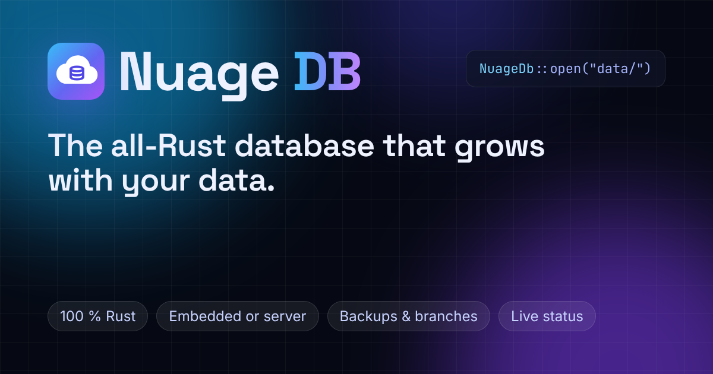

<div align="center">

[](https://github.com/maxlestage/Nuage)

# Nuage DB

**Memoire's own database, in pure Rust. Embedded in your application or as a server, with the same code.**

[](https://github.com/maxlestage/Nuage/actions/workflows/ci.yml)
[](#license)
[](https://heroku.com/deploy?template=https://github.com/maxlestage/Nuage)

**English** · [Français](README.fr.md) · [Español](README.es.md)

</div>

---

Nuage DB keeps your tables on disk behind a write-ahead log, makes instant copy-on-write
branches of a database, backs itself up to a second location and restores itself from there
at boot, and serves everything over HTTP(S) with a management console and a live dashboard.
It is the database of [Memoire](https://github.com/maxlestage/Memoire), the Rust ORM: the
same models and queries run on it embedded during development and tests, and on a Nuage DB
server in production, without changing a line.

## Features

| | |
|---|---|
| **Encrypted at rest** | Everything stored is encrypted (`NUAGE_ENCRYPTION_KEY`): the pages with XTS-AES-256, each log record with AES-256-GCM, and the backups, which are copies of them. Keys derived per application (HKDF, or Argon2id from a passphrase). |
| **Several applications** | One server, one database per application: its own tokens, its own keys, its own backups. The token an application sends picks its database. The console and `/app` show them side by side. |
| **Pages on disk** | Tables and indexes in one B-tree file with a bounded page cache (`NUAGE_CACHE_MB`): the data is not limited by memory. Primary-key and index lookups read only the rows they need. |
| **Write-ahead log** | Each commit is appended to the log and synced to disk before it is applied. Checkpoints, crash recovery, CRC-32 on log records and checksums on pages. |
| **Memoire semantics** | Statements run on Memoire's own evaluator over the rows read from disk: Nuage DB behaves exactly like Memoire's in-memory engine, on data of any size. |
| **Transactions** | Snapshot reads, optimistic commits (`Error::Conflict`, retried by `db.transaction(...)`), interactive transactions over HTTP, all-or-nothing batches. |
| **Branches** | A full copy of the database for a preview, a test or an experiment, made in an instant: it shares its parent's pages and stores only its own changes. |
| **Backups, restored at boot** | Snapshots plus log segments, to a folder or to S3-compatible storage. An empty data directory is restored automatically at startup, which makes hosts with an ephemeral disk work. |
| **Server** | One binary, configured by environment variables: the database protocol (`/v1`), the live status (`/api/status`, `/api/status/stream`), the console (`/admin`) and the website with its live dashboard (`/app`), on one port. |
| **WebAssembly client** | `memoire_orm::NuageDb` speaks HTTP(S): natively with Tokio, and in the browser through `fetch`. |
| **Upkeep on its own** | A background thread runs the checkpoints, ships the backups and compacts the file. |

## Two modes, one API

Nuage DB is used through [Memoire](https://github.com/maxlestage/Memoire)'s API: models,
the query builder, relations, transactions and migrations.

```toml
[dependencies]
# The engine, embedded mode and the server. `default-features = false` leaves the website out.
nuage = { git = "https://github.com/maxlestage/Nuage", default-features = false }
# The same Memoire as Nuage DB (the `nuage` feature is the client of a server).
memoire-orm = { git = "https://github.com/maxlestage/Memoire", rev = "fd1fdd5464547ce1f60f4a11e552c394da73cfc8", features = ["nuage"] }
tokio = { version = "1", features = ["macros", "rt-multi-thread"] }
```

### Embedded: a directory on disk

```rust
use memoire_orm::prelude::*;
use nuage::Embedded;

#[derive(Model, Debug, Clone)]
#[memoire(table = "notes")]
pub struct Note {
    #[memoire(primary_key, auto_increment)]
    pub id: i64,
    pub text: String,
}

#[tokio::main]
async fn main() -> memoire_orm::Result<()> {
    let db = Embedded::open("data")?; // created if missing
    db.create_table_if_not_exists::<Note>().await?;
    Note { id: 0, text: "hello".into() }.insert(&db).await?;
    println!("{:?}", Note::query().all(&db).await?);
    Ok(())
}
```

### Server: the same code over HTTP(S)

```rust
let db = NuageDb::connect("https://my-nuage.herokuapp.com", token).await?;
Note::query().filter(Note::TEXT.contains("hello")).all(&db).await?;
```

### One setting for both

```rust
// NUAGE_URL=data                                    -> embedded, in ./data
// NUAGE_URL=https://db.example.com NUAGE_TOKEN=...  -> a server
let db = nuage::Db::from_env().await?;
```

### Branches

```rust
db.create_branch("preview-42", None).await?;         // instant, whatever the size
let preview = db.on_branch("preview-42");
Note { id: 0, text: "only in the preview".into() }.insert(&preview).await?;
db.reset_branch("preview-42").await?;                // forget its changes
db.delete_branch("preview-42").await?;
```

## Encryption

Nuage DB encrypts everything it stores (AES-256, HKDF-SHA256, Argon2id):

| What | How |
|---|---|
| pages (`nuage.redb`: tables, indexes, branches, the list of applications) | XTS-AES-256 (IEEE 1619), the mode of disk encryption: pages keep their place and size |
| write-ahead log (`wal/*.log`) | AES-256-GCM per record, under a key of its own for each segment (random salt), the LSN as nonce |
| backups (folder or S3) | copies of the files above, encrypted the same way, with the directory's header |

`NUAGE_ENCRYPTION_KEY` is a key (`openssl rand -hex 32`) or a passphrase. Each data directory
has a header, `encryption.json`, with a random salt and a check value (never the key): its
root key is HKDF(key, salt), or Argon2id(passphrase, salt) (64 MiB, 3 passes), and the keys
of the pages, of the log and the check value derive from it. Each application has its own
directory, hence its own salt and keys. A wrong key is refused at startup, before anything is
read. A database or a backup stored in clear by an earlier version is encrypted when it is
opened with a key, and the backup in clear is replaced. **Keep the key**: without it, neither
the data nor the backups can be read. The embedded mode encrypts too, with
`EngineOptions { encryption: Some(Encryption::parse(key)?), .. }` or `NUAGE_ENCRYPTION_KEY`
with `nuage::Db::from_env()`.

## Several applications

One server holds several applications, each with a database of its own:

- the **first application** is the server's own database (`NUAGE_NAME`, data at the root of
  `NUAGE_DATA_DIR`, token `NUAGE_TOKEN`): an existing deployment keeps its data as is;
- the **others** are made in the console (`/admin`, **New application**): a database in
  `apps/<name>/`, encrypted under keys of its own, backed up under `apps/<name>/`, and a first
  token, shown once (the server keeps only its SHA-256 digest);
- the **token** an application sends picks its database: `NuageDb::connect(url, token)` does
  not change, and an application never sees another's data, nor its transactions;
- their list lives in the first application's metadata: logged, encrypted, backed up and
  restored with it, then each application restores its own backup.

`Server::create_app`, `new_app_token`, `revoke_app_token`, `delete_app` and `apps` do the
same from Rust.

## SQL

Nuage DB speaks SQL (`POST /v1/sql`, the console's **Query** tab, `Embedded::sql` in Rust):

| | |
|---|---|
| **Reading** | `SELECT [DISTINCT]`, `JOIN`, `LEFT JOIN`, `CROSS JOIN` (`ON`, `USING`), `WHERE`, `GROUP BY`, `HAVING`, `ORDER BY ... NULLS FIRST/LAST`, `LIMIT`/`OFFSET`, `UNION [ALL]`, `INTERSECT`, `EXCEPT`, subqueries (`IN`, `EXISTS`, scalar, correlated, in `FROM`) |
| **Expressions** | `CASE`, `CAST` and `::`, `\|\|`, `+ - * / %`, `LIKE`, `ILIKE`, `BETWEEN`, `IN`, `IS [NOT] NULL`, `IS [NOT] DISTINCT FROM` |
| **Functions** | `count`, `sum`, `avg`, `min`, `max`, `total`, `group_concat`/`string_agg`, `array_agg` (with `DISTINCT`); `lower`, `upper`, `length`, `trim`, `substr`, `replace`, `instr`, `lpad`, `concat`, `coalesce`, `nullif`, `iif`, `greatest`, `least`, `abs`, `round`, `floor`, `ceil`, `power`, `sqrt`, `random`, `now`, `current_date`, `date`, `extract`, `strftime`, `json_extract`, `json_object`, `json_array`, `gen_random_uuid`... |
| **Writing** | `INSERT ... VALUES / SELECT / DEFAULT VALUES`, `ON CONFLICT ... DO NOTHING / DO UPDATE SET ... excluded.x`, `INSERT OR IGNORE`, `REPLACE INTO`, `ON DUPLICATE KEY UPDATE`, `UPDATE ... SET col = <expression>`, `DELETE`, `RETURNING` |
| **Schema** | `CREATE TABLE [IF NOT EXISTS]` (types of PostgreSQL, MySQL and SQLite; `PRIMARY KEY`, `SERIAL`/`AUTOINCREMENT`, `NOT NULL`, `UNIQUE`, `DEFAULT`, `REFERENCES`, `UNIQUE (a, b)`), `CREATE TABLE ... AS SELECT`, `CREATE [UNIQUE] INDEX` (built from the rows there), `DROP INDEX`, `ALTER TABLE ... ADD COLUMN`, `DROP TABLE`, `EXPLAIN` |

A query Memoire's statements can express runs as one of them, through the indexes and stopping
at the end of the page; the rest (functions, `CASE`, subqueries, `UNION`) is computed by the
SQL layer on the rows the indexes found, with hash joins. Not there: `RIGHT`/`FULL` joins,
`WITH`, window functions, views, triggers, a primary key of several columns, changing a primary
key. A table created without a primary key gets a `rowid` column.

## Websites

Any website can use an application's database, from its server or from its pages:

- **`POST /v1/sql`**, from any language: full SQL with `?` (or `$1`) parameters, values
  never parsed as SQL (no injection). Rows come back as JSON objects (`"arrays": true` for
  arrays), an insert gives its `last_insert_id`. Several statements (separated by `;`, or
  `"statements": [...]`) run in one transaction, all or nothing.
- **From the browser**: list the website in the console (**Settings → Websites**:
  `https://site.fr`, `http://localhost:3000`, or `*`) and its pages may call `/v1` (CORS).
  The browser's preflight is cached for a day, so it costs one round trip, once.
- **Read-only tokens** (**Tokens → New read-only token**): a token in a page is public, so
  pages get one that reads and never writes; keep read-and-write tokens on servers.

```js
const res = await fetch("https://my-nuage.herokuapp.com/v1/sql", {
  method: "POST",
  headers: { "Authorization": "Bearer " + READ_ONLY_TOKEN, "Content-Type": "application/json" },
  body: JSON.stringify({ sql: "SELECT id, title FROM posts WHERE category = ? ORDER BY id DESC LIMIT 20", params: [3] }),
});
const { rows } = await res.json(); // [{ "id": 42, "title": "…" }, …]
```

```bash
curl https://my-nuage.herokuapp.com/v1/sql -H "Authorization: Bearer $NUAGE_TOKEN" \
  -d '{"sql": "INSERT INTO messages (name, text) VALUES (?, ?)", "params": ["Ada", "Hello"]}'
```

Speed, measured on the server's machine (`cargo run --release -p nuage --example bench`,
encrypted data, 20 000 rows, 4 cores): a row by key or by a unique column in **0.2 ms**,
a page of 20 rows through an index in **0.5 ms**, a durable update (fsync) in **0.5 ms**,
**13 000+ reads/s**. JSON answers of 1 KiB or more are gzip-compressed for clients that accept
it. What a visitor feels is mostly the network: pick the host's region closest to them, and a
dyno that never sleeps (Heroku **Basic**, not Eco, whose first request after a pause takes
seconds).

## Install on a server

On any Linux server (Debian, Ubuntu, Fedora, Rocky, Alpine..., x86_64 or ARM64, from 512 MiB
of memory), one command:

```bash
curl -fsSL https://raw.githubusercontent.com/maxlestage/Nuage/master/install.sh | sudo bash
```

It installs the `nuage` binary (a static build: no dependency), **creates swap** when the
server has none (the size of the memory, 1 to 4 GiB; `vm.swappiness=10`, so the memory goes
to the database), a `nuage` user, the data in `/var/lib/nuage`, the settings in
`/etc/nuage/nuage.env` with a generated key, token and console password, and a systemd
service started at boot. It prints the address, the token and the password once: **copy
`/etc/nuage/nuage.env` somewhere safe**, nobody can read the data without its key.

- **HTTPS**: point a domain name to the server, then
  `curl -fsSL .../install.sh | sudo NUAGE_DOMAIN=db.example.com bash` (Caddy, with a free
  certificate; Nuage DB then listens on `127.0.0.1` only). Without HTTPS the console works,
  but warns that the password travels in clear.
- **Upgrade**: run the command again; data, key and settings stay.
- **Options**: `NUAGE_PORT`, `NUAGE_SWAP_MB` (`0`: no swap), `NUAGE_VERSION=v0.3.0`,
  `NUAGE_FROM_SOURCE=1` (build with cargo).
- **Remove**: `... | sudo bash -s uninstall` (keeps the data), `... | sudo bash -s purge`.
- **Memory**: each application's page cache is `NUAGE_CACHE_MB=auto`, an eighth of the
  memory (8 to 512 MiB); the rest stays on disk. The console's *Server* page shows the memory
  Nuage DB uses, the free memory and the swap.

Binaries for Linux, macOS and Windows are on the
[releases page](https://github.com/maxlestage/Nuage/releases).

## Quick start

```bash
git clone https://github.com/maxlestage/Nuage && cd Nuage
# The key everything is encrypted with: keep it, the data cannot be read without it.
export NUAGE_ENCRYPTION_KEY=$(openssl rand -hex 32)
NUAGE_TOKEN=dev-token NUAGE_ADMIN_PASSWORD=dev-password cargo run -p nuage --release
# nuage: data is stored in /home/me/Nuage/nuage-data on this server's disk
# nuage: listening on 0.0.0.0:8080
```

Then open:

- http://localhost:8080/ : the website (English, French, Spanish);
- http://localhost:8080/app : the live dashboard (sign in with `NUAGE_ADMIN_PASSWORD`);
- http://localhost:8080/admin : the management console.

Applications connect with `NuageDb::connect("http://localhost:8080", "dev-token")`.

Docker (Compose, with the settings in `.env`, from [`nuage.env.example`](nuage.env.example)):

```bash
cp nuage.env.example .env   # then set NUAGE_ENCRYPTION_KEY, NUAGE_TOKEN, NUAGE_ADMIN_PASSWORD
docker compose up -d
```

## Deploy on Heroku

The root of this repository deploys as is: `Procfile`, `RustConfig` and `heroku-build.sh`
(the `emk/rust` buildpack builds the `nuage` binary with the website), and `app.json` for the
**Deploy to Heroku** button above.

- **One Basic dyno.** A Basic dyno never sleeps. Run exactly one web dyno: two dynos would be
  two separate databases writing to the same backups.
- **The disk is ephemeral.** A dyno's disk is erased at every restart (at least once a day,
  and at each deploy). The data directory is only a working copy: **configure backups**, and
  each boot restores the database from them. On Heroku, use S3-compatible storage
  (`NUAGE_BACKUP_S3_*`); on a host with a persistent disk, a folder is enough
  (`NUAGE_BACKUP_DIR`).
- **Loss window.** Commits since the last shipped log segment (30 seconds by default) are
  lost only if the dyno stops without the `SIGTERM` Heroku sends first: on `SIGTERM` the
  server checkpoints and ships the last segment.

By hand:

```bash
heroku create my-nuage --buildpack emk/rust
heroku config:set NUAGE_ENCRYPTION_KEY=$(openssl rand -hex 32) NUAGE_TOKEN=$(openssl rand -hex 32) \
  NUAGE_ADMIN_PASSWORD='a long passphrase' \
  NUAGE_BACKUP_S3_BUCKET=my-bucket NUAGE_BACKUP_S3_REGION=eu-west-3 \
  NUAGE_BACKUP_S3_ACCESS_KEY_ID=... NUAGE_BACKUP_S3_SECRET_ACCESS_KEY=...
git push heroku master
```

For storage other than AWS, set `NUAGE_BACKUP_S3_ENDPOINT` too. Then open
`https://my-nuage.herokuapp.com/admin`.

## Environment variables

| Variable | Meaning | Default |
|---|---|---|
| `PORT` | port to listen on (set by Heroku and most hosts) | `8080` |
| `NUAGE_BIND` | address to listen on (`127.0.0.1`: this machine only, behind a proxy) | `0.0.0.0` |
| `NUAGE_DATA_DIR` | data directory | `nuage-data` |
| `NUAGE_NAME` | name of the first application (and of its database) | `nuage` |
| `NUAGE_ENCRYPTION_KEY` | the key everything is encrypted with: 64 hex digits (`openssl rand -hex 32`, `nuage genkey`), base64 of 32 bytes, or a passphrase of 12 characters or more | **required**: the binary does not start without it |
| `NUAGE_TOKEN` | a token of the first application (named `NUAGE_NAME`); the console makes the other applications and their tokens | none |
| `NUAGE_ADMIN_PASSWORD` | password of the console (and of the dashboard) | none: the console is off |
| `NUAGE_PUBLIC_STATUS` | `true`: `/api/status` and `/app` show a public subset without signing in | `false` |
| `NUAGE_CACHE_MB` | page cache of each application, in MiB, or `auto` | `auto`: an eighth of the memory, 8 to 512 MiB |
| `NUAGE_BACKUP_DIR` | back up to this folder | |
| `NUAGE_BACKUP_S3_BUCKET` | back up to this bucket | |
| `NUAGE_BACKUP_S3_ENDPOINT` | endpoint of S3-compatible storage | `https://s3.<region>.amazonaws.com` |
| `NUAGE_BACKUP_S3_REGION` | region | `us-east-1` |
| `NUAGE_BACKUP_S3_PREFIX` | prefix of the backup objects | `nuage/` |
| `NUAGE_BACKUP_S3_ACCESS_KEY_ID`, `NUAGE_BACKUP_S3_SECRET_ACCESS_KEY` | credentials (else `AWS_ACCESS_KEY_ID`, `AWS_SECRET_ACCESS_KEY`) | |
| `NUAGE_BACKUP_SNAPSHOT_MINUTES` | minutes between two snapshots | `60` |
| `NUAGE_KEEP_AWAKE_URL` | the server requests this address (its own `https://…/api/health`) so a host that puts idle servers to sleep (Heroku Eco) keeps it awake; an awake server only: asleep, the next visitor wakes it | off |
| `NUAGE_KEEP_AWAKE_MINUTES` | minutes between two requests (under Eco's 30) | `20` |
| `NUAGE_KEEP_AWAKE_HOURS` | only in these hours, UTC (`6-22`); outside them it may sleep | always |
| `SITE_URL` | public address of the website (canonical links, share card) | each request's host |

A commented example: [`nuage.env.example`](nuage.env.example). Serve the server over HTTPS
(most hosts do it for you; on your own server, the installer's `NUAGE_DOMAIN`): the token
travels in a header, and the console's cookie is `Secure` over HTTPS.

## `/app` and `/admin`

- **`/app`**, the live dashboard: requests per second, p50/p99 latency, connections,
  services, storage, cache, write-ahead log, backups, one card per application (its requests, latency, data, branches, encryption; chips narrow the cards and the log to one), and a live event
  log. It is a Rust/WebAssembly island that reads `/api/status`, then follows
  `/api/status/stream` (Server-Sent Events, every second). It is private: the **Sign in**
  link goes through `/admin?next=/en/app/` and comes back to the dashboard. With
  `NUAGE_PUBLIC_STATUS=true`, visitors see the public subset. It installs as an app (PWA) and
  shows the last known state offline.
- **`/admin`**, the console (in English, French and Spanish: the browser's language, or the EN · FR · ES links of every page): the applications (cards; create one, its token is shown once), then for each one its overview, tables and their rows, its tokens (new, revoke), its settings (description, deletion confirmed by its name), a query console (all of SQL,
  with a confirmation before changes), branches, storage and buttons for a
  checkpoint, a backup, an integrity check and a compaction. Rendered by the server, it works
  without JavaScript, on a phone too. `HttpOnly`, `Secure`, `SameSite=Strict` session cookie,
  CSRF tokens, limited login attempts.

| Path | What | Access |
|---|---|---|
| `/v1/*` | the database protocol, on the database of the application the token opens | `Authorization: Bearer <token of an application>` |
| `POST /v1/sql` | SQL with `?` parameters, rows as JSON objects (websites, any language) | a token of the application; a read-only token reads only |
| `/api/health` | `{"status":"ok"}` | public |
| `/api/status`, `/api/status/stream` | live status, JSON and Server-Sent Events | an application's token (that application) or a console session (all of them) |
| `/admin` | the console | `NUAGE_ADMIN_PASSWORD` |
| everything else | the website, `/app` included | public |

## Repository layout

```
.
├── Cargo.toml            workspace (memoire-orm pinned here)
├── crates/
│   ├── nuage/            the engine, embedded mode, server, console, status API,
│   │                     backups (folder, S3), the `nuage` binary; tests/common is
│   │                     Memoire's backend test suite
│   └── nuage-site/       the website: pages, the live /app dashboard (Rust/wasm, the
│                         prebuilt bundle in pkg/, rebuilt by build-wasm.sh), PWA, share card
├── Procfile, RustConfig, heroku-build.sh, app.json    Heroku
├── Dockerfile            any container host
├── nuage.env.example     the environment, commented
└── .github/workflows/ci.yml
```

The `site` feature of `crates/nuage` (on by default) mounts the website in the server
(`nuage::site()`); `default-features = false` leaves it out.

## Development

```bash
cargo fmt --all --check
cargo clippy --workspace --all-targets --all-features -- -D warnings
cargo clippy -p nuage-site --lib --target wasm32-unknown-unknown -- -D warnings
cargo test --workspace --all-features
crates/nuage-site/build-wasm.sh   # after changing the dashboard (Rust 1.99, wasm-bindgen of Cargo.lock)
```

## The family

- [Memoire](https://github.com/maxlestage/Memoire) ([website](https://memoire-7f4525f1fdaf.herokuapp.com/)): the Rust ORM whose database Nuage DB is.
- [Paquets](https://github.com/maxlestage/Paquets) ([website](https://paquets-90dfc06b6fea.herokuapp.com/)): the simplest full-stack framework for Rust.

## License

Proprietary: see [LICENSE](LICENSE). Copyright (c) 2026 Maxime Nathan Lestage.
